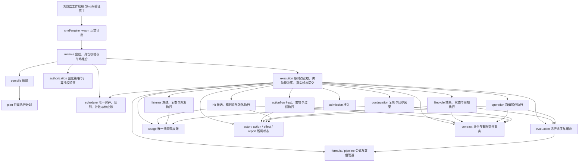

# TinyGo Engine V2 当前架构

本文说明正式编译、运行、释放链及执行所有权。职责与协作的完整定义见[控制反转规划](../../文档记录/概要设计/项目/Wasm子系统控制反转规划.md)。完整方法以源码能力声明为准；持续约束和成本验证见[功能执行与组合设计](../../文档记录/详细设计/项目/执行协调层功能执行与组合重构技术方案.md)。业务概念与整条计算链可先读[项目知识手册](../../文档记录/项目说明/项目知识手册/README.md)。

## 模块与执行依赖

根运行入口创建唯一 `scheduler.Loop`，再组合执行器。循环通过有限协作接口调用执行层，不导入执行包。执行层有六个执行所有者，以及准入、运行求值、共同额度三个支撑包。

循环不再借出可写堆；执行根层通过有限排程能力查询、入队、改期及取还同刻候选。前置业务判断由执行器返回四种明确决定，事件后失败及普攻死亡继续立即复核。完整交接见[接口与协作约束](../../文档记录/详细设计/项目/Wasm子系统接口设计草案.md)。

图只展示主要依赖，完整合法边由 `scripts/check-package-boundaries.mjs` 逐项维护。六个执行所有者不互相导入，也不导入父执行包、根运行包或调度器；状态包不反向取得执行控制。跨功能同步调用通过消费方声明的有限能力交接，不等于导入另一执行所有者。

准入包拥有完整监听操作及目标标记初态判定，只借用真实选中来源与只读初始事实。生命周期包按角色预演效果变更，根层汇总各类事件数后检查唯一队列；同组后续选盾只投影已有实例的移除与刷新。报告包拥有冻结执行事实的纯字段转换，对 `formula`（公式包）的新增直接依赖只用于既有伤害快照类型，不调用公式或取得战斗控制。

基础能力仍位于 `internal/base/` 的六个独立包，见[基础层说明](internal/base/README.md)。主要对象使用具体类型；能力接口表达真实借用及阶段约束，不建立插件注册表或通用流程解释器。

## 正式调用链与共享值

`engine_compile` 从编译帧（种类200）读取 `CompileRequest`，调用编译器并登记 `CompiledSession`；`engine_run` 从运行帧（种类201）读取请求并核对会话和规则身份，再创建本场独立状态及唯一循环；`engine_release_session` 处理释放帧（种类202）并删除会话。宿主通过统一出箱缓冲读取结果，不新增内部求值导出。

编译和运行入口先按产物固化策略检查顶层 `authorization` 票据；启用时成功编译登记账号编号，每次运行重新验签并匹配同一账号。关闭版只跳过授权，仍校验输入、会话和规则身份。释放不核验票据。验签包独立于战斗协议、编译计划与执行循环，不在每次事件或命中中检查账号资格。

编译计划可被多次运行借用。执行与数值管道只消费编译结果，不反向调用编译器；本次驱动公式进入独立运行公式表，不改共享计划。`internal/model/` 定义外部协议，`internal/plan/` 定义编译结果，`internal/runtime/contract/` 保存跨所有者的有限身份及事实。

`CompiledSkillHit` 包含只读候选与规则组计划，运行上下文由 `hit.Context` 私有持有。共同事件快照只保留 `SkillHitFacts` 等有限命中事实，不携带完整候选、计划或强化等待上下文。

## 状态与局部帧所有权

| 所有者 | 私有状态或事实 | 根层取得的内容 |
| --- | --- | --- |
| 会话与只读计划 | 会话登记、编译规则、公式及完整编译身份 | 本场只读绑定 |
| `scheduler.Loop` | 唯一时钟、队列、事件计数与停止账 | 原位入队、容量及循环协作 |
| `actor/action/effect` | 角色数值、实际使用与过程、冷却弹药等待、效果状态与护盾 | 有限视图及所属变更对象 |
| `actionflow` | 行动及过程业务阶段、发动前状态与弹药捕获、等待准备 | 本次真实帧的有限执行阶段 |
| `lifecycle` | 效果局部迁移、动态投影、期限与周期计算 | 所属变更及已决定的计时请求 |
| `operation.Frame` | 数值汇总、逐伤、操作输出、同次施放消费及待报告事实 | 原提交位置借用的事实 |
| `hit` | 命中账、历史、候选上下文、阻挡复用及强化暂存 | 有限命中事实及原序发布请求 |
| `listener` | 动态列表、冻结条件、派发遍历与成功节流 | 已核定监听的同步执行请求 |
| `continuation` | 复制收集、重复请求、延迟载荷及同步因果栈 | 原位复制帧及唯一队列请求 |
| `usage.Ledger` | 唯一共同额度记录及真实预留凭据 | 命中、监听、复制及行动累计冷却返还沿原边界预留、提交及失败释放 |
| `evaluation/report` | 单场求值缓存、可靠累计、有界记录及采样 | 计算结果、已拥有快照及输出 |

根 `Engine` 组合这些对象，根 `Frame` 组合所属变更和局部帧，不另存同一套功能私有账。使用身份归 `action`，命中历史、发动前状态、弹药捕获和复制因果各归实际消费者；同步因果不写入过程快照。帧、伤害、施放等编号及共同预算保留原位置，不提前分配身份。

## 同步执行与读取边界

根层按原时点准备当前暂存、帧入口、事件入口和事件冻结视图。普通伤害防御读取当前伤害帧入口，复制伤害读取原伤害冻结的完整防御双方；当前盾血在实际结算位置读取。惰性到期、动态投影和两遍重算保持原位置，读取准备不是无副作用查询。

根层保留以下跨功能次序：

- 普攻受击通知 → 命中候选或规则组 → 事件当前属性及资源刷新 → 普通监听 → 法盾阻挡监听 → 强化尾部。
- 伤害扣盾血 → 盾耗尽及属性同步 → 吸血 → 原受伤和逐伤事实。
- 效果卸载中的行动／弹药、监听、所属效果、修正及属性清理，按现有局部发布顺序执行。

候选、监听、过程和周期的业务循环由所属包执行。根层在有限同步阶段创建真实帧、交接原操作、统一提交并处理跨功能尾部。返回后按原规则复查活过程及挂载；每次嵌套调用有独立绑定恢复凭据，不保存单个可覆盖的“当前帧”。

同帧专用操作借用当前原帧。`resolve_skill_hit` 只准备事实和待派发事件，不能提前提交或运行候选与监听。监听先冻结列表及全部条件，再逐项复查实际资格；规则组共用原帧与共同额度，逐候选清理可读操作输出。首接触及合格接触保留原尝试登记时点，节流和额度保留原成功记账及失败释放边界。

## 提交、恢复与验证

统一提交按原位置预检，再发布所属状态、生命周期、过程与强化事实、死亡冻结、队列和报告。局部发布之后失败保留真实已发生的事实；成功返回、正常跳过、内部失败和致命错误不合并为全链事务的单一标志。

过程和目标计时保留实际身份、版本、世代、完整期限、有限分段与精确到期规则。恢复只重建当前允许的计时，不恢复整个事件堆，不用新的作者公式重写冻结历史。可靠累计、明细限额与采样独立，截断记录不改变计算、使用身份或最终状态。

源码阅读从[24 个根组合文件与功能入口](internal/runtime/execution/README.md)进入。命令与正式工具链见[引擎说明](README.md)，固定机制及真实宿主验证见[机制说明](../../web/tests/mechanisms/README.md)。验证须对应当前源码、产物和实际环境，历史阶段与执行结果从Git历史及对应证据目录追溯。
