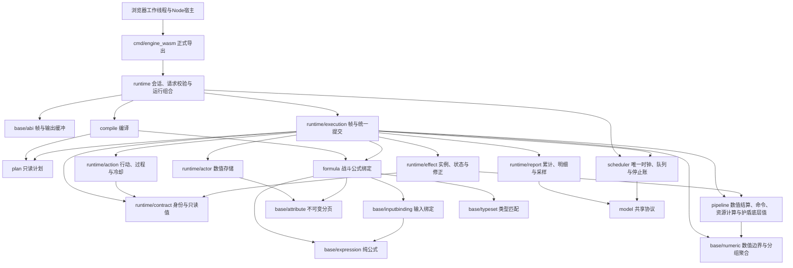
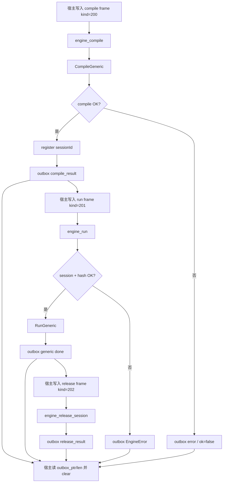
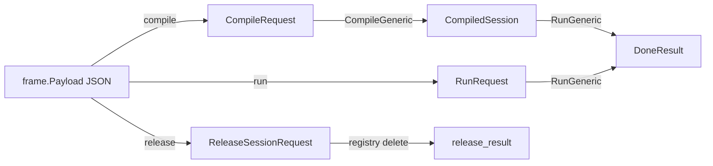
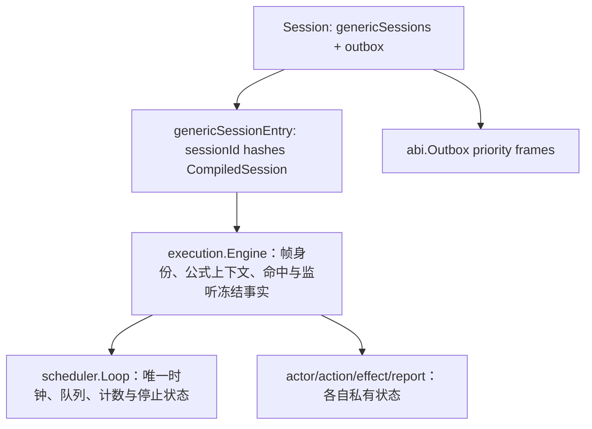

# TinyGo Engine V2 当前架构图

按当前 generic ABI 实现生成，用于快速 review 边界。使用基础 `graph TD/LR`，避免部分预览器不识别复杂 Mermaid 语法。

## 模块依赖图

运行状态按所属子系统封装，箭头表示生产包依赖。根入口创建唯一循环；执行协调借用同一实例，调度通过有限接口调用执行器，不导入执行包。

## 控制流时序图

基础能力统一位于 `internal/base/`，各叶目录独立成包；默认写入边界和独立验证见[基础层说明](internal/base/README.md)。`base/attribute` 继续提供属性分页与不可变表；外层公式、数值管道和运行时只组合这些能力。

## 数据形态转换图

## CompiledSession 职责（glance）

| 对象 | 职责 |
| --- | --- |
| `plan.CompiledSession` | 只读规则快照：schema/rules hash、combatants、providers、abilities、operations、formulas、settings、abilityRefIndex；类型归执行计划包，编译器仅生产它 |
| `CompiledSkillActionBinding` | 编译期固定来源、首次过程控制与合法完成命中绑定；运行只选择预设，不改过程时点或能力引用 |
| `CompiledCombatant` | combatant 模板与 provider mounts |
| `CompiledProvider` / `CompiledAbility` | capability 与 ability 定义；含 `instanceScope`、`statusContributions` 与治疗组计算方式 |
| `CompiledOperation` | 执行期 operation IR；`resolve_skill_hit` 携带编译后的命中计划；`outputRef` 导出同帧伤害口径 |
| `CompiledSkillHit` | 命中候选、阻挡范围、供值条件与候选 operations 切片；可选规则组保存连续候选区间和已有额度身份；显式普攻主体和待击替换角色编译为整数及固定候选位置 |
| `formula.GenericRegistry` | 内部用途指令与技能／伤害共同只读程序共享的有界注册表；外部调用只链接已声明具名程序 |
| `formula.SkillBinding` | 私有作者归属、原定义定位、已选参数、实际运行来源及只读绑定；可达依赖覆盖条件两支 |
| `CompiledAttributeDerivation` | 明确派生拥有方与可选作者技能；共同读取按拥有方解释，内部读取维持战斗侧语义 |
| `CompiledDamageTypeFormula` | 共同程序编号、只读绑定及原属性读值描述；一次防御求值供两部分使用 |
| `typeset.CatalogResult` | flat type key / matcher 输入 |

## 运行状态归属

## Review 建议

1. 先看 `internal/model/generic*.go` 与 `ARCHITECTURE` 本图，确认 ABI 边界。
2. 再看 `compile/generic.go` → `session.go` → `RunGeneric`，确认 call chain。
3. 新机制落在 provider/ability/operation + gate/execution；legacy step-loop/DPS 源码与导出已删除。
4. 当前验证契约：独立作者 `formula-phase4-input.mjs`／`formula_phase4_explicit_basic_damage.json` + `smoke-node.mjs` + `go run ./cmd/bench`。原 `generic_p0_basic_damage.json` 字节保留，当前协议明确拒绝；旧900结果由 `target/formula-phase4-baseline` 档案复核。

第二阶段执行及数值管道已解除对编译器包的类型依赖；会话接线仍调用真实编译入口。临时驱动程序只追加到本次独立公式表，派生与其他求值共同读取该表。第三阶段A将伤害共同定义接入正式防御结算；第三阶段B将技能具名共同定义和私有参数绑定先注册，再链接内部用途包装，统一读取依赖、静态冻结、作用域及调用预算。第四阶段要求每个实际伤害操作都有成功注册的共同防御计划，金额短路前检查计划约束；普通防御读取帧入口，复制读取完整冻结双方视图，统一结算后才经 `ApplyMitigatedDamage` 扣盾和生命。通用命令入口只保留治疗、护盾与斩杀。成功编译的已核定静态输出只供宿主消费本次真实程序结果，不另设求值导出。正式技能／伤害专项经过真实编译、运行和释放导出，Node证据不代替浏览器工作线程。

## 阶段2连续运行链

`model/generic_basic_attack.go`定义原生连续计划、已知预算原因、可靠记录与完整性字段。`runtime/execution/basic_attack_admission.go`在原始初始快照上核对本次编译身份和静态共享普攻范围；`runtime/execution/basic_attack.go`在`RunGeneric`内逐刀创建使用身份，依次经过真实开始监听、首次即时过程、命中候选及同步尾部，只消费已提交的过程冷却并安排下一刀。它不改变单次事实限制，也不增加导出入口。

`runtime/execution/frame_commit*.go`先核对本帧所需队列容量，再统一提交生命、过程、冷却、证据及相关统计；`runtime/execution/execution_budget*.go`跨同刀各帧保留命令计数，并传播可识别的停止原因。`runtime/execution/basic_attack_output.go`只观察已提交伤害，完整累计与有限明细互不代替；预算中断可保留已经发生的击杀，但不能把未完成尾部标成完整。

`runtime/execution/sampling_cursor.go`只在战斗时点之间和同刻全部提交后观察，独立于`scheduler.GenericHeap`。调整或关闭采样、截断记录都不改变战斗时钟、事件预算或可靠汇总。具体运行字段与验收以规划工作树阶段2设计及验收记录为准，本图不另定义契约。

## 主动过程运行链

阶段6C `runtime/execution/skill_actions.go` 的有限行动列表与现有普攻事件堆共用时钟，使用引用索引关联每项真实过程及其已接受首次指令。后续控制调用真实阶段能力，转移提交后接受；首次只发布一次成功开始事件。普通过程成功完成或唯一末尾复杂步骤的实际执行，在该转移同步尾部生成同一使用的独立命中事实，不另排宿主计时器或预加载成功事实。`runtime/execution/process_repeat.go`冻结有限分段并只调度下一真实时点，快照保存进度及占用历史。`runtime/execution/action_occupancy.go`从已提交活动步骤派生许可，共同提交预检用待提交实例核对安全期限与唯一下一刀的队列容量；提前控制按实际退出唤醒，旧步骤与段序守卫防重复释放。占用、普通冷却与弹药恢复共同约束下一刀，不重复建立时钟。直接治疗与实际扣血在原帧提交时累计，行动、使用、治疗记录预算只控制保留数量。当前通用机制验证不等于候选业务对象已录入或已通过真实联调；详细契约以规划真源阶段6设计为准。

`model/generic_process.go` 固定第4项过程、控制事实与实例快照；`compile/generic_process.go` 编译步骤时间、逐笔成本和有序时点操作。`runtime/execution/process.go` 负责单次控制入口、暂存付款、统一时点和终结；`runtime/execution/process_snapshot.go` 负责严格恢复与计时重建。

`runtime/execution/process_repeat.go`（有限分段执行）在引导实际进入时冻结指定窗口的首末偏移、次数及完整时长，只安排下一段或最后一段后的完整期限事件。旧引导仍直接按冻结完整时长与原首次口径计算，各段不依赖已舍入的证明端点。`runtime/execution/process_snapshot.go`（过程恢复）按真实步骤口径校验两项偏移、计数、最后／下一执行时刻及完整占用；终结不恢复下一段，变化后的作者表达式不能重写冻结历史。

`generic_empowered_attack.go`（强化下一次普攻）只索引活动等待。`generic_skill_hit.go` 在真实普攻命中入口冻结实例与使用，保留原普攻及原候选完整执行，随后暂存并整体提交所有仍合法的强化负载、法术护盾消费、过程进度和双使用关联。负载始终读取实际命中目标；原激活目标与使用仍保留。单步等待的超时、刷新及旧计时失效沿过程终结路径处理；不接受含该步骤的过程快照恢复，不发布伪造的独立技能命中。

首次控制使用一个执行帧检查全部成本，再生成稳定使用归属的实例。阶段推进复用首次拥有者、挂载、目标和能力分类，数值仍经现有操作与管道；时点帧提交后按首次完整能力引用累计伤害和治疗。成本供值仅在所属完成/失败时点开放。

过程计时采用独立事件类别，同刻先于推进。实例索引与步骤版本让旧事件失效；拥有者、挂载、过程和使用组成可重建的同刻排序键，因此中途恢复与连续执行顺序一致。死亡结算先冻结全部受影响实例，再执行失败效果并检查连带死亡。

实例快照保存活动和终结记录，独立预算不遗忘已开始的使用。恢复只重建当前步骤所需计时，不恢复整个事件堆；到期等于快照时间仍入队处理，过去期限拒绝。过程相关运行拒绝任何过去驱动，避免普通伤害或第5项命中使时间倒退。

`compile/generic_target_timing.go` 将显式目标保相位周期和预约负载绑定为最多四个编译槽；`runtime/execution/target_timing.go` 只为这些来源建立小数组事实，所有世代、期限、相位序号和待入队事件均暂存于现有提交帧。它复用普通锚事件与清理类别，不建立另一套时钟，不扩旧续时或恢复门。

`compile/generic_damage_state_before.go` 仅从真实已挂载逐伤监听条件建立读取表；`runtime/execution/damage_state_before.go` 在每笔扣血前冻结该帧已暂存的必要整数，成功产生原伤害编号后一起提交。条件读取、七字段证据、逐伤事件及恢复因果使用同一编号；没有编译读取表时不采集，不复制完整状态。具体字段与边界由上述有界目标时序共享契约独占定义。
