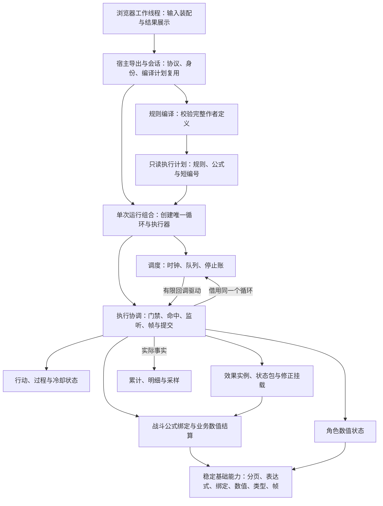

TASK_KEY: planning-engine-subsystem-refactor
DOC_TYPE: 概要设计
WORKSTREAM: planning
STATUS: tracked
EXECUTION_MODEL: Codex 主负责人编写，内置代理独立只读复核
LAST_TRACKED_AT: 2026-10-27

# Wasm子系统职责与协作现状及调整方向

## 1. 结论与阅读边界

当前引擎已经从一个运行总状态拆为“各子系统保存自己的状态，执行层组合并协调提交”。下一轮建议保留十项主要职责，优先将命令材料、资源数值运算和护盾基础表示归入现有数值结算包，删除三个不再需要独立存在的小包；角色、行动、效果和报告继续各自拥有状态。目标边界见第7节，实施规划见第8节，均尚未实施。

本文面向后续软件工程规划，回答四个问题：现在有哪些职责；谁拥有状态；可以调用什么能力、怎样配合；哪些边界值得继续调整。职责子系统不与Go包数量一一对应。基础工具、共享数据形状和测试构造包也列入覆盖清单，但不把它们都称为独立运行子系统。

调查日期为2026-10-27，运行源码基线为 `1060d5bdde4ea9077367dcabeba369fcff2c5997`；该基线包含本次运行拆分、增幅分组及通用数值归集。接口页面及提取工具为 `73ac9e627`。当前 `internal/` 共24个生产或测试包，其中22个可由正式 `cmd/engine_wasm` 入口到达，另2个仅服务测试。本次仅做源码说明与规划，不把接口存在视为某个完整英雄已经可用，也不据此更新运行、性能或数据库验收结论。

本文是**当前职责与调整建议的说明入口**，不重新定义字段、数学或运行语义：

- [运行时拆分实施设计](../../详细设计/项目/运行时子系统拆分与数值修正分组实施详细设计.md)拥有状态边界、分组乘区及迁移约束；[原概要方案](通用计算引擎子系统拆分与公式数据驱动重构方案.md)保留整体目标。
- [共同公式契约](../../详细设计/项目/共同公式定义与校验详细设计.md)、[纯公式与执行计划设计](../../详细设计/项目/纯公式编译求值与执行计划拆分详细设计.md)拥有公式及绑定语义；主动调度等机制继续遵循各自现行设计。
- [引擎架构图](../../../wasm/tinygo_engine_v2/ARCHITECTURE.md)提供代码导览；[交互说明页](../../../temp_record/wasm-memory-2026-10-12/wasm-memory.html)提供包选择、签名搜索和耦合源码摘录；[验收摘要](../../测试记录/项目/共同公式与引擎重构验收摘要.md)提供分层执行证据。

## 2. 先区分三种接口

| 接口层次 | 调用者能取得什么 | 工程上的含义 |
| --- | --- | --- |
| 正式Wasm边界 | 编译、运行、释放会话，以及输入内存和出箱运输 | 浏览器工作线程经指针、长度与帧协议调用；这是跨语言边界。 |
| 引擎内部协作入口 | 初始化、标量查询、只读视图、数值计算、暂存变更和发布 | Go包之间的能力；调用方需要遵守时间、身份、借用及提交约束。 |
| 源码中的公开声明 | 大写类型、函数、方法及数据字段 | 只说明Go可见性；不自动表示有正式消费者、可任意组合或构成稳定产品接口。 |

例如，`runtime.RunGeneric` 是内部单次运行入口，`engine_run` 才是正式Wasm导出；`pipeline` 中的若干 `Packet`（结算材料包）目前只有声明，不能画成已经接入的正式结算链。默认签名目录也不能代替协作说明。本文每一节优先列实际职责和代表性消费入口，不复制全部声明清单。

## 3. 整体分层及完整覆盖



图中箭头表示主要协作，不是完整Go导入图。调度器通过其定义的有限回调协议调用执行器，因此控制流可以双向协作，Go依赖仍由执行层指向调度包。`model`（共享协议）和 `runtime/contract`（运行交换值）横跨这些协作，均不拥有运行控制。

以下路径统一相对 `wasm/tinygo_engine_v2/`；`base` 本层不形成公共大包。

| 代码落点 | 所属职责 | 当前能力及定位 |
| --- | --- | --- |
| `cmd/engine_wasm` | 正式入口 | 宿主导出、输入分配根表、全局会话接线；在24个内部包之外。 |
| `internal/runtime` | 会话及组合 | 会话注册、请求身份校验、一次运行的装配。 |
| `internal/model` | 共享协议 | 输入、输出、错误、快照和只读数值视图。 |
| `internal/compile` | 规则编译 | 准入、引用与依赖校验，生产执行计划。 |
| `internal/plan` | 执行计划 | 编译后的规则数据与索引，本身不执行战斗。 |
| `internal/scheduler` | 调度 | 唯一时钟、事件堆、处理计数和停止状态。 |
| `internal/runtime/execution` | 执行协调 | 初始化、门禁、操作、命中、监听、冻结事实和跨子系统提交。 |
| `internal/runtime/actor` | 角色数值 | 已提交属性、资源及生命上限锚点；提供暂存变更。 |
| `internal/runtime/action` | 行动 | 过程、普攻、手动／自动施放、使用身份、冷却、占用与弹药。 |
| `internal/runtime/effect` | 效果 | 供值器、普通盾、状态包、修正挂载、实例身份和时间载荷。 |
| `internal/runtime/report` | 结果观察 | 可靠累计、有限明细、证据计数和采样游标。 |
| `internal/runtime/contract` | 运行交换值 | 运行内稳定引用、冷却身份与借用视图；不拥有账本。 |
| `internal/formula` | 战斗公式绑定 | 用途、读取权限、事件／过程／供值器上下文及程序注册。 |
| `internal/pipeline` | 业务数值结算 | 属性与伤害修正、治疗、护盾吸收和生命变化的计算。 |
| `internal/command` | 命令值 | 已支持的有限战斗命令与结果形状。 |
| `internal/resource` | 资源策略 | 单槽扣减／返还及等待时刻估算；不拥有资源集合。 |
| `internal/shield` | 护盾值与策略 | 实例值、有效期、匹配及优先顺序；实时集合归效果子系统。 |
| `internal/base/abi` | 基础协议运输 | 帧编码／解码、线性内存桥接与出箱缓冲。 |
| `internal/base/attribute` | 基础属性存储 | 属性槽、存在性、不可变分页、写时复制编辑器。 |
| `internal/base/expression` | 基础纯公式 | 表达式校验、编译、数学原语及数值求值。 |
| `internal/base/inputbinding` | 基础输入绑定 | 声明输入到明确只读数值的绑定计划。 |
| `internal/base/numeric` | 基础数值 | 上下界、概率夹取及短编号增幅分组聚合。 |
| `internal/base/typeset` | 基础类型匹配 | 目录编号、位集合和匹配器。 |
| `internal/testkit` | 测试支撑 | 固定输入、帧和会话辅助，不进入正式Wasm依赖。 |
| `internal/testkit/formuladefinition` | 测试支撑 | 构造显式测试公式，不进入正式Wasm依赖。 |

`tests/runtime/` 是组合回归目录，`cmd/bench` 是原生测量入口，构建脚本和Web生产适配测试各有验证职责，均不属于新增运行子系统。旧 `trigger`、`crit`、`control`、`mark`、`status` 目录已经删除；现行标记、控制和状态能力仍在实际执行与效果路径中。

## 4. 各子系统的职责、能力与协作

### 4.1 宿主协议、会话与单次运行组合

**负责什么。** 将宿主输入变成请求，编译并登记可复用计划，核对会话和规则身份，再为每场运行创建独立执行状态；最后编码结果。会话跨多次宿主调用存在，一场运行的执行器不存回会话作为下一场的战斗状态。

**暴露什么。** 正式业务导出为 `engine_compile`、`engine_run`、`engine_release_session`；运输能力为 `alloc/dealloc` 和 `engine_outbox_ptr/len/clear`。内部协作入口为 `Session.CompileFrame/RunFrame/ReleaseSessionFrame`、`RunGeneric`。

**如何交互。** `Session` 调用编译器并持有 `plan.CompiledSession`；`RunGeneric` 接收该计划和 `RunRequest`，创建唯一 `scheduler.Loop`，依次执行 `execution.New`、`loop.Run(engine)`、`engine.Finish`。会话内的出箱保存完整编码结果，宿主复制出箱字节后清空；清空出箱与释放编译会话分别承担运输清理和规则释放。

**状态边界。** 输入分配根表在 `cmd/engine_wasm`，会话注册表与出箱在 `runtime.Session`，循环与战斗状态属于本次运行。`dealloc` 删除输入根，`engine_outbox_clear` 清出箱并触发当前垃圾回收；固定线性内存容量不等同于每场实际堆占用。

源码：[宿主导出](../../../wasm/tinygo_engine_v2/cmd/engine_wasm/main.go)、[会话](../../../wasm/tinygo_engine_v2/internal/runtime/session.go)、[运行组合](../../../wasm/tinygo_engine_v2/internal/runtime/run.go)。

### 4.2 共享协议与运行交换值

**负责什么。** `model` 定义外部数据形状、结构化错误和快照；`runtime/contract` 定义内部运行引用及冷却交换值。两者提供共同语言，不决定何时发起行动、怎样算伤害或何时提交。

**暴露什么。** `CompileRequest/CompileResult`、`RunRequest/DoneResult`、`EngineError`、资源／数值只读视图；内部的 `ProcessRef/ActionRef`、`CooldownIdentity`、`CooldownView` 等。

**如何交互。** 编译器生产并校验共享协议的编译形态，执行器消费计划；行动子系统生产冷却读视图，效果子系统消费该视图。`ProcessRef/ActionRef` 是本场稳定槽身份，0号槽合法，缺失由存在标记表达；跨运行或快照重建后必须重新登记。

**使用约束。** 只读视图限制写入口，借用的底层集合仍需生产者按复制规则维护；它不是自动深拷贝。公共数据形状的改变需要同时检查编译、执行与宿主消费，不能只改一个Go类型。

源码：[协议目录](../../../wasm/tinygo_engine_v2/internal/model)、[运行身份](../../../wasm/tinygo_engine_v2/internal/runtime/contract/identity.go)、[冷却视图](../../../wasm/tinygo_engine_v2/internal/runtime/contract/cooldown.go)。

### 4.3 规则编译与只读执行计划

**负责什么。** `compile` 检查完整作者图、引用闭包、读取权限和支持范围，把定义转换为已验证的规则、索引及程序。`plan` 保存这些数据，不持有当前角色生命、过程进度或真实冷却。

**暴露什么。** `CompileGeneric(CompileRequest)` 返回编译结果；成功时得到 `plan.CompiledSession`，其中包含供值器、能力、操作、公式、类型、过程及命中等计划。运行及管道直接依赖 `plan`，不反向依赖编译器实现。

**如何交互。** 编译器组合公式、输入绑定、属性目录和类型匹配；会话保存计划，执行器从它建立本场状态。`provider`（供值器）承载挂载与可提供的行为，`ability`（能力）描述可尝试的行为，`operation`（操作）描述具体状态变化；它们是数据建模单元，不能各自再建一个互相调用的运行总状态。

**使用约束。** 共享计划中的切片、映射及部分程序按只读约定复用，Go类型没有强制深不可变。`CloneForRun` 隔离本次公式注册表的可追加描述和索引；随运行输入而来的驱动条件在该私有表编译，不能污染复用计划，也不应被冒充为共享静态规则。

源码：[规则编译](../../../wasm/tinygo_engine_v2/internal/compile/generic.go)、[计划形态](../../../wasm/tinygo_engine_v2/internal/plan/compiled.go)、[公式表隔离](../../../wasm/tinygo_engine_v2/internal/formula/generic_registry.go)。

### 4.4 唯一时钟与事件调度

**负责什么。** `scheduler.Loop` 拥有本场唯一的队列、当前／起始／终点时刻、已处理数和停止账。有限事件堆确定基础顺序，循环通过 `LoopDriver` 调用执行协调层。

**暴露什么。** `NewLoop/Loop.Run`，`TimeMs/ProcessedEvents/Reason` 等标量查询，`GenericHeap.Push/Pop/PeekTime`、容量检查与有限等待改期。`LoopDriver` 的11个方法交换循环状态、选择并处理事件、观察采样、处理预算与结束结算。

**如何交互。** 根入口创建循环，执行器借用同一实例，事件入队由初始化及执行协调完成；行动、效果、报告不另建堆、不推进时间。`effect.TimeState` 只存时间载荷和世代，并不是第二个调度器。

**当前耦合。** `LoopState` 仍包含普攻、技能计划、手动行动及死亡等待的判断；`Queue()` 借出可写堆。基础顺序还需结合过程稳定排序键和执行器的两个同刻选择例外：已有真实战斗先于状态到期回调，实际目标末跳先于同刻过程计时。改变其中一处必须联合检查另几处，不能以“堆测试通过”认定全部时序不变。

源码：[循环及回调协议](../../../wasm/tinygo_engine_v2/internal/scheduler/loop.go)、[事件堆](../../../wasm/tinygo_engine_v2/internal/scheduler/generic_heap.go)、[执行侧循环适配](../../../wasm/tinygo_engine_v2/internal/runtime/execution/loop_driver.go)。

### 4.5 执行协调、门禁与提交

**负责什么。** `execution.Engine` 装配一场战斗，路由能力和操作，建立真实使用／命中／监听因果，冻结需要保留的事实，管理预算；`Frame` 暂存一次结算所需的跨子系统变化并协调发布。动态运行监听、命中账、同次使用额度和延迟续接载荷目前仍由执行层持有，不归入效果包。

**暴露什么。** 根入口只需 `New` 与 `Finish`；调度只需 `LoopDriver` 回调。公式通过 `Frame.DamageStateBefore`、`LinkedShieldPresent`、`ReceivedLinkedShieldAbsorbed` 等有限只读适配取得特定真实事实。门禁、命中、操作和帧提交仍是本包内部协作，不应为了画图而全部公开。

**如何交互。** 执行层从角色／行动／效果取得当前值及暂存变更，组合公式与数值管道计算，再按现有顺序预检和发布。报告接收实际事实，调度接收相关入队与唤醒，子系统不互相调用发布口。帧字段、执行器字段保持私有。

**错误边界。** 统一协调不等于整条事件链全局回滚。当前 `Frame.commit` 在部分状态发布后仍有生命周期分支可能失败；父子帧、同步派生及结束结算也有各自边界。后续结构调整应保留现有已成功事实、失败路径和提交顺序；若要扩大原子性，需作为单独的行为变更定义与验证。

源码：[执行器](../../../wasm/tinygo_engine_v2/internal/runtime/execution/engine.go)、[门禁](../../../wasm/tinygo_engine_v2/internal/runtime/execution/gate.go)、[执行帧](../../../wasm/tinygo_engine_v2/internal/runtime/execution/frame.go)、[事实提交](../../../wasm/tinygo_engine_v2/internal/runtime/execution/frame_commit.go)。

### 4.6 角色数值状态

**负责什么。** `actor.State` 保存一个角色已经提交的属性表、资源槽与生命上限锚点；本包拥有数值存储，不决定技能金额、资源规则或护盾顺序。

**暴露什么。** `New`、`Attributes/Resources/HPMaxAnchor`；`Stage` 创建 `ChangeSet`，通过 `SetAttributes/SetResource` 放入已经核定的值，`FreezeResources` 保留历史读视图，`Publish` 返回新的已提交状态。

**如何交互。** 执行层取得暂存变更；管道返回新属性，资源策略返回新槽值，执行层将其放入暂存区。只有统一提交时才交回角色状态。属性快照由基础属性表保证隔离，资源表第一次共享后写入时复制。

**使用约束。** 护盾集合属于效果子系统；冷却属于行动子系统。`actor` 不需要知道伤害源、监听器或全局事件堆，也不为等待检查提供可写资源映射。

源码：[角色状态与变更](../../../wasm/tinygo_engine_v2/internal/runtime/actor/state.go)。

### 4.7 行动、过程、冷却与等待

**负责什么。** `action.State` 拥有过程槽、普攻、手动／自动行动、使用映射、占用、弹药和局部驱动事实；`CooldownLedger` 是真实冷却截止及相关等待版本的权威账本。过程定义来自只读计划，当前步骤和状态属于本场行动。

**暴露什么。** 过程的 `NewProcess/AddProcess/Process`、`StageProcess/ProcessChangeSet.Publish`；历史保留用 `ProcessView.Freeze/Snapshot`；行动的初始化、`Accept/FinishAttempt` 及自动开始／结束转换；冷却的 `View/Start/CommitOrdinary/Subtract/RegisterWait/ChangedWaits`。

**如何交互。** 执行器根据真实时刻、门禁和操作结果调用局部转换，并向唯一循环排程；冷却暂存首次写共享账本前复制。效果只消费冷却的版本与只读数值投影，不能另存一套真实期限或据投影反推截止。

**使用约束。** `ProcessView` 是活对象借用，发布后旧视图可以看到新状态；`ProcessViews` 只复制外层列表。要保留事件发生时的过程必须 `Freeze/Snapshot`，只保留当前身份则用 `ProcessRef`。本包没有替整场运行完成全局发布或结束的一个总方法。

源码：[过程与局部状态](../../../wasm/tinygo_engine_v2/internal/runtime/action/process.go)、[冷却账本](../../../wasm/tinygo_engine_v2/internal/runtime/action/cooldown.go)、[自动行动](../../../wasm/tinygo_engine_v2/internal/runtime/action/automatic.go)。

### 4.8 效果实例、状态包、修正与护盾集合

**负责什么。** `effect` 拥有活动供值器和普通护盾集合、属性／伤害修正挂载、资源贡献、状态值及期限、目标状态、锚定世代、实例身份和时间事件载荷。它提供状态操作与计算适配，不接管执行器的真实监听因果和时钟。

**暴露什么。** `NewInstances/StageInstances/InstanceChangeSet.Publish` 与挂载／移除；`RestoreBags/StageBags/BagChangeSet.Edit/Publish`；`BagView` 查询及 `BagState.Freeze/Snapshot`；`AttributeResolver`、`DamageResolver` 和 `ShieldList` 的数值适配；`IdentityRegistry/TimeState` 的身份与载荷登记。

**如何交互。** 执行器给定真实时刻、完整身份、计划和公式上下文；效果集合经管道计算返回新属性／护盾值或错误，执行器决定是否放入暂存区并发布。实例删除不复用已分配身份，旧到期或周期事件通过身份／世代判断失效。资源贡献影响实际资源时仍由统一协调同步数值。

**读取的两种性质。** `Lookup/State/ExpireAt` 等查询借用已有值；`PrepareRead` 可能复制包头、绑定元数据、处理惰性到期、准备默认／目标表、刷新冷却数值投影。它需要所属状态及真实时刻，不能视为无写入的纯查询。冷却投影不会写真实冷却截止。

**写句柄有效期。** `BagChange` 仅在取得独占包头的本次访问中可写；发布、冻结或再次共享后丢弃该句柄，需要写入时重新 `Edit`。这是当前接口约束风险，不是已发现正式调用违规。各个 `Publish` 都只发布本包投影，不构成跨子系统事务。

准备完成后共享读取的原生零分配约束由现有包内测试锁定；相关收敛应保留这一性质，正式Wasm成本仍需另测，不能从原生分配断言推断。

源码：[实例及管道适配](../../../wasm/tinygo_engine_v2/internal/runtime/effect/instances.go)、[状态访问入口](../../../wasm/tinygo_engine_v2/internal/runtime/effect/bag_store.go)、[读取准备](../../../wasm/tinygo_engine_v2/internal/runtime/effect/bag.go)、[时间载荷](../../../wasm/tinygo_engine_v2/internal/runtime/effect/time_state.go)。

### 4.9 结果、可靠累计、明细与采样

**负责什么。** `report.State` 接收真实尝试／跳过事实和已提交数值事实，累计统计，按预算保留明细与证据，管理采样游标及展示容器；不重新判定一次伤害是否应当发生。

**暴露什么。** `Attempt/Skip/Cast`、`RecordCommittedDamage/AbilityOutput/RecordResourceChange/RecordEvidence`，累计及截断查询，采样初始化／推进／收点，`Snapshot/Finish`。

**如何交互。** 执行器在相应真实发生点传入事实；采样时刻由循环观察点协调，执行器读取已提交生命等值后传入报告。报告不读取角色内部状态，也不创建采样事件堆。完整业务事实如使用额度不能依靠可截断的展示记录恢复。

**使用约束。** 详细／汇总模式及明细预算只改变保留内容，不改变战斗数值与可靠累计。`Snapshot` 复制输出后仍可继续记录；`Finish` 转交最终容器并清空状态，应作为终止使用边界。

源码：[报告状态](../../../wasm/tinygo_engine_v2/internal/runtime/report/state.go)、[统计](../../../wasm/tinygo_engine_v2/internal/runtime/report/statistics.go)、[输出所有权](../../../wasm/tinygo_engine_v2/internal/runtime/report/output.go)、[采样](../../../wasm/tinygo_engine_v2/internal/runtime/report/sampling.go)。

### 4.10 战斗公式绑定与纯公式计算

**负责什么。** `formula` 决定某种用途可以读哪些真实事实，把拥有者／目标、属性／资源、参数、过程费用、供值状态、事件快照和同帧结果绑定到程序；`base/expression` 只做纯表达式计算。`base/inputbinding` 只把声明输入与明确值对上，不自行查找战斗对象。

**暴露什么。** 战斗层的 `GenericRegistry`、`CompileGenericFormula`、`CloneForRun`、`EvalContext` 等；纯计算层的 `CompileDefinition/Program.Evaluate`；绑定层的 `Bind/Plan.Reader/Plan.Evaluate`。

**如何交互。** 编译阶段检查可达依赖和读取权限；执行帧从真实上下文组装 `GenericEvalContext`，同步借给求值器；需要特殊事实时，通过求值器定义的有限只读接口回调帧。纯程序返回数值或结构化问题，不扣血、不挂状态、不推进时间。

**使用约束。** 当前 `GenericEvalContext` 包含公开集合及借用视图，调用方必须保证求值期间稳定并在正确时点冻结；缺少真实输入依照对应读取的现行错误语义处理，不能统一补0。战斗事实和用途权限使 `formula` 保持在基础层之外。

源码：[公式上下文与求值](../../../wasm/tinygo_engine_v2/internal/formula/generic_eval.go)、[纯程序](../../../wasm/tinygo_engine_v2/internal/base/expression/program.go)、[输入绑定](../../../wasm/tinygo_engine_v2/internal/base/inputbinding/binding.go)。

### 4.11 业务数值结算及有限策略

**负责什么。** `pipeline` 应用属性和伤害修正规则，消费共同防御公式的结果，计算盾吸收、实际生命变化及治疗；`command` 提供有限命令形状，`resource` 提供资源单槽策略，`shield` 提供盾实例值与排序辅助。它们不拥有一场战斗的全局状态。

**暴露什么。** 属性计算的 `ResolveAttributesWithProviderContext/ResolveDerivedAttribute`；伤害修正的 `CollectForCommandChannelsWithMatches`；结算的 `ApplyMitigatedDamage/ResolveCommand/ResolveExecuteThreshold`；资源的 `SpendSlot/RefundSlot/EstimateReadyTimeMs`；护盾的有效期、匹配和优先级辅助。

**如何交互。** 执行器及效果适配给出 `CombatantView`、已核定金额、计划与公式，管道返回 `DamageOutcome`、新属性或新护盾视图；状态所有者的暂存变更接收结果。防御求值在当前共同公式路径完成，`ApplyMitigatedDamage` 处理防御后金额的扣盾和扣血，不另补抗性算法。

**分组能力边界。** 本次 `multiplierGroupKey`（增幅组标识）只接入已批准的总属性及防御前／后伤害增幅；基础数值包只聚合同组因子，业务侧仍决定有效成员、优先级、期限、次数消费和错误来源。既有 `bucket` 的排序或次数范围含义不变，不能用作增幅组标识；治疗、减幅及特殊快照图不能据此自动获得分组资格。

**使用约束。** `command` 的有限校验不取代完整规则准入，公开的命令种类也不表示所有入口都支持它。`resource.RegenPerMs` 当前返回0；等待估算函数不等于通用被动资源恢复已完成。`pipeline.go` 中未被生产消费的 `Packet/Result` 声明不应演化为第二套结算链。

源码：[实际结算入口](../../../wasm/tinygo_engine_v2/internal/pipeline/resolver.go)、[属性修正](../../../wasm/tinygo_engine_v2/internal/pipeline/attribute_resolver.go)、[命令值](../../../wasm/tinygo_engine_v2/internal/command/command.go)、[资源策略](../../../wasm/tinygo_engine_v2/internal/resource/runtime.go)、[护盾实例](../../../wasm/tinygo_engine_v2/internal/shield/instance.go)。

### 4.12 稳定基础能力

基础层是同一模块中的六个独立包；普通业务迭代默认消费它们，具体变更边界见[基础层说明](../../../wasm/tinygo_engine_v2/internal/base/README.md)。其中帧能力见4.1，纯表达式及绑定见4.10，仍在此列出完整能力表。

| 基础包 | 提供的代表能力 | 输入／结果及责任边界 |
| --- | --- | --- |
| `base/abi` | `EncodeFrame/DecodeFrame`、`Outbox.WriteJSON/Bytes/Clear`、指针字节桥接 | 明确帧与字节的运输；不执行规则。 |
| `base/attribute` | `Layout/Table.Lookup`、`Table.Edit`、`Editor.SetIndex/Finish`、快照及页共享查询 | `Finish` 发布不可变表并撤销已发布页的就地写权限；同一编辑器后续写入重新复制页，保持旧快照。 |
| `base/expression` | `CompileDefinition`、`Program.Evaluate`、程序表注册／求值 | 声明输入与数学程序；无角色、事件、供值器读取。 |
| `base/inputbinding` | `Bind`、`Plan.Reader/Evaluate` | 编译绑定与明确值；不猜战斗字段或缺省业务值。 |
| `base/numeric` | 数值／概率夹取、`AmplificationGroups.Add/Factor/Product` | 有限数值和短组号；不判断来源、到期和成员资格。 |
| `base/typeset` | 类型目录编译、`Registry`、`TypeSet`、`Matcher.Match` | 目录和类型编号；不按游戏名称决定效果。 |

当前属性页保持每页8项及现有确定排序。分页调整应以实际复制页数和正式Wasm同口径结果为依据，跨页数量少或原生Go更快均不能单独证明产品收益。

### 4.13 测试与验证支撑

`testkit` 及其公式子包构造固定、显式的测试输入；包内测试直接检查私有不变量，`tests/runtime/` 通过根会话和真实循环检查组合行为。Web固定机制用例经生产适配器和正式Wasm验证，浏览器承担工作线程运输及代表对象冒烟。它们形成分层证据，不是生产子系统对外能力。

包移动时测试随实现移动；跨子系统组合另在组合目录组织。不得为外部测试公开内部状态，也不得复制一个简化运行循环。原生测试、正式Wasm、生产适配、工作线程浏览器各层分别报告。

## 5. 子系统如何一起完成一次计算

### 5.1 三个生命周期

| 生命周期 | 所有者与保留内容 | 不应跨过的边界 |
| --- | --- | --- |
| 编译会话 | `Session` 保存规则身份和共享执行计划，直到明确释放 | 不存放上一场的角色、过程和效果实例作为下一场初态。 |
| 单次运行 | 根入口组合唯一循环；执行器持有各子系统的本场状态与因果账 | 不把临时驱动公式或运行引用写回共享计划。 |
| 执行帧／只读借用 | 数值与效果暂存、局部冷却副本、过程变更、冻结事实 | 不把活视图误作历史快照，不跨发布复用可写句柄。 |

### 5.2 运行主链

1. **编译。** 宿主传入显式作者定义，严格解析与编译成功后保存计划及身份；失败返回现行错误，不补造默认规则。
2. **装配。** 每场传入初始快照、驱动和停止／记录配置；校验会话与规则身份，建立运行公式表、角色／行动／效果／报告状态，并把真实初始化事件放进唯一队列。
3. **选取事件。** 循环检查预算和停止条件，取基础堆序事件，由执行侧处理必要同刻选择；观察事件前采样，接受真实事件并推进唯一时钟。
4. **执行。** 执行器按事件进入初始化、能力尝试、过程推进、周期、到期、普攻等路径。门禁读取实际占用／冷却／条件；命中和监听在各自真实派发点冻结上下文、产生有限操作。部分派生同步执行，合法续接才入同一队列，不能把所有监听都画成异步消息。
5. **计算及暂存。** 帧借用当前或冻结视图，组合公式和效果修正，由数值管道得到新值，写入所属子系统的暂存变更；子系统不自行发布整场状态。
6. **协调发布。** `Frame.commit` 先做现行预检，再依现有顺序发布数值／冷却／效果／状态包，处理相应生命周期和过程，提交队列及事实，并完成死亡关联处理。这里是阅读顺序概括，不表示所有错误都在写入前被排除。
7. **观察与结束。** 观察同刻事件处理后的已提交状态；循环停止后完成现有结束结算，执行器构造末态和完整性，报告转交最终容器，会话编码出箱供宿主复制。

### 5.3 几个容易误拆的交互

| 场景 | 正确协作 | 保持这一边界的原因 |
| --- | --- | --- |
| 伤害与护盾消耗 | 执行帧建立真实伤害上下文 → 公式／修正 → 盾与生命计算 → 所属暂存 → 统一发布 → 相应事实 | 单个盾包不能自行写生命或提前发布伤害统计。 |
| 冷却影响状态条件 | 行动账本产生版本化视图 → 效果生成指定时刻的数值投影 → 公式读取 | 投影不是第二份真实冷却账，版本与时刻都要匹配。 |
| 效果到期或刷新 | 效果状态保存身份／期限／世代 → 执行器登记同一队列事件 → 回调核验实际实例 → 撤销挂载并协调提交 | 删除、换实例、刷新与旧事件失效必须一起解释。 |
| 过程事件保存历史 | 行动持有活过程 → 执行器在真实时点冻结 → 后续监听读取冻结事实 | 保留同一指针并不会保留旧时刻。 |
| 关闭详细记录 | 执行器继续维护使用／命中／伤害事实 → 报告继续可靠累计，仅减少明细保留 | 输出成本与战斗资格、数值结果分别负责。 |

### 5.4 新需求应该落在哪里

| 需求实例 | 首先判断 | 在已有准入范围内的落点 |
| --- | --- | --- |
| 增加一种已有模式的属性增幅 | 是否已经支持该来源、阶段、依赖和生命周期 | 修改作者数据；沿编译、效果挂载、属性结算链验证，不能只凭字段能保存就判定完成。 |
| 新增一类公式可读事实 | 事实由谁产生，读取时点是什么，哪些用途可读 | 共享契约／编译准入、真实生产及冻结、`formula`有限读口和执行适配一起核对；纯表达式包通常不需改变。 |
| 新增一种持续效果 | 是否可由已有供值器、状态与周期操作表达 | 优先复用效果实例与状态、真实挂载和唯一队列；缺少能力时先明确生命周期和操作结果。 |
| 调整自动释放或等待策略 | 行动资格、冷却／占用与调度顺序分别受何影响 | 行动状态及执行驱动负责业务判断，循环保持唯一时钟；按受影响的同刻、唤醒和停止用例验证。 |
| 增加一种展示统计 | 是实际业务事实，还是已有事实的展示聚合 | 业务所需事实在执行层可靠保存，报告负责累计和保留，宿主负责呈现。 |

这张表用于确定第一落点，不承诺任意新技能都只需配置。完整对象仍需其真实配置经过生产适配、正式Wasm和宿主验证。

## 6. 从软件工程角度评估当前边界

### 6.1 已经建立、应继续保持的边界

编译器生产计划，运行消费计划；基础表达式不认识战斗对象；唯一循环掌管时间；各子系统保存自己的状态；执行帧协调跨子系统变化；报告观察真实事实。这些边界已经减少反向依赖与共享可写集合，下一轮应在其上做小范围收敛。

必要协调不应仅为了减少依赖箭头而挪走。执行层需要同时知道数值、行动、效果及队列，才能保持提交和事件因果。公式绑定、数值结算、调度、资源和护盾均有业务语义，应留在 `base` 外；其中资源和护盾不必继续独立成包，归并位置见第7节。

### 6.2 仍需关注的耦合点

| 当前事实 | 工程影响 | 后续处理判断 |
| --- | --- | --- |
| 循环读取普攻／技能计划策略状态，`Queue` 借出可写堆 | 新驱动策略可能同时改执行和循环；队列写入范围靠调用约定 | 当策略继续变化时，收敛策略决策与队列写入口；保留唯一循环和当前顺序。 |
| 基础排序、过程排序键、两个同刻选择例外共同决定顺序 | 单看一个包无法解释同刻行为 | 先整理统一时序说明与组合断言，再决定是否提炼内部选择逻辑。不能把整个选择规则下沉到纯基础层。 |
| 运行条件（`condition`）与重复配置（`repeat`）两处驱动公式权限检查重复 | 新增读值类型时可能一处允许、一处漏拒绝 | 优先在执行包内合并共同判定，保留两处准确错误路径及本次私有公式注册。 |
| `PrepareRead` 带受控写入，部分公式视图会准备缓存 | “查询是否改变状态”需要跨多处理解 | 将准备、借用、历史冻结的职责写清；有真实修改需求时再收敛最小入口。 |
| `BagChange` 写句柄能被调用方保留 | 跨发布继续写可能绕过写时复制 | 核对生产调用生命周期；优先保留短作用域写入，是否增加运行保护须衡量正式Wasm开销。 |
| 计划、公式上下文及部分读视图按只读约定共享 | 类型本身不能阻止所有别名写入 | 保持运行表隔离和冻结测试，沿实际生产／消费点收窄泄漏，不全面深拷贝。 |
| 执行层仍集中监听、命中与使用额度等因果状态 | 新机制可能反复改同一批执行文件 | 按真实反复变化的一项因果责任局部收敛，先证明输入／输出和状态归属；不预建万能事件总线。 |
| 某些生命周期错误发生于部分发布之后 | 不能把提交接口当作全链原子事务 | 先列失败边界；扩大回滚必须单独定义，不能混入保持行为的搬迁。 |
| 管道存在未接入的公开结算材料声明 | 容易被误用为另一套正式接口 | 触及该区域时查生产与测试引用，确认无用途后删除；不补第二套消费者。 |

以上是结构事实和使用风险，不表示已经发生数据错误。必要协作与误用风险要分别验收；不能依据公开函数数、文件长度或包数量给架构打分。

## 7. 真正保留的子系统与包整合方案

### 7.1 保留十项主要职责

下表是建议保留的职责边界，不是十套都要有独立状态和接口的运行框架。角色、行动、效果、报告是四个状态所有者；其余承担协议、编译、控制或计算。原有主干包继续使用，不新增统一大包或发布模块。

| 保留职责 | 目标代码落点 | 自己拥有或负责 | 对外能力与交接 | 保留理由 |
| --- | --- | --- | --- | --- |
| 1. 宿主协议与会话 | `cmd/engine_wasm`、根 `runtime`，消费 `base/abi` | 会话登记、规则身份、出箱；为每场装配循环与执行器 | 编译／运行／释放与字节运输 | 跨宿主调用的会话生命期，与单场状态不同。 |
| 2. 规则编译与计划生产 | `compile`，生产 `plan` | 完整作者图准入、引用与依赖校验、短编号与计划构建 | 返回可复用计划或编译错误 | 校验和计划生产不能混入每次结算；计划仍是独立数据包。 |
| 3. 战斗执行与提交协调 | `runtime/execution` | 门禁、驱动决策、命中／监听／使用因果、执行帧和统一提交 | 消费计划及各子系统视图，提交局部变更、队列及事实 | 同一行为横跨多状态，必须保留明确协调者。 |
| 4. 时间与事件调度 | `scheduler` | 唯一时钟、事件堆、稳定基础排序、处理数及停止账 | 有限排程、选定事件的驱动、标量查询 | 机械调度不拥有战斗状态；与执行层通过有限协议协作。 |
| 5. 角色数值状态 | `runtime/actor` | 已提交属性、生命／资源数值及生命上限锚点 | 读视图、暂存数值、冻结资源及局部发布 | 数值所有权和快照不变量独立；不接收完整执行器。 |
| 6. 行动与过程状态 | `runtime/action` | 普攻、主动行动、过程、冷却账本、占用、弹药及局部使用身份 | 过程转换、冷却与等待版本、行动资格所需事实 | 行动进度和冷却期限具有自己的状态转换。 |
| 7. 效果与生命周期状态 | `runtime/effect` | 活动供值器、护盾集合、状态包、修正挂载、实例身份和时间载荷 | 只读视图、效果暂存、挂载／退场、结算适配 | 实例生命周期不能交给纯数值计算；状态隔离必须保留。 |
| 8. 战斗公式绑定与求值 | `formula`，消费纯表达式及输入绑定 | 用途权限、真实事实绑定、运行公式表及求值 | 用明确上下文返回数值或公式错误 | 读取权限与事实时点不同于应用结算结果。 |
| 9. 业务数值结算 | `pipeline` | 属性／伤害／治疗／盾／资源数值规则，命令材料与统一护盾底层值 | 明确值及视图输入，返回新数值、结果和必要吸收事实 | 聚合相同结算变化点，消除无独立状态的小包及重复表示。 |
| 10. 结果累计与观察 | `runtime/report` | 可靠累计、有限明细、证据计数、采样游标和输出容器 | 接收真实事实，返回累计／快照／最终输出 | 输出预算和展示变化不能干扰战斗资格与数值。 |

`model`、`plan`、`runtime/contract` 继续作为共享协议、编译数据和运行交换值，不另立三个执行中心。尤其保留 `runtime/contract`，使行动生产的冷却视图可被效果消费，不以效果反向导入行动实现代替它。

基础六包继续独立保留并受保护；它们是支撑能力，不与上述十项职责并列作为战斗控制者。`testkit` 两包仍仅用于测试。

### 7.2 具体合并什么

| 当前独立包或重复表示 | 规划落点 | 合并内容 | 明确保留的边界 |
| --- | --- | --- | --- |
| `command` | 现有 `pipeline` 包内的命令文件 | 实际使用的命令种类、输入、结果和有限校验；清掉无消费者的另一套 `Packet/Result` 骨架 | 操作路由、门禁、供值器生命周期、冷却写入和事件派发仍在执行协调层，不能因常量搬迁而进入管道。 |
| `shield.Instance` 与 `pipeline.ShieldInstance` | 统一为 `pipeline` 拥有的一种护盾底层值 | 基础字段、有效期判断、实际使用的排序／过滤／吸收辅助；删除重复的双向字段搬运 | 效果侧保留护盾集合、只读包装、暂存与发布；生命周期关联仍由执行层协调。 |
| `resource` 的扣减／返还／夹取 | `pipeline` 包内的资源计算文件 | 接收槽值、返回新槽值及是否成功，不保存资源集合 | 实际资源状态留在 `actor`，消费资格和费用时点留在执行／行动路径。 |
| `resource` 的等待估算 | `runtime/execution` 的现有门禁职责 | 仅供当前门禁使用的私有等待计算；删除没有实际恢复能力的零值占位函数 | 当前恢复速率为0及按条件重查间隔回退的行为不变，不新增被动资源恢复。 |

这三包的合并有实际消费者依据：`command` 被 `pipeline/effect/execution` 使用，后两者已经依赖管道；`shield` 的生产消费者只有管道与效果；`resource` 只被执行层使用。现有依赖方向支持归并，不需要建立新的公共类型包或中转层。

归并时只迁移已被消费的能力。旧盾包中仅声明或测试使用的类型范围、刷新策略等骨架，先逐项核对再删除，不因搬包重新激活；当前作者目录及生命周期语义仍由原实际消费者负责。

`pipeline` 按命令、护盾、资源、属性／伤害修正分文件组织，继续提供有限计算入口；它不拥有角色、行动、效果实例集合或事件队列。不能把“统一结算”扩成一个能直接执行任意操作的万能引擎。

### 7.3 护盾统一的精确范围

当前不是三份都应删除的重复状态：`shield.Instance` 和 `pipeline.ShieldInstance` 的基础字段相近，前者存于效果集合，后者用于结算投影；`effect.Shield` 则通过 `ObjectView` 包装嵌套状态，避免把可写映射交给调用方。后者是必要的只读能力边界。

规划保留**一种底层值、一个只读包装，以及已提交／暂存两个所有权阶段**：

1. 管道定义统一的护盾底层值。它可以携带余量、期限、优先级、来源、拥有者和生命周期关联等结算所需字段，但不能依赖运行子系统。
2. 效果状态私有保存该值的集合，对外仍给 `Shield/ShieldList` 只读包装；不公开底层切片或可写 `State` 映射。
3. 暂存时复制所需集合，按真实时刻过滤；计算中排序和减少余量只能改暂存值。统一类型后仍需为隔离而复制，不能直接就地修改已提交集合。
4. 首轮保留发布时的独立结果复制，按现行规则核定缺失来源／拥有者及空状态的处理，保护发布后继续使用的暂存分支；这些行为原本藏在转换函数中，删除转换时必须显式保留。
5. 护盾身份、定义、关联供值器、原期限、逐盾实际吸收事实及旧视图保持不变。嵌套状态当前按规则借用，只读封装不能被同类型切片替换所绕开；新增嵌套写入仍须遵守所属状态隔离。

统一后可以消除仅为类型不同而存在的 `Instance ↔ ShieldInstance` 字段复制，以及 `ShieldList` 区分两种元素类型的分支；但暂存与已提交阶段之间的隔离不能合并。首轮只消除重复过滤／字段搬运，保留独占工作表和发布复制，以及空护盾、按需采集吸收事实的路径。是否减少分配或提高速度由正式Wasm测量决定，规划首先追求减少重复字段同步和调用细节。

源码依据：[两种效果侧包装及集合](../../../wasm/tinygo_engine_v2/internal/runtime/effect/instances.go)、[管道护盾值与往返转换](../../../wasm/tinygo_engine_v2/internal/pipeline/resolver.go)、[原盾实例值](../../../wasm/tinygo_engine_v2/internal/shield/instance.go)。

### 7.4 调度与执行整合决策，不整体合包

保留 `scheduler` 的机械能力与 `execution` 的业务决策归属。后续触及调度时，将普攻／主动驱动模式、业务等待／结束判定和同刻特殊选择集中在执行侧；调度继续持有唯一时钟、队列、计数与停止账，并应用稳定基础顺序。执行侧提供有限决策值，不新增任意回调框架。

这不是声称循环已经通用化：目前 `LoopState` 中的模式字段与循环业务分支仍在。重整时需联合检查循环前后决策、`SelectLoopEvent`、同刻观察、预算及最终停止优先级，不能仅把几个布尔量改名后视为解耦完成。队列写入按初始化和提交的真实需求收口，行动／效果／报告仍不直接持有堆。

本轮不再新拆监听、命中、使用额度等子系统；先在执行包内部理顺完整因果链，只有真实状态归属和重复变化轴成立时才重新评估。

### 7.5 目标结构与数量口径

以下为目标结构；当前24包的现状清单仍以第3节为准。

```text
internal/
├── base/{abi,attribute,expression,inputbinding,numeric,typeset}/
├── model/                       # 外部共享协议
├── plan/                        # 编译后只读数据
├── compile/                     # 编译准入与计划生产
├── formula/                     # 战斗事实绑定与求值
├── pipeline/                    # 结算及命令／盾／资源基础值与算法
├── scheduler/                   # 唯一时钟、队列与机械调度
├── runtime/                     # 会话及单次运行组合
│   ├── execution/               # 业务决策、命中监听与统一提交
│   ├── actor/                   # 角色数值状态
│   ├── action/                  # 行动、过程与冷却状态
│   ├── effect/                  # 效果状态与只读实例集合
│   ├── report/                  # 累计与展示状态
│   └── contract/                # 内部稳定身份与交换值
└── testkit/                     # 测试支撑，含formuladefinition子包
```

实现并清除旧路径后，正式可达内部包由22减至19，计入测试支撑则由24减至21；基础六包不变。这个数量是本次归并的结果，不是减少包数的考核目标。删除 `command/resource/shield` 旧路径及其无消费者骨架，不留类型别名、转发兼容包或平行实现。

## 8. 建议的实施顺序与验收边界

以下为规划，尚未实施；本次交付仅修改本文。

| 顺序 | 最小可交付调整 | 允许触及的责任 | 需要证明什么 |
| --- | --- | --- | --- |
| 0 | 冻结真实调用、行为及正式产物基线，确认可复用的失败／快照测试和测量场景 | 只读核对及被忽略目录中的基线证据 | 区分原有失败和本次变化；既有有效证据可复用，不盲目重跑全部历史场景。 |
| 1 | 清理无消费者的 `Packet/Result`，将现用命令材料合入 `pipeline`，避免结果类型重名 | 管道、命令包及实际调用者，包边界检查和所属测试 | 命令／结果语义、完整准入及错误行为不变；不扩大 `ResolveCommand` 支持种类。 |
| 2 | 统一盾底层表示并移入排序／过滤等实际辅助，删除旧盾包和类型往返转换 | 管道、效果集合及其消费者；生命周期协调逻辑只做必要适配 | 旧视图与失败分支隔离，精确到期、同优先级顺序、身份、归属、关联生命周期和逐盾吸收事实不变。 |
| 3 | 资源扣返与夹取进入管道，等待估算回到执行门禁，删除旧资源包 | 数值管道、执行帧及门禁、所属测试和包边界检查 | 缺失槽、非法金额、上下界、零恢复速率和条件重查回退不变；资源集合仍归角色状态。 |
| 有界小修 | 合并驱动条件／重复间隔的共同读取权限判定，补清活视图、读取准备及写句柄约束 | 执行初始化及效果访问边界；与上述共享文件有冲突时顺序实施 | 拒绝范围、错误路径／顺序、引用、注册顺序及共享计划隔离一致。 |
| 后续 | 实际驱动或时序需求触及时，收敛调度策略及队列写入口；监听与命中先在包内组织 | 唯一循环与既有执行适配；不新增运行子系统 | 普攻与主动混合、精确到期、旧世代、同刻例外、预算和停止优先级不变；正式Wasm成本可接受。 |

主线为结算接口和护盾表示统一，资源归并随后完成；驱动公式去重不再作为架构主线。每步单独可验收，避免把包移动与业务变化混在一起；`pipeline`、`effect/instances.go`、`execution/frame.go` 是共享热点，不能交给多个写入者并行改。基础分页优化不纳入此次包归并范围。

### 8.1 每项调整如何形成可验收边界

每项变更写清一项责任、真实调用方、输入结果、状态所有者、失败前后已发生事实、允许写入范围及受影响用例。先决定保持哪些行为，再实施；不能用“增加一个接口”充当交付。

实施时同时更新真实导入白名单、被删除包路径禁用规则和所属测试；包内测试随实现迁移，组合测试仍经真实入口。命令材料合入前先移除无消费者结果骨架，不为旧类型留下兼容壳。若发现来源归属、空值规范化、失败边界或事件排序必须改变，应单独定义该行为变化，不借合包直接修改。

护盾合并前有一项已定位的证据缺口：`runtime/execution/shield_lifecycle_test.go` 中对私有字段集合 `effect.ShieldList` 直接做JSON序列化比较，得到的空对象不能证明集合内容未变。应改为显式 `Len/At` 字段或稳定快照值比较，继续保留关联身份检查，并复核部分吸收、同优先级顺序及发布后分支隔离。该问题属于测试断言不足，不能据此认定运行错误，也不能把原断言当作删除隔离复制的依据。

现有验证入口可直接复用：

| 要保持的边界 | 当前检查与测试入口 | 证据范围 |
| --- | --- | --- |
| 包依赖与基础层保护 | `wasm/tinygo_engine_v2/scripts/check-package-boundaries.mjs` | 静态导入及路径约束。 |
| 护盾统一及资源归并 | `internal/runtime/effect/instances_test.go`、`internal/pipeline/resolver_test.go`，以及原盾／资源包迁移后的单测 | 旧视图隔离、精确到期、同序吸收、归属规范化、槽值计算及失败不发布。 |
| 本包状态与视图隔离 | `internal/runtime/actor/`、`action/`、`effect/` 内单测；`execution/formula_plan_test.go`、`provider_state_frame_header_test.go`；`base/attribute/editor_test.go` | 私有不变量、别名、计划复用、发布后继续编辑的隔离及准备后读取分配。 |
| 真实循环及跨包提交 | `internal/scheduler/loop_test.go`、`generic_heap_test.go`；`tests/runtime/generic_frame_commit_test.go` 等组合测试 | 时序、错误边界及组合结果，不只是总伤害。 |
| 操作、增幅和精确期限 | `execution/damage_groups_test.go`、`grouped_review_regression_test.go`；Web固定机制目录 | 分组成员、消费、错误和期限。 |
| 正式运行与生产输入 | [固定机制回归说明](../../../web/tests/mechanisms/README.md)、模块正式构建与宿主冒烟入口 | 最终Wasm、生产适配及宿主运输；浏览器代表对象另列。 |
| 性能与分页 | 模块原生基准辅助定位，正式Wasm同口径对照及实际复制页数 | 原生耗时、计算、记录、运输与页面展示分别解释。 |

表中 `internal/`、`tests/` 路径相对引擎模块，其余为仓库相对路径。详细命令以[模块说明](../../../wasm/tinygo_engine_v2/README.md)和[模块完成规则](../../../wasm/tinygo_engine_v2/AGENTS.md)为准；本次文档核对没有重新运行这些引擎验收。

涉及管道、运行状态和提交的完成验证包括全量Go、原生基准、最终正式Wasm及生产适配固定机制回归；代表对象的浏览器工作线程另做冒烟。结构收益首先看是否删除字段往返和类型分支，分配／性能收益须用同一产物参数及同一盾场景前后对照，不能把规划中的减少转换写成已经变快。

### 8.2 调整后应能回答的问题

- 新增一种已有机制的数据配置，是否只改变作者数据？确需新运行能力时，是否能指出唯一的状态所有者和执行落点？
- 调用一项能力时，是否知道它是纯计算、借用查询、读取准备还是暂存写入，结果能保留多久？
- 同刻事件、精确到期和失败之后的已成功事实，是否能从同一组规则和组合测试解释？
- 关闭详细记录是否仍保持同样的战斗资格、数值和可靠累计？
- 结构调整是否实际减少下一次修改必须理解的内部细节，并在正式Wasm中保持已约定成本？

这些问题比“还剩多少目录没迁到base”更适合作为后续调整的完成标准。

### 8.3 本次规划核对范围

2026-10-27重新核对的主干为 `51c5ab2af`，其引擎及直接宿主源码与第1节基线一致。已核对三包的生产引用、盾包装／投影／发布路径和既有隔离测试；当前包边界静态检查通过，将三包映射到上述目标后也未发现规划依赖环。该映射只验证包方向，不证明函数迁移后的实现可编译、隔离正确或性能改善。本次未移动引擎代码、未更新正式产物，也未重新执行战斗、数据库或性能验收。
