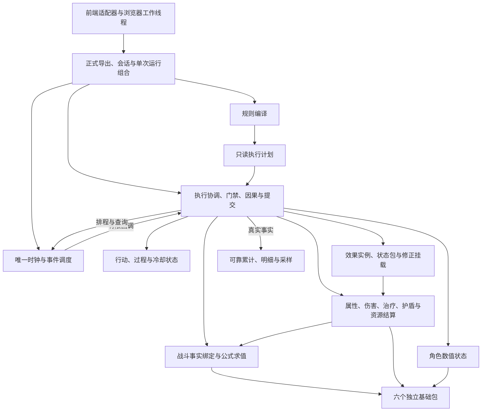

TASK_KEY: planning-engine-subsystem-refactor
DOC_TYPE: 概要设计
WORKSTREAM: planning
STATUS: tracked
EXECUTION_MODEL: Codex 主负责人编写，内置代理独立只读复核
LAST_TRACKED_AT: 2026-10-29

# Wasm子系统职责与协作现状及调整方向

## 1. 定位与当前结论

本文说明当前Wasm引擎的职责、状态归属、能力入口和协作关系，并明确期望终态。现状按2026-10-29主干 `57e72576466640550cd7780a77bd27c8e6d0f4ea` 的源码核对；第2至6节描述现状，第7至8节描述目标及其判断标准，第9节提供源码阅读入口。

可通过[子系统职责与改动看板](wasm-subsystem-progress.html)查看主要协作及具体工作项。该页是2026-10-29的只读展示快照，不自动同步；任务状态、职责和验收仍分别以任务规则、本文及验收摘要为准。

各子系统的入参、返回值、错误和状态交接见[接口设计草案](../../详细设计/项目/Wasm子系统接口设计草案.md)。草案区分沿用能力与拟收敛接口，供后续调整，不代表候选接口已经实现。

当前保留十项主要职责：宿主协议与会话、规则编译、执行协调、时间调度、角色数值、行动过程、效果生命周期、战斗公式、数值结算、结果观察。它们不等于十个Go包，也不是十套独立运行框架。角色、行动、效果、报告分别拥有自己的业务状态；执行层保存跨子系统因果并协调提交，调度器保存唯一时钟和队列，会话保存可复用的编译计划。

当前结构已具备上述分工，但调度与业务决策、执行因果组织、只读借用与缓存准备等边界仍需收敛。期望终态是让每项状态有明确所有者、每项能力有清楚的使用边界、每次业务变化有可定位的落点。包数、文件数和接口数不作为架构完成标准。

本文是概要说明，不重复定义数学、字段和具体机制准入。共享语义以[运行时拆分与分组设计](../../详细设计/项目/运行时子系统拆分与数值修正分组实施详细设计.md)、[共同公式契约](../../详细设计/项目/共同公式定义与校验详细设计.md)、[纯公式与执行计划设计](../../详细设计/项目/纯公式编译求值与执行计划拆分详细设计.md)及相应机制契约为准。实际验证范围见[验收摘要](../../测试记录/项目/共同公式与引擎重构验收摘要.md)。本文的终态目标不代表尚未实现的边界已经通过验收。

## 2. 当前系统位置与调用边界

### 2.1 后端、前端与Wasm分别负责什么

| 层次 | 当前职责 | 向下一层交付什么 |
| --- | --- | --- |
| 后端 | 保存作者配置；按场景选择读取角色、装备、技能及其依赖，在只读一致性事务中生成场景快照和内容摘要 | 完整场景数据及配置身份，不执行战斗 |
| 前端页面及生产适配器 | 收集选择和场景输入，校验快照、检查支持范围、组织公式预检，将作者数据装配为引擎请求 | 编译请求、初始快照、行动驱动、停止和记录配置 |
| 浏览器工作线程与桥接 | 加载Wasm，编码请求帧，管理线性内存输入，读取和清理出箱，将结果交回页面 | 对正式导出的调用及结构化结果；不另算一套战斗结果 |
| Wasm | 复核并编译规则，保存会话，按统一时序执行状态变化和数值结算 | 编译问题、真实运行结果、末态与执行证据 |

当前选择页面已经读取列表及部分技能资料，并保存页面内场景快照。编译验证或计算时仍会重新请求完整快照，比较配置及摘要；确认可继续后，再进行Wasm公式预检、正式装配和编译，计算路径继续运行并释放会话。公式预检本身也会编译并释放一个临时会话。因此，页面上的“准备／编译”耗时不能直接等同于 `engine_compile` 的耗时。

当前没有按数据版本复用的浏览器场景快照缓存。按已确认的方向，缓存、复用与失效更新留到版本管理明确后处理；它们属于数据与宿主协作，不成为Wasm战斗子系统的职责。

### 2.2 当前主要协作关系

图中箭头表示主要调用与数据协作，不是完整Go导入图。调度器通过自身定义的 `LoopDriver`（循环驱动协议）回调执行器，生产依赖仍由执行层指向调度包；行动、效果和报告不拥有另一套事件堆。

### 2.3 三类接口不能混用

| 接口层次 | 当前入口 | 使用含义 |
| --- | --- | --- |
| 跨语言业务接口 | `engine_compile`、`engine_run`、`engine_release_session` | 正式的编译、运行与会话释放能力 |
| 跨语言运输接口 | `alloc/dealloc`、`engine_outbox_ptr/len/clear` | 输入分配、结果读取与出箱清理；不代表额外业务能力 |
| 内部能力声明与协作入口 | `类型名API`、真实协作接口、纯函数和只读值 | 说明Go调用者可用的方法及约束，不自动形成独立服务或公开产品接口 |

`类型名API` 是当前对象的完整公开实例方法目录。实际运行仍主要使用具体类型；增加一份接口声明不会自动隔离状态、消除别名或改变调用成本。

## 3. 当前十项主要职责

以下代码路径统一相对 `wasm/tinygo_engine_v2/`。能力名称用于定位真实入口，完整方法签名和借用约束以第9节源码为准。

### 3.1 宿主协议、会话与运行组合

**职责与状态。** `cmd/engine_wasm` 负责正式导出及输入分配根表；根 `runtime` 负责帧解析接线、会话登记、规则身份校验和单次运行组合。`Session` 保存编译计划及出箱，战斗状态属于每次运行。

**暴露能力。** 正式业务导出及运输接口；内部的 `SessionAPI`、`CompileFrame/RunFrame/ReleaseSessionFrame` 和 `RunGeneric`。

**协作边界。** 编译请求交给编译器；运行请求校验会话与规则身份后，由根入口创建唯一 `scheduler.Loop`，组合 `execution.New`、`loop.Run(engine)` 和 `engine.Finish`。同一会话可以多次运行，每次都有独立的战斗状态。宿主复制出箱后清理，当前出箱清理还触发垃圾回收；清出箱、释放输入和释放编译会话各有独立作用。

### 3.2 规则编译与计划生产

**职责与状态。** `compile` 检查编译请求中的完整通用规则定义、引用闭包、读取权限和支持范围，生产规则索引、短编号及执行计划。原始管理配置到通用规则的解释和转换由前端生产适配器负责。`plan.CompiledSession` 保存编译后的数据，不保存本场生命、冷却或过程进度。

**暴露能力。** `CompileGeneric` 及编译问题；成功计划包含角色模板、供值器、能力、操作、公式、类型、过程和命中等编译形态。

**协作边界。** 编译器组合战斗公式、纯表达式、输入绑定及类型目录；会话保存结果，运行和管道直接消费 `plan`。共享计划按只读约定复用。本次运行的驱动公式写入 `CloneForRun` 创建的独立公式表，不追加或覆盖共享计划。

### 3.3 战斗执行与提交协调

**职责与状态。** `execution.Engine` 组合各子系统，负责门禁、操作路由、真实使用／命中／监听因果、预算和事实冻结。动态监听、命中账、同次使用额度、施放节流和延迟续接仍在执行层。`Frame`（执行帧）保存一次结算的暂存变化并协调提交。

**暴露能力。** 单次运行的 `New/Finish`、`EngineAPI` 中的循环回调，以及 `FrameAPI` 中供公式使用的有限事实读取。操作路由、门禁和跨子系统提交属于包内协作。

**协作边界。** 执行层读取角色、行动、效果的值和视图，调用公式与管道，将结果放入所属暂存对象，再协调发布、排程及事实记录。子系统不接收整个执行器，也不互相发起全局提交。当前提交存在部分发布后仍可能失败的生命周期分支，不能把它理解为整条事件链的全局回滚事务。

### 3.4 时间与事件调度

**职责与状态。** `scheduler.Loop` 持有本场唯一时钟、事件堆、事件计数和停止原因。堆提供稳定基础顺序，循环驱动执行器处理事件和观察时点。

**暴露能力。** `NewLoop`、`LoopAPI`、`LoopDriver`，以及事件堆的入队、出队、窥视时刻、容量检查和有限改期能力。

**协作边界。** 根入口创建循环，执行层借用同一实例。当前 `LoopState` 仍带普攻、技能计划、手动行动和死亡等待等业务事实，`Queue()` 仍返回可写堆；因此调度器尚未完全收敛为机械调度。效果时间载荷只记录身份、世代和参数，不自行推进时间。

### 3.5 角色数值状态

**职责与状态。** `runtime/actor.State` 保存角色已提交的属性表、资源槽和生命上限锚点。它没有技能集合、技能行为方法或事件队列。

**暴露能力。** `StateAPI` 的属性／资源／锚点读取；`Stage` 及 `ChangeSetAPI` 的数值暂存、资源冻结和 `Publish`。

**协作边界。** 管道计算新属性或资源槽值，执行层将核定结果放入角色暂存对象；统一提交时发布。属性分页与资源复制规则负责旧视图隔离。护盾集合由效果层拥有，冷却账本由行动层拥有，角色数值包不承担这些规则。

### 3.6 行动、过程、冷却与等待

**职责与状态。** `runtime/action.State` 保存普攻、手动／自动行动、过程、局部使用身份、占用、弹药及驱动事实；每拥有者的 `CooldownLedger` 是真实冷却期限和等待版本的权威账本。

**暴露能力。** `StateAPI` 的行动初始化与局部转换；过程的创建、查询、暂存和发布；`CooldownLedgerAPI` 的版本化读取、普通冷却提交、增减、等待登记与变化查询。

**协作边界。** 执行层根据真实时刻和门禁结果调用局部转换，并向唯一循环排程。行动包的发布不自动更新效果或队列。效果只消费冷却只读投影，不能另存一套真实冷却截止。`ProcessView` 是活对象借用，保留历史必须显式 `Freeze/Snapshot`；只复制视图列表不等于冻结过程。

### 3.7 效果实例与生命周期状态

**职责与状态。** `runtime/effect` 保存活动供值器、护盾集合、属性／伤害修正挂载、资源贡献、状态值与期限、目标状态、实例身份和时间载荷。实例生命周期与结算算法分开负责。

**暴露能力。** 实例的创建、挂载／移除、暂存与发布；状态包的查询、`PrepareRead`、`Edit`、冻结与发布；`IdentityRegistry/TimeState` 的身份和载荷登记；属性、伤害及护盾只读集合的结算适配。

**协作边界。** 执行层提供真实时刻、完整身份、计划和上下文，效果适配调用管道返回计算结果，由执行层决定暂存与提交。旧周期或到期事件按实例身份、世代和期限失效。`PrepareRead` 可以准备元数据、处理惰性到期及刷新冷却投影，不能当作无副作用查询；写句柄在发布、冻结或再次共享后需要重新取得。

### 3.8 战斗公式绑定与求值

**职责与状态。** `formula` 定义各用途可以读取的战斗事实，将拥有者／目标、属性／资源、参数、过程、供值状态、事件和同帧结果绑定到程序。纯数学由基础表达式层完成。

**暴露能力。** `GenericRegistryAPI`、`CompileGenericFormula`、`CloneForRun`、`EvalContext`，以及特定事实的有限只读接口。

**协作边界。** 编译时核对依赖和权限，执行时由真实上下文提供输入并在需要的时点冻结。求值返回数值或结构化问题，不扣血、不挂状态、不推进时间。缺少真实事实沿各读取的错误规则处理，不能统一补零；当前上下文含按只读约定借用的集合，类型本身并不保证深不可变。

### 3.9 业务数值结算

**职责与状态。** `pipeline` 负责属性、伤害、治疗、护盾和资源数值规则，同时定义命令材料及统一护盾底层值。它不持有本场角色、行动、效果实例集合或事件队列。

**暴露能力。** 属性／伤害修正解析；`ApplyMitigatedDamage`、`ResolveCommand`、`ResolveExecuteThreshold`；资源槽的 `SpendSlot/RefundSlot`；护盾的过滤、排序、规范化与吸收计算。

**协作边界。** 接收明确值、计划和只读视图，返回新数值及必要事实。共同防御公式先完成防御求值，管道再计算扣盾和扣血；`ResolveCommand` 的分发范围仍是治疗、护盾及斩杀，不能从公开命令种类推断所有入口都支持它。资源等待和消费资格由执行门禁负责。

护盾采用一种管道底层值，由效果状态私有持有集合并提供只读包装。计算工作表与已提交集合仍隔离，发布结果仍按现行规则复制；空集合缺失语义、来源归属、精确到期和逐盾吸收事实均属于实际行为边界。

当前增幅组标识 `multiplierGroupKey` 只用于已批准的总属性及防御前／后伤害增幅。同组按 `1 + Σ(f - 1)` 聚合，各倍率有限且不小于1，组间相乘；成员资格、优先级、期限和次数消费由业务层决定。原 `bucket` 的排序或次数范围含义保持，不能当作增幅组标识。治疗、减幅及特殊快照图不会因出现该字段自动获得分组支持。

### 3.10 结果累计与观察

**职责与状态。** `runtime/report.State` 接收真实尝试、跳过和已提交数值事实，保存可靠累计、有限明细、证据计数、采样游标及输出容器。

**暴露能力。** `StateAPI` 中的尝试／跳过／施放统计、已提交伤害及资源记录、能力输出、证据累计、采样、截断查询、`Snapshot/Finish`。

**协作边界。** 执行器在真实发生点传入事实，循环观察点控制采样时机。报告不读取角色私有状态，不排战斗事件，不决定伤害是否发生。关闭明细或达到记录预算只影响保留内容，可靠累计与战斗资格继续有效。`Snapshot` 复制结果后可继续记录，`Finish` 转交容器并结束该报告状态的使用。

## 4. 共享数据、基础能力与测试支撑

### 4.1 三类共享数据

| 包 | 负责的数据 | 边界 |
| --- | --- | --- |
| `model` | 外部请求、结果、结构化错误、快照和只读数值视图 | 共享数据形状，不承担编译或运行控制 |
| `plan` | 编译后的规则、短编号、索引及公式绑定 | 由编译器生产，运行消费；不是本场可写状态 |
| `runtime/contract` | 稳定过程／行动引用、冷却身份与只读交换值 | 让行动与效果交换必要事实，不互相依赖实现，不另设账本 |

过程和行动引用只在本场有效，0号槽可以合法；缺失使用显式存在标记。只读视图只限制调用入口，底层集合是否独立、能借用多久，仍由生产者的复制及生命周期规则决定。

### 4.2 六个独立基础包

| 基础包 | 暴露能力 | 责任边界 |
| --- | --- | --- |
| `base/abi` | 帧编解码、内存桥接、`Outbox` 输出缓冲 | 运输明确字节和协议数据，不执行战斗规则 |
| `base/attribute` | 属性布局、不可变表、编辑器、快照及页共享查询 | 保证属性存在性和写时复制；编辑器发布后继续写仍须隔离旧表 |
| `base/expression` | 纯表达式校验、编译、程序表及求值 | 只认识声明输入和数学，不读取角色或事件 |
| `base/inputbinding` | `Bind`、绑定计划、读取器与求值 | 将声明输入绑定到明确值，不推测战斗对象和业务默认值 |
| `base/numeric` | 上下界／概率夹取及增幅组聚合 | 只消费数值和组编号，不判断来源、期限和使用资格 |
| `base/typeset` | 类型目录、编号、位集合与匹配器 | 依据明确目录匹配，不按游戏对象名称决定效果 |

`base` 目录不形成公共大包或额外发布模块。普通业务迭代默认在外层组合这些能力；战斗公式、数值结算和调度具有业务含义，保持在基础层之外。当前属性页为每页8项，后续分页取舍以实际复制页数和正式Wasm测量为准，不以原生Go耗时单独判断收益。

### 4.3 测试支撑与代码覆盖口径

`internal/testkit` 及其 `formuladefinition` 子包提供显式固定输入，仅服务测试。包内测试检查所属私有不变量，`tests/runtime/` 通过真实会话与循环检查组合行为；[Web固定机制用例](../../../web/tests/mechanisms/README.md)经生产适配器和正式Wasm验证，浏览器检查工作线程及代表对象路径。

当前 `internal/` 共21个包，其中19个由正式入口到达，另2个仅服务测试。`cmd/engine_wasm` 是正式入口，`cmd/bench`、脚本和测试目录是支撑入口。职责划分由状态和消费者决定，包数只用于核对代码覆盖。

## 5. 当前如何协作完成一次计算

### 5.1 技能、角色、行动和效果的实际关系

业务上，一个角色拥有技能；当前代码用角色模板及供值器挂载表达这种归属。技能被编译为供值器、能力、操作及必要过程等定义，不是每个技能各自持有一份角色对象并直接修改它。

| 概念 | 当前落点和作用 |
| --- | --- |
| 角色 | `actor.State` 保存数值；执行层的角色运行组合另关联效果实例、冷却账本和状态包 |
| 供值器（`provider`） | 表达挂载来源及其可提供的行为，实际实例与状态由效果层维护 |
| 能力（`ability`） | 表达可以尝试的行为；执行层检查条件、冷却、占用和身份后执行 |
| 操作（`operation`） | 表达具体变化，例如伤害、治疗、状态或效果变化，进入统一执行与结算路径 |
| 行动与过程 | 表达一次真实使用的接受、进行、等待、推进和结束，由行动层保存局部状态 |
| 效果 | 表达持续实例、修正、护盾、状态值和期限；效果生命周期通过同一执行协调及队列推进 |

典型协作为：**调度选中事件 → 执行层确定真实拥有者和目标 → 门禁核对行动资格 → 能力产生操作 → 公式与管道算出变化 → 各状态所有者暂存 → 执行层协调发布 → 报告接收事实。** `actor.State` 自身不负责调度技能。一次伤害也可以同时影响目标生命、目标护盾、行动进度及来源统计，因此必须存在跨子系统协调者。

### 5.2 三个生命周期

| 生命周期 | 保留什么 | 隔离要求 |
| --- | --- | --- |
| 编译会话 | 规则身份、共享执行计划，直到明确释放 | 不保存上一场战斗状态作为下一场初态 |
| 单次运行 | 唯一循环、私有公式表、角色／行动／效果／报告状态及执行因果 | 不把本场引用或动态驱动公式写回共享计划 |
| 执行帧及借用 | 本次结算的暂存变化、冻结事实和有限只读视图 | 活视图不当历史快照，写句柄不跨发布继续复用 |

### 5.3 一次运行的主链

1. **装配。** 校验会话和规则身份，接收初始快照、驱动及停止／记录配置，创建本场状态和唯一循环，将真实初始化事件入队。
2. **选取事件。** 循环依据预算、停止条件及基础堆序选择事件，执行侧处理必要的同刻选择，推进唯一时间并调用相应执行路径。
3. **判定和计算。** 门禁读取真实占用、冷却和条件；执行层在命中及监听派发点冻结上下文。公式提供明确数值，管道完成结算，结果进入所属暂存对象。
4. **协调提交。** 执行帧按当前预检、局部发布、生命周期、过程、排程、事实和死亡处理边界提交。部分派生同步执行，合法延迟续接才进入同一队列；监听并非全部异步消息。
5. **观察和结束。** 在约定观察点读取已提交状态；停止后完成结束结算，构造末态和完整性，报告交出输出，会话编码出箱供宿主读取。

上述顺序是协作概括，不能据此推导“所有可能错误均在发布前排除”。父子帧、同步派生和生命周期各有实际成功／失败边界。

### 5.4 需要共同维护的交互

| 场景 | 正确的责任交接 |
| --- | --- |
| 伤害消耗护盾并扣生命 | 执行帧提供真实上下文，公式／管道计算，效果及角色暂存，统一发布后记录实际吸收与生命损失 |
| 冷却参与状态条件 | 行动账本提供版本化事实，效果准备指定时刻的数值投影，公式读取；投影不成为第二份期限账本 |
| 效果刷新或到期 | 效果保存身份、期限及世代，执行层登记事件，回调复核实例，再撤销挂载并协调提交 |
| 同刻事件 | 基础堆序、过程稳定排序键和执行侧特殊选择共同确定顺序；真实战斗先于状态到期回调，实际目标末跳先于相应过程计时 |
| 历史事实与当前状态 | 行动／效果提供当前视图，执行层在真实事件点冻结需要保留的事实，后续公式及监听读取相应时点 |
| 关闭详细记录 | 执行层仍保留计算资格所需的使用、命中及伤害事实，报告保持可靠累计，只减少展示明细 |

## 6. 当前仍存在的耦合

下表描述维护上的耦合和使用约束，不等于已经发现运行错误。必要的跨状态协调可以保留，隐藏的写入权限、时序和失败边界需要更清楚地表达。

| 当前事实 | 对下一次修改的影响 | 主要源码位置 |
| --- | --- | --- |
| 循环消费普攻、主动计划、手动行动等业务状态，且 `Queue()` 借出可写堆 | 调整驱动或停止策略可能同时改执行与循环；队列写入范围靠调用约定 | `scheduler/loop.go`、`runtime/execution/loop_driver.go` |
| 同刻顺序分布在基础堆序、过程排序键及执行侧特殊选择 | 单独测试堆不能解释全部战斗顺序 | `scheduler/generic_heap.go`、`runtime/execution/loop_driver.go` 及过程／到期路径 |
| 使用、命中、监听、额度、节流及延迟续接集中在执行层 | 新增因果规则仍可能触及同一组执行文件；行动与效果并未封装整条因果链 | `runtime/execution/engine.go` 及命中／监听实现 |
| `PrepareRead` 会准备状态和缓存，普通过程视图又是活借用 | 调用方必须同时理解读取时点、可能写入和是否需要冻结 | `runtime/effect/bag_store.go`、`bag.go`、`runtime/action/process.go` |
| 状态包写句柄、计划集合和公式上下文依靠生命周期及只读约定 | 仅凭类型名不能防止跨发布写入或别名污染；不能简单用全面深复制消除风险 | 效果状态包、`plan/compiled.go`、`formula/generic_eval.go` |
| 驱动条件与重复间隔分别核对公式读取范围 | 新增读取种类时需要同步检查两处拒绝逻辑及其错误定位 | `runtime/execution/engine.go` |
| 提交预检后仍有生命周期等分支可能失败 | 统一提交接口不能被调用方当成全事件链原子事务 | `runtime/execution/frame.go`、`frame_commit.go` |
| 管理配置到通用规则的转换包含来源、阶段和机制准入，Wasm再校验最终请求 | 新增共享机制可能同时涉及作者模型、前端适配和Wasm；配置可保存不等于已有完整运行消费者 | `simulationAdapter.ts`、`model/generic_compile.go`、`compile/generic.go` |
| 页面把快照刷新、公式预检、装配、编译与运行串在同一操作链 | 用户感知等待不能只归因于Wasm计算；数据更新策略与会话复用需要宿主明确安排 | `SimulationScenarioPanel.tsx`、`skillFormulaPreflight.ts`、`simulationAdapter.ts` |

## 7. 期望终态：保留职责，明确能力边界

终态沿用第3节十项职责，以及共享数据和六个基础包。包内可以按真实变化点组织实现，职责不需要一一变成独立服务、动态接口或发布模块。当前已成立的数值／行动／效果所有权、唯一时钟、纯公式和计划复用边界继续保持。

| 方面 | 期望的最终形态 | 当前与目标的关系 |
| --- | --- | --- |
| 宿主与引擎 | 后端提供版本明确的数据；宿主负责选择、输入映射和会话使用；Wasm只消费明确请求并给出确定结果 | 当前计算职责已分开；数据版本管理及浏览器快照缓存属于后续目标，缓存先暂缓 |
| 角色与技能归属 | 从显式定义、挂载和使用身份能够追踪谁拥有能力、由谁作用于谁；数值存储、行动进度和效果实例各有权威所有者 | 当前已有这些组成部分；整体协作仍由执行层串联，不预设必须重写为每技能一个行为对象 |
| 调度与执行 | 调度掌管唯一时钟、队列、基础稳定顺序和计数；业务行动资格、等待／结束决策及同刻特殊选择归执行侧，按有限协议交接 | 当前循环仍有业务分支，可写队列仍借出；这是尚未完全落实的边界 |
| 排程与提交 | 初始化和执行协调拥有明确排程入口；局部变更、队列影响及事实记录在一个可追踪的提交边界中协调 | 当前所有者已明确，写入口与失败边界仍需更集中地表达；不隐含扩大回滚范围 |
| 读取与写入 | 能力声明清楚区分纯计算、只读借用、读取准备、历史冻结、暂存写入和发布，调用方知道结果能保留多久 | 当前能力目录和主要中文约束已具备；部分保证仍依赖调用纪律与测试 |
| 执行因果 | 每项使用、命中、监听与派生规则有清楚的输入、状态和输出；执行包能够按完整因果链阅读 | 当前因果集中于执行层；终态可以在包内收敛，不预建监听、命中、技能等额外运行中心 |
| 公式与结算 | 公式决定合法输入和数值结果，管道决定如何应用修正及结算，状态所有者决定存放和发布；同一数学规则只有一个实现 | 当前主边界已成立；调用适配可以保留，不能为减少依赖箭头重复实现算法 |
| 结果与观察 | 可靠累计及计算所需事实完整保留，明细与采样可以限额；输出策略不反向控制战斗 | 当前已有明确分工，继续以相同数值和因果断言维持 |

这些目标不要求将执行器变成没有逻辑的转发层。跨角色数值、效果消耗、行动进度和派生事实的操作仍需要集中协调；需要收敛的是责任与可写边界，而不是消除所有跨包调用。

如果未来需要角色级对外入口，它应清楚组合现有数值、行动和效果能力；是否采用这种入口仍属于后续架构选择，本文不把它写成当前已经确认的对象模型。

## 8. 终态判断与能力边界

### 8.1 用实际变化判断边界是否有效

| 需要处理的变化 | 终态应有的明确落点 |
| --- | --- |
| 已支持机制下新增角色、技能或装备数据 | 作者配置及生产适配准入；已有运行机制不需要按对象名称增加分支 |
| 新增一种行动规则 | 行动状态负责局部转换，执行层负责资格及因果，唯一循环负责排程；相关时序能够从同一组规则解释 |
| 新增一种持续效果 | 效果层负责实例、状态与期限，执行层负责真实派发和提交，数值由现有公式／管道组合 |
| 新增一种可读事实 | 明确真实生产者、读取权限和冻结时点，再进入公式绑定；纯数学层不承担战斗事实查找 |
| 新增统计或展示 | 已提交事实进入报告，页面负责呈现；不依赖截断的展示明细恢复战斗资格 |
| 调整基础算法或分页 | 有明确基础问题及独立验证，正式Wasm和实际复制页数支持取舍；普通业务配置不直接修改基础层 |

支持一种通用机制不等于任意完整英雄都已支持。来源、目标、阶段、依赖和生命周期仍须经过真实配置、生产适配与正式运行验证；缺少输入或消费路径时继续明确报错，不补造默认效果。

### 8.2 终态需要持续满足的可观察结果

- 同一输入的数值、事件顺序、精确到期、身份与因果保持确定；共享计划不会被一次运行污染。
- 每项可变状态只有一个权威所有者；局部发布、跨子系统协调和失败后已经发生的事实能够分别说明。
- 当前视图、历史快照和可写句柄的生命周期清楚；关闭详细记录不改变战斗资格、数值及可靠累计。
- 能力目录能指向唯一实现，新增业务不需要恢复旧路径、兼容转发壳或平行算法。
- 性能分别解释纯计算、记录生成、编码及工作线程运输、页面展示；准备数据的网络等待另列。结构变简单不自动等于正式Wasm更快。

### 8.3 对应的验证入口

| 需要证明什么 | 对应证据 |
| --- | --- |
| 包依赖及能力声明完整 | `scripts/check-package-boundaries.mjs`、`go run ./scripts/check-contract-layout` |
| 状态、视图、快照及公式表隔离 | 所属包内测试与 `tests/runtime/` 的真实入口组合测试 |
| 数值、时序、错误和提交边界 | 引擎行为测试、正式Wasm及生产适配固定机制用例 |
| 宿主和用户实际路径 | 浏览器工作线程及代表对象冒烟，独立于Node测试 |
| 性能与基础分页收益 | 同口径正式Wasm测量、实际复制页数；原生Go仅辅助定位 |

脚本路径相对引擎模块；完整命令见[模块规则](../../../wasm/tinygo_engine_v2/AGENTS.md)。本次仅更新文档并核对源码、路径与差异，没有重新执行运行时、数据库或浏览器验收；已有执行证据仍以[验收摘要](../../测试记录/项目/共同公式与引擎重构验收摘要.md)为准。

## 9. 能力声明与实现的阅读约定

主要对象在原定义文件前部依次列出 `类型名API` 能力声明、具体结构体和编译期实现检查，再给出构造及方法实现。接口方法上的中文说明是使用约束入口，实现处保留算法、排序及局部分支说明。纯函数直接在真实定义处说明，共享数据不另建服务壳。

| 职责 | 优先阅读的定义与能力入口 |
| --- | --- |
| 宿主协议与会话 | [正式导出](../../../wasm/tinygo_engine_v2/cmd/engine_wasm/main.go)、[SessionAPI](../../../wasm/tinygo_engine_v2/internal/runtime/session.go)、[运行组合](../../../wasm/tinygo_engine_v2/internal/runtime/run.go) |
| 规则编译与计划 | [CompileGeneric](../../../wasm/tinygo_engine_v2/internal/compile/generic.go)、[CompiledSession](../../../wasm/tinygo_engine_v2/internal/plan/compiled.go) |
| 执行与提交 | [EngineAPI](../../../wasm/tinygo_engine_v2/internal/runtime/execution/engine.go)、[FrameAPI与提交](../../../wasm/tinygo_engine_v2/internal/runtime/execution/frame.go)、[事实发布](../../../wasm/tinygo_engine_v2/internal/runtime/execution/frame_commit.go) |
| 时间与事件调度 | [LoopDriver与LoopAPI](../../../wasm/tinygo_engine_v2/internal/scheduler/loop.go)、[基础堆序](../../../wasm/tinygo_engine_v2/internal/scheduler/generic_heap.go)、[执行侧循环适配](../../../wasm/tinygo_engine_v2/internal/runtime/execution/loop_driver.go) |
| 角色数值 | [StateAPI与ChangeSetAPI](../../../wasm/tinygo_engine_v2/internal/runtime/actor/state.go) |
| 行动与过程 | [StateAPI与过程视图](../../../wasm/tinygo_engine_v2/internal/runtime/action/process.go)、[CooldownLedgerAPI](../../../wasm/tinygo_engine_v2/internal/runtime/action/cooldown.go) |
| 效果与生命周期 | [实例及结算适配](../../../wasm/tinygo_engine_v2/internal/runtime/effect/instances.go)、[状态访问](../../../wasm/tinygo_engine_v2/internal/runtime/effect/bag_store.go)、[读取准备](../../../wasm/tinygo_engine_v2/internal/runtime/effect/bag.go)、[时间载荷](../../../wasm/tinygo_engine_v2/internal/runtime/effect/time_state.go) |
| 战斗公式 | [GenericRegistryAPI](../../../wasm/tinygo_engine_v2/internal/formula/generic_registry.go)、[事实读取与求值](../../../wasm/tinygo_engine_v2/internal/formula/generic_eval.go) |
| 数值结算 | [属性解析](../../../wasm/tinygo_engine_v2/internal/pipeline/attribute_resolver.go)、[伤害修正](../../../wasm/tinygo_engine_v2/internal/pipeline/damage_modifier.go)、[结算入口](../../../wasm/tinygo_engine_v2/internal/pipeline/resolver.go)、[资源槽计算](../../../wasm/tinygo_engine_v2/internal/pipeline/resource.go)、[护盾值](../../../wasm/tinygo_engine_v2/internal/pipeline/shield.go) |
| 结果观察 | [StateAPI](../../../wasm/tinygo_engine_v2/internal/runtime/report/state.go)、[输出容器所有权](../../../wasm/tinygo_engine_v2/internal/runtime/report/output.go) |
| 共享数据及基础能力 | [共享协议](../../../wasm/tinygo_engine_v2/internal/model)、[运行交换值](../../../wasm/tinygo_engine_v2/internal/runtime/contract)、[基础六包说明](../../../wasm/tinygo_engine_v2/internal/base/README.md) |
| 上游快照及宿主 | [后端快照服务](../../../server/data_manage/src/main/java/xyz/game/datamanage/service/simulation/SimulationSnapshotService.java)、[页面执行链](../../../web/src/pages/simulation/SimulationScenarioPanel.tsx)、[公式预检](../../../web/src/engine/skillFormulaPreflight.ts)、[生产适配](../../../web/src/engine/simulationAdapter.ts) |

新增公开实例方法时同步维护能力目录和说明。说明应包含必要输入、结果、错误、借用期限、读取准备、暂存及发布边界。`var _ 类型名API = (*类型名)(nil)` 验证实现满足声明，静态检查进一步核对完整公开方法集合；这两者均不能代替状态隔离和数值／时序验证。
