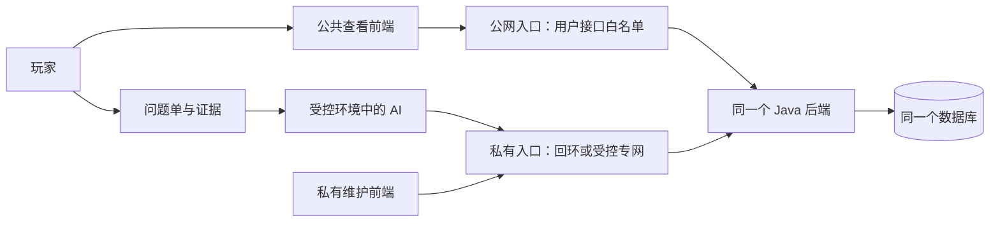
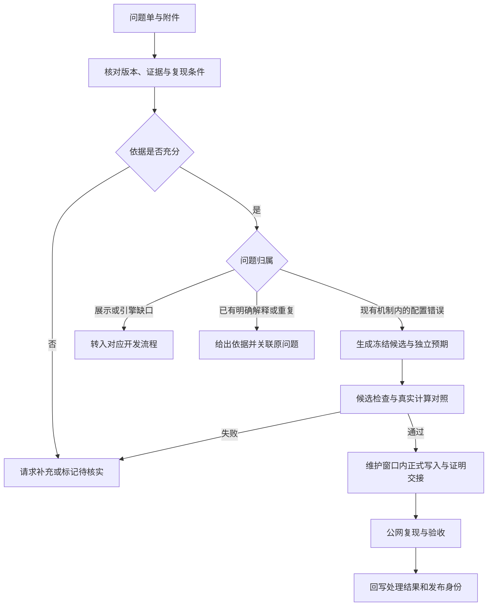

TASK_KEY: planning-viewer-ai-maintenance
DOC_TYPE: 概要设计
WORKSTREAM: planning
STATUS: active
EXECUTION_MODEL: Codex 主负责人及内置独立评审代理
LAST_TRACKED_AT: 2026-11-13

# 公共查看与 AI 维护单后端方案

## 1. 目标与生效边界

所有玩家统一为查看者，不再向玩家提供编辑资格。玩家负责描述问题、提交复现条件和图片、视频等证据；AI（人工智能助手）负责核实资料、形成配置变更、验证和维护交接。

生产环境部署一个 Java 后端，保留同一套业务服务和数据库。公网通过 Nginx（入口代理）转发明确允许的用户接口，维护者经私有入口访问同一后端。前端从同一代码库执行一次构建，分别交付公共查看和私有维护所需的静态文件。

现行注册、付费开通、验证器、会话及账号恢复由[账号方案](../../详细设计/项目/账号注册登录与权限接入技术方案.md)维护。发布状态和数据迁移以实际部署记录为准。

当前共享接口与字段以[维护契约](../../../contracts/maintenance/README.md)为准，候选、对照和问题事件的执行入口见[维护工具](../../../tools/maintenance/README.md)。启用前仍须配置反馈仓库、受控执行宿主及实际凭据隔离，并按部署计划完成目标数据库迁移、入口切换和公网验收；源码修改不代表现网或实库已经切换。实施不得借此取消登录付费边界、扩大游戏模拟范围，或恢复已退出的版本发布子系统。本方案不建设通用角色系统、多人编辑平台、站内媒体存储或另一套业务后端。

## 2. 变更前基础与替换范围

下表以 `6f66ba9974fc45b923fced86d4076660bc00866b` 为变更前基线，说明本次替换范围；当前接口、配置和运行入口查对应模块说明，不以旧基线推断现网或实库状态。

| 范围 | 已有基础 | 本次需要补齐 |
| --- | --- | --- |
| 用户权限 | 账号的 `can_edit` 表示编辑资格，过滤器、实际路由和写事务分别复核 | 移除玩家编辑资格，以独立维护身份承担配置写入 |
| 游戏读取 | 游戏读取匿名开放；场景快照以 POST 查询，在只读事务中装配 | 保留读取语义，导出明确的公网接口白名单 |
| 配置保存 | 统一技能保存具有基线摘要、游戏写锁、事务及组合校验 | 维护身份接入同一服务；维护留痕不能再依赖玩家身份 |
| 计算授权 | 正式票据只接受已开通玩家，前端固定从玩家接口取票 | 增加维护取票来源，并同步签发、验签、主体绑定和宿主缓存 |
| 编辑前端 | 管理页面与计算页面共用应用，编辑操作未统一按部署隔离 | 构建两个前端入口，公共版没有配置编辑路径 |
| 复现材料 | 计算页已有场景快照、配置摘要及部分运行档案导出 | 汇成一次问题报告，补齐版本、输入和结果关联 |
| 计算可用性 | 正式证明匹配配置、依赖、引擎及适配器身份 | 候选验证、正式写入和证明更新必须有一致的交接流程 |
| 反馈处理 | 现有资料、录入和对照工具可以承担部分步骤 | 增加问题接收、去重、判断、编排和处理结果回写 |

当前入口见[后端说明](../../../server/data_manage/README.md)、[前端说明](../../../web/README.md)、[统一配置保存](../../../server/data_manage/src/main/java/xyz/game/datamanage/service/skillconfiguration/SkillConfigurationService.java)、[实际路由鉴权](../../../server/data_manage/src/main/java/xyz/game/datamanage/support/account/AccountMvcAuthorization.java)和[正式可用性判定](../../../server/data_manage/src/main/java/xyz/game/datamanage/service/simulation/availability/SimulationAvailabilityService.java)。候选装配和完整自动反馈流程属于新增能力，不能由现有脚本的存在推断已经具备。

## 3. 单后端与两个访问入口

后端端口仅对回环地址或已确认的受控链路开放，外网不能绕过公网入口直连。公网入口与后端分机时使用受控加密链路；不能因需要转发就开放后端公网端口。私有维护入口默认采用回环监听，通过 SSH 安全隧道供远程 AI 访问；确有专网时才按实际网络配置开放。

公网代理连接公开端口。私有代理连接同一进程上的 Unix 套接字（本机进程通信入口），文件权限限制为后端与私有代理服务身份。维护者的 SSH 隧道只转发到私有 Nginx 的回环站点。后端按实际连接器判定入口，具体来源和跨站请求规则归[共享维护契约](../../../contracts/maintenance/README.md)。

私有维护前端使用独立的加密站点。由各构建入口分别装配允许的页面和请求，部署工具按实际资源关系分发，同次构建中的共用资源可同时用于两个站点。

## 4. 公网接口分类与默认拒绝

“只读”限制公共游戏配置写入，不限制玩家修改本场计算输入，也不把 HTTP 请求方法直接当作业务副作用。

| 接口类别 | 公网入口 | 后端要求 |
| --- | --- | --- |
| 明确登记的游戏、角色、技能、装备、构筑、图片及可用目录读取 | 允许对应 GET、HEAD | 保持现行匿名读取；账号和运维信息不属于此类 |
| `POST /api/admin/games/{gameId}/simulation-snapshot` | 允许 | 只读装配场景，不保存配置或个人场景 |
| 现有注册、登录、恢复、安全流程、退出及计算授权 | 按具体路由与方法允许 | 保留各自的玩家会话、流程、防伪和限流要求 |
| `POST /api/visits` | 允许 | 仅做现行匿名访问上报 |
| 游戏配置新增、修改、删除及图片上传 | 拒绝 | 私有入口也必须具有有效维护身份 |
| 统计明细查询及 `/internal/**` | 拒绝 | 仅从对应受控入口访问，统计与账号开通各检查独立凭据 |
| 未登记的新接口、不匹配的方法和异常路径 | 默认拒绝 | 不因新增控制器或路径看起来像读取而自动公开 |

不能笼统放行 `/api/admin/**`，也不能封掉其中所有路径：当前游戏读取和只读快照也在管理命名空间下。本次不为路径名称统一而整体搬迁已有游戏读取接口。

接口分类由后端源码旁的一份清单统一维护，至少记录方法、路由模式、用途与公开或私有类别。部署侧消费该清单导出的 Nginx 白名单；运行配置和参数仍由部署仓库维护，不在两处手写完整业务分类。路由覆盖检查发现未分类接口时失败，公网默认不开放它。

Nginx 负责入口路径和方法限制，后端负责实际路由与身份授权。两层必须对编码、重复斜杠、路径参数等规范化行为有拒绝用例；不依赖某一层的字符串前缀判断守住写入。优先保持同源请求；如需预检 OPTIONS，只按已登记路径处理，不能因此放行实际写入。

未知或私有路径在公网统一拒绝；已登记路径的方法不符也拒绝。私有端缺失或失效的维护凭据返回认证失败，玩家凭据尝试维护返回无权操作。错误响应不携带内部凭据或私有配置。

## 5. 玩家身份、维护身份与留痕

### 5.1 玩家全部为查看者

玩家保留匿名读取、账号安全与已开通后的计算能力。付款、登录及账号开通均不能取得配置写入资格；账号响应、前端状态和数据库现行模型最终移除 `can_edit`，不把它改名后继续作为玩家权限。

实施时先核对现有编辑资格及相关真实数据，迁移只处理已确认字段和引用。保留玩家账号、付费记录、验证器、恢复码、有效会话及历史编辑记录，不因取消编辑资格清空账号或重新生成密钥。旧会话按新的玩家规则处理，不能携带旧编辑资格继续写入。

### 5.2 AI 使用独立维护身份

维护主体拥有独立且稳定的数据库编号，用于计算授权、批次和编辑留痕。后端从私有入口解析配置的主体，浏览器和工具均直接访问该入口。写入事务内复核主体仍启用，再执行业务锁、引用、组合和批次验证。账号开通和窗口控制使用各自的授权入口。

### 5.3 编辑留痕和其他私有能力

维护记录关联维护主体、问题编号或明确维护任务编号、候选摘要、变更前后摘要及执行结果，不伪造玩家账号。用于自动发布的配置变更与必要留痕同事务提交；留痕失败即回滚该笔变更，不能沿用部分旧管理操作“记录失败仍返回成功”的行为。保留历史操作者与原记录，不回填虚假维护身份。

访问统计的查询资格从玩家账号移出，交给私有运维入口；AI 配置维护凭据不因此取得账号开通或人员信息访问权。公网保留匿名访问上报。涉及 `can_edit` 的统计按钮、查询守卫、账号修改方法及编辑日志结构必须一并核对，不能只删除数据库一列。

### 5.4 维护计算授权与玩家计算授权

查看页和维护页分别使用玩家与私有取票入口。正式引擎校验签发身份，按主体类别和编号绑定编译会话。票据字段、期限与来源以[共享维护契约](../../../contracts/maintenance/README.md#计算票据第-2-版)为准。

## 6. 两种前端产物

| 用户行为 | 公共查看版 | 私有维护版 |
| --- | --- | --- |
| 选择英雄、等级、技能等级、装备、目标、连招和观察条件 | 保留 | 可用于复核 |
| 计算、查看结果与来源、下载复现材料 | 保留 | 保留 |
| 查看公共配置 | 提供只读资料和计算解释，按实际需要复用详情组件 | 可查看完整维护结构 |
| 新增、修改、删除公共配置或上传管理图片 | 只读查看 | 由私有入口提供，保存遵守第 8 节批次规则 |
| 报告问题 | 提供明显入口 | 可定位原问题与处理证据 |

公共版默认进入计算场景，不再以数据管理作为首页。不能通过修改网址进入编辑页。已有弹窗的只读模式可以复用；统一技能工作台目前没有完整的只读入口，不能直接把整套编辑器禁用后当成公共资料页交付。

私有维护页面保留查看、编辑草稿和候选核对；生产环境的保存动作走候选验证和维护交接，不提供绕过它的即时线上试改。私有页面的访问控制也独立于公共前端导航是否可见。

## 7. 问题反馈与 AI 处理

### 7.1 玩家只需描述问题并举证

初期以 GitHub Issues（问题单）作为统一反馈队列，可使用独立反馈仓库，不要求公开业务源码。站内提供“报告问题”“复制问题说明”和“下载复现材料”；玩家补充预期、实际表现及图片、视频即可，不要求理解技能组成或填写内部配置字段。

自动生成的材料包括可取得的应用发布身份、游戏资料版本、配置和场景摘要、引擎与适配器身份、本场输入、计算完成状态、结果或错误，以及导出时间。不存在的身份明确标记未知，不编造版本。复现材料不含会话、授权票据、维护凭据、验证器或其他账号秘密。

较大的场景、运行档案和媒体由用户作为附件提交，不塞入问题链接的查询参数。没有 GitHub 账号或通过其他渠道反馈时，可保留复制说明与下载材料，并由维护者整理到同一问题队列；不因此新增站内媒体服务。

### 7.2 处理流程与自动修改范围

问题创建或修改事件、评论补充证据或明确的重新处理请求触发受控环境中的 AI 执行器；不在用户请求中同步运行 AI，也不安排定时浏览网站寻找任务。问题单保存反馈状态，现有任务规则继续保存软件任务状态，不为每条用户反馈新建一套项目任务。

同一仓库、问题编号及证据修订只处理一次；重复事件先核对已有处理结果。处理中的问题被修改后重新核对修订，不能沿用旧证据直接提交。AI 自己的回复不再次触发同一轮任务。外部事件先验证来源，附件与问题正文作为待核实证据，不能改变维护权限或成为直接执行命令。

资料核实由主负责人或上游资料整理步骤完成，输出版本明确的中文技能文本及来源。结构转换步骤只把已确认文本映射为当前系统配置；独立对照步骤按相同输入比较预期与真实 Wasm（浏览器计算模块）的数值、触发与时序，不负责证明资料本身正确。可复用[技能结构转换入口](../../../.agents/skills/character-skill-authoring/SKILL.md)、[结果对照入口](../../../.agents/skills/skill-damage-verification/SKILL.md)及[现行接口保存规程](../../../.agents/skills/damage-api-authoring/SKILL.md)。

自动配置修正限定为有明确依据、能够由现有机制表达的变更。新引擎机制、权限和数据模型变化转入独立开发流程；资料不明、游戏版本不匹配或与已确认简化边界冲突时保留待核实。不能只因视频出现一个数值就推定全部隐藏条件，更不能修改预期去迎合当前引擎结果。

处理结果至少说明问题是否确认、修改范围或未修改原因、验证层次、发布身份及剩余限制。只有正式写入、公网验收和结果回写均完成才标为已解决；代码或配置仅在本地通过时不提前关闭。

## 8. 单数据库下的候选验证与正式生效

### 8.1 保存之前验证候选

AI 先冻结当前完整配置、所需依赖、证据修订及引擎和适配器身份，再生成明确变更和完整预期。复用统一配置摘要保护和独立回读，不直接改 SQL，也不为避免冲突强行覆盖新基线。

补齐候选装配能力：从一致性场景快照和冻结变更在内存中形成候选场景，供相同生产适配与真实引擎运行；这一步不把候选提前保存到生产库。新增引用、技能等级、条件分支、触发次数与时序的相关场景均应覆盖。候选、独立预期及验证结果使用同一内容身份，不用现行旧快照证明新配置。

首轮自动修正限定为来源、引用、排序、枚举、集合结构和最高等级均保持不变的数值或说明修改；验证执行者重新读取真实完整场景，并在运行前后复核整游戏基线。新增组成或依赖闭包变化交回开发流程，不只替换技能对象就宣称已重建派生来源。该范围由候选工具强制拒绝，待相应完整装配与验证能力实现后再扩大。

候选通过后按受影响对象及依赖范围完成必要的正式运行核验。局部数值对照不等于整角色准入；配置变更也不能只刷新引擎摘要就沿用旧内容证明。正式证明要求继续由[开发与独立评审流程](../../项目说明/开发与独立评审流程说明.md)和实际可用目录定义。

### 8.2 后端强制的正式提交条件

后端拥有最小维护批次记录及提交门禁，批次不作为通用配置版本库。记录绑定维护主体、问题或任务编号及证据修订、完整基线与依赖摘要、冻结请求及候选摘要、独立预期、引擎和适配器身份、验证回执、执行顺序和逐笔提交事实。

验证回执由独立验证执行器对实际运行档案生成，绑定本次候选、独立预期、验证范围及所用产物。配置写入客户端不能仅提交“已通过”布尔值取得写入资格；回执的受信签发凭据不交给该客户端，后端核对签发来源及全部内容身份。凭据隔离必须由实际工具权限或进程权限保证，不能只靠提示词声明。这只保证验证路径及内容对应，不能替代对资料依据和预期正确性的独立判断。

所有公共配置写入口，包括私有编辑页面调用的原管理接口，都必须在真实事务内满足：维护身份有效、批次由该主体拥有且处于可提交阶段、验证回执匹配冻结请求及候选、当前配置和依赖仍匹配基线、后端维护状态属于该批次。缺少任一条件即拒绝，不留绕过批次的直接保存入口。请求中的批次编号只用于查找服务端记录，本身不是授权。

部署执行者通过私有运维通道协调公网维护状态与后端批次状态；窗口内只有该批次可以写对应游戏，批次门禁与原有游戏写锁共同保证串行。服务重启后先恢复未完成批次及逐笔事实，状态不明则保持维护并只读回查，不自动解锁或重放。提交门禁、可信验证回执及状态恢复遵守维护契约，不能只凭现有 `baseDigest` 视为已经满足。

### 8.3 正式写入与证明交接

共用数据库时，管理接口保存就是修改公网后续读取的数据。本期采用短维护窗口完成最小发布批次，不增加完整数据库版本库或第二个常驻后端。

1. 准备冻结候选、受影响证明、所需程序产物、明确写入顺序、涉及游戏配置的恢复材料及验收场景。若需更新随程序分发的正式证明，按现行制包流程准备对应产物；不能假定它支持在线热替换。
2. 公网入口进入维护状态，暂停新的游戏配置读取、场景快照和玩家计算授权请求，并等待已进入的相关请求完成。账号安全操作可继续按现行规则运行。后端同时绑定本次批次及维护状态；状态由部署执行者协调保持，后端重启不能自动解除。
3. 同游戏发布串行进行，后端按第 8.2 节排除其他配置写入。重新核对目标配置和依赖基线；发生漂移则停止并重新生成验证候选，不自动改用最新摘要重放。
4. 使用维护身份及原有服务事务提交，逐笔记录已提交事实并独立回读。整批使用多个事务时不声称能够自动整体回滚；写入结果未知时先回读，不重发同一写入。
5. 按实际顺序交接匹配的正式证明和必要程序产物，执行维护入口的可用性和代表计算验收。最终配置、依赖和产物身份必须与验证材料一致。
6. 验收通过后恢复公网读取和计算授权，再经正常公网入口复核代表场景，完成问题回写。失败保持或恢复维护，按已提交事实执行明确恢复方案，不能只回退程序就宣布配置已恢复。

恢复范围只包含本批次实际变更的游戏配置及必要关联记录，不以回滚配置为由覆盖玩家账号、会话、付费或统计数据。恢复方案无法确认时保留现场和维护状态，交回主负责人处理。

已经加载旧场景的浏览器可以继续基于原快照计算，本次不承诺撤回已发出的计算票据或强制终止离线计算。新请求恢复后读取新配置；新旧结果均通过各自快照和发布身份追溯，不把旧缓存结果当作新配置验收。

## 9. 模块责任与实施顺序

| 拥有者 | 写入责任 | 完成条件 |
| --- | --- | --- |
| 后端与账号数据 | 私有连接器、维护身份、实际路由及事务授权、维护留痕 | 仅私有入口接受已验证的写入，写入使用固定维护主体 |
| 前端 | 单次构建、两个入口、公共只读资料与计算、私有编辑和反馈 | 查看页的资源闭包只含公开代码，维护页可预检、计算与保存 |
| 后端、前端与引擎授权 | 第 2 版计算票据、维护取票入口、主体绑定、宿主授权来源及缓存 | 两类主体均能在启用验签的正式产物运行；票据不转化为写入资格 |
| AI 执行器与候选工具 | 反馈接收去重、资料确认、结构转换、独立预期、候选装配、可信验证回执、结果回写 | 同一输入可复现；依据不足不写；失败不伪造成功 |
| 后端提交协调 | 持久化批次及逐笔事实、验证回执检查、同游戏批次排他、重启恢复 | 无有效批次或维护状态时不能调用旧接口绕过验证 |
| 部署仓库 | 公网白名单、私有入口、后端直连隔离、维护窗口、冻结制包与公网验收 | 外网只能使用用户接口；维护与生效过程有实际证据 |
| 主负责人及独立评审 | 统一共享语义、核对迁移及恢复边界、检查最终产物 | 证据对应最终文件和实际环境，不以计划代替完成 |

源码已实现上述模块和工具，隔离验证分别覆盖身份授权、两个前端产物、候选对照、批次提交与恢复、问题事件和入口规则。完整目标仍须在实际部署环境接通问题处理和维护生效流程，并通过公网验收；本地代码验证不代替这一启用条件。

旧编辑身份与新维护身份不作为长期并行方案。正式切换前核对现有依赖，目标环境通过验收后进入下一轮必要清理。

## 10. 验收与清理门槛

| 场景 | 必须得到的结果 | 证据层次 |
| --- | --- | --- |
| 匿名读取、登录计算、调整等级装备和连招 | 正常运行，保留现有账号与计算资格语义 | 后端接口及真实浏览器 |
| 公网调用配置新增、修改、删除、上传和任意私有入口 | 入口拒绝，数据库无相应变更 | 外网请求及独立回读 |
| 原编辑账号、普通玩家会话或伪造维护请求头尝试写入 | 后端拒绝，不因历史字段或伪造头放行 | 后端权限及真实事务 |
| 通过私有入口编辑、跨站读取或从公开连接器请求维护 | 允许同源维护，拒绝跨站读取和公开连接器上的维护请求 | 两站代理、后端及真实浏览器 |
| 两类主体申请计算票据并在真实引擎编译、运行和释放 | 按各自入口签发票据，运行时按主体绑定 | 后端、正式 Wasm 及真实浏览器 |
| 用账号开通凭据请求维护接口，或反向请求 | 独立守卫拒绝，不要求 AI 同时持有两类凭据 | 私有实际路由及过滤器 |
| 新增未分类接口、异常路径或错误方法 | 分类检查失败或公网默认拒绝，不落入通配放行 | 路由覆盖及实际 Nginx |
| 公共版手改网址或尝试打开编辑页面 | 无编辑入口；正常资料与计算仍可使用 | 两种产物及真实浏览器 |
| 资料不足、重复反馈、处理期间证据变化 | 不写配置、不重复提交，保留明确处理结果 | AI 流程与接口记录 |
| 故意改变候选结果、次数或时点 | 独立对照失败；不能进入正式写入 | 同输入下的真实 Wasm |
| 配置或依赖在候选验证后变化 | 停止写入，重新读取与验证 | 并发及基线冲突 |
| 经私有入口保存，但缺少批次、回执无效或请求内容不符 | 后端拒绝写入，当前批次提交序号保持 | 真实接口、事务及批次恢复 |
| 写入超时、留痕失败或证明交接失败 | 按实际提交事实处理；未知结果先回读，维护不自动解除 | 真实接口、事务及部署演练 |
| 正式配置与旧证明不匹配 | 保持未验证，不虚构可用资格 | 可用目录及真实计算 |
| 发布成功并生成问题回复 | 公网可复现，回复关联实际发布；材料与日志不泄露凭据 | 正常证书的公网浏览器及脱敏检查 |

模块命令和最低验证继续遵循各模块规则；本方案不另立远端检查门禁。Nginx 配置检查通过不能替代外网拒绝和真实计算验收。实现交付分别报告静态、单测、实库、引擎、浏览器和现网证据。

目标环境通过上述验收后的下一轮，删除只为切换保留的玩家编辑分支、旧权限响应、失效编辑入口、双重代理配置及过渡说明；同步将现行账号和模块说明改为新的唯一边界。当前行为测试、真实历史编辑记录、仍被已登记目标需要的迁移及恢复备份先核对依赖，不能按旧名称直接删除。

## 11. 外部能力依据

核对日期：2026-11-13。以下资料只支持平台能力判断，不表示当前部署已经配置。

- [Nginx 请求方法限制](https://nginx.org/en/docs/http/ngx_http_core_module.html#limit_except)：入口可按路径与方法限制；允许 GET 时也包含 HEAD。
- [Nginx 来源访问限制](https://nginx.org/en/docs/http/ngx_http_access_module.html)：可限制来源地址；实际隔离仍须核对监听、受信链路及外网可达性。
- [GitHub 图片与视频附件](https://docs.github.com/en/get-started/writing-on-github/working-with-advanced-formatting/attaching-files)：问题单可以附加图片、视频等材料，实际大小与格式限制以平台当前规则为准。
- GitHub 的[问题事件](https://docs.github.com/en/webhooks/webhook-events-and-payloads#issues)与[评论事件](https://docs.github.com/en/webhooks/webhook-events-and-payloads#issue_comment)分别接收问题变更和评论补充，接入时明确选择有效触发并避免自动回复循环。
