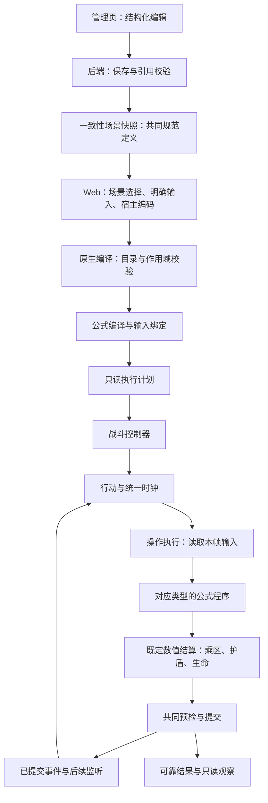

TASK_KEY: planning-engine-subsystem-refactor
DOC_TYPE: 概要设计
WORKSTREAM: planning
STATUS: active
EXECUTION_MODEL: 主负责人跨端实现、执行代理分端实现、领域独立复核
LAST_TRACKED_AT: 2026-10-09

# 通用计算引擎子系统拆分与公式数据驱动重构方案

## 1. 已确认范围与当前状态

负责人已经确认首轮边界：**伤害类型、属性引用、公式和公式内部阶段由数据定义，保留通用的伤害→护盾→生命执行框架，不建设可任意编排整体战斗流程的规则语言。**

本稿是架构与首批实施的唯一概要入口，不是逐文件搬迁清单。负责人已授权按实施顺序开发；结构、字段、错误与三端消费方式由[共同公式定义与校验详细设计](../../详细设计/项目/共同公式定义与校验详细设计.md)定义。第一、第二阶段及第三阶段的伤害类型、技能共同公式闭环已分别验收，正式保存、快照、原生求值及真实数据转换已切换到共同定义。现行六阶段业务仍按[阶段6详细设计](../../详细设计/项目/阶段6主动技能接入与混合时间线详细设计.md)运行；第四阶段的默认分支清理及后续固定语义收敛尚未完成。

源码核对基线：Wasm `wasm/dev` 的 `890ce742e`；Web `web/dev` 的 `38bb7bc9e`；后端 `backend/dev` 的 `3a55e61d4`；规划 `master` 的 `56fbb9011`。四个工作树调查开始时均干净。数据库结论来自当前DDL（表结构定义）和服务源码，不是本轮实库读回。

### 1.1 必须纠正的目标表述

“所有代码里不能有枚举或转换”不能作为验收标准。加减乘除、数值种类、协议字段、有限执行、事件排序和状态提交必然需要确定实现；取消这些约束会把问题变成开发另一套编程语言。

应禁止的是**按照具体游戏身份猜算法**：物理／魔法／真实类型分支、抗性属性别名、默认公式、固定五段名称、按属性名猜百分比含义，以及只把这些分支从Go搬到Java或TypeScript。

必要转换仍保留：结构解码、严格校验、目录标识转换为内部索引、表达式编译、宿主帧编码。它们不能夹带游戏公式。新增游戏伤害类型必须只增加数据，不增加业务代码分支；增加一种新的数学运算原语则仍需要代码和测试。

## 2. 当前问题不是没有模块，而是责任泄漏

| 当前事实 | 证据 | 需要改变的责任 |
| --- | --- | --- |
| 伤害类型在数据库中已经是普通数据行，公式属于该类型 | `C:/project/damage_backend_dev/db/game_manage/schema.sql:330` | 保留数据所有权，不能在执行端重新把目录缩成三种类型。 |
| Web只接受三种伤害类型转换 | `C:/project/damage_web_dev/web/src/engine/damageTypeAdapter.ts:2` | 去掉业务类型翻译，直接使用目录原标识。 |
| 五阶段名称与数量在三端各自固定 | `C:/project/damage_backend_dev/server/data_manage/src/main/java/xyz/game/datamanage/model/damagetype/DamageTypeCalculationFormula.java:3`；`C:/project/damage_web_dev/web/src/types/damageTypeFormula.ts:8`；`C:/project/damage_wasm_dev/wasm/tinygo_engine_v2/internal/model/generic_authoring.go:15` | 把阶段变成公式自己的有限命名结果，不再成为内核字段。 |
| Web重复解释属性取值、阶段引用和表达式，装备与主体各有装配 | `C:/project/damage_web_dev/web/src/engine/numericAdapter.ts:113`；`C:/project/damage_web_dev/web/src/engine/simulationAdapter.ts:249`；`C:/project/damage_web_dev/web/src/engine/simulationTriggeredEquipment.ts:114` | 共同表达式结构与引用语义；不让每个装配入口各造一套编译器。 |
| Go仍有默认类型白名单与抗性公式 | `C:/project/damage_wasm_dev/wasm/tinygo_engine_v2/internal/compile/generic.go:1510`；`C:/project/damage_wasm_dev/wasm/tinygo_engine_v2/internal/pipeline/resolver.go:199`；`C:/project/damage_wasm_dev/wasm/tinygo_engine_v2/internal/pipeline/resolver.go:258` | 所有进入正式计算的类型必须有作者公式；删除正式路径默认兜底。 |
| 公式上下文知道伤害五段、命中、弹药、充能与成本等具体场景 | `C:/project/damage_wasm_dev/wasm/tinygo_engine_v2/internal/formula/generic_eval.go:12` | 公式只知道数值与声明输入；场景读值由独立绑定层提供。 |
| 已编译运行结构归属于compile包，数值管道反向依赖它 | `C:/project/damage_wasm_dev/wasm/tinygo_engine_v2/internal/compile/generic.go:27`；`C:/project/damage_wasm_dev/wasm/tinygo_engine_v2/internal/pipeline/attribute_resolver.go:10` | 编译器只生产只读执行计划，计划数据类型独立于编译器实现。 |
| 暴击、伤害、帧、监听和复制等职责仍聚合在同一个执行文件 | `C:/project/damage_wasm_dev/wasm/tinygo_engine_v2/internal/runtime/generic_execution.go:642`；`C:/project/damage_wasm_dev/wasm/tinygo_engine_v2/internal/runtime/generic_execution.go:1726` | 按状态所有权及输入／输出边界分拆，不能只按行数换文件。 |

现行Web与后端已经拒绝缺少已用类型的防御公式，但拒绝条件仍依赖五阶段结构；不能因为已有公式字段，就认定从数据到执行的整个路径已经通用。

## 3. 目标子系统与状态所有权

下表是责任边界，不要求立刻建立十个包或十个接口。沿用已有职责明确的包；只有本批跨越的真实变化点才物理拆包。

| 子系统 | 自己负责 | 不得负责 | 当前落点与首轮变化 |
| --- | --- | --- | --- |
| 共同契约与目录 | 结构、稳定标识、数值种类、作用域、字段约束；将目录标识编为短索引 | 游戏公式、缺值猜测、对象专用算法 | model及typeset；新增共同表达式规范，类型引用不再靠名称或前缀推断。 |
| 公式 | 纯表达式验证、依赖分析、有限程序生成与数值求值 | 扣血、挂状态、找英雄、改时钟、决定哪个属性是抗性 | formula；首轮解除五阶段及战斗对象上下文依赖。 |
| 输入绑定与属性读值 | 将声明引用绑定到真实双方、槽位、参数或快照；提供只读输入 | 根据属性名称补别名或默认0、偷偷应用游戏比例 | 从Web数值编译及runtime求值上下文抽离；首轮实现原标识与明确取值口径。 |
| 规则编译与只读计划 | 检查完整选择与依赖、调用各领域编译器、组装可复用执行计划 | 产生战斗扣血、保存运行态、按伤害类型补算法 | compile生产计划；共享的编译后数据不由编译器包独占。 |
| 行动与过程 | 使用身份、开始／释放／命中关联、冷却、有限步骤、行动占用 | 计算物理减伤、解释原始公式JSON、直接写生命 | 现有过程与行动模块；本轮保持既有语义，后续再分离控制器和过程状态。 |
| 驱动与时钟 | 按明确驱动策略发起尝试、维护唯一计时和确定顺序 | 解释伤害公式、选择游戏伤害类型、自动猜最优施法 | scheduler与普攻／技能驱动；自动按CD施法仍是独立功能，不借架构改造宣称已支持。 |
| 供值器、状态与事件 | 挂载身份、状态实例、生命周期、监听匹配；产出操作意图 | 绕过提交直接改数值，自己建立第二套时钟 | 现有供值器、状态、接收事件与监听代码；后续按状态所有者分拆。 |
| 数值结算 | 按已确认框架消费公式结果、乘区、护盾、生命及治疗结果 | 默认抗性公式、伤害类型白名单、重复执行作者算法 | pipeline及伤害结算；首轮用明确类型公式代替原生兜底。 |
| 状态提交 | 唯一拥有可变战斗状态；预检、提交本帧变化及相关事件 | 在写入过程中继续求作者公式或执行不受控业务回调 | 执行帧与提交代码；首轮不冒称整条事件链可回滚，后续再收敛提交边界。 |
| 会话、结果与宿主 | 会话复用／释放、可靠累计、有限记录、采样与编码 | 修改战斗状态、把采样当时钟、把记录反推为完整结算 | session、采样、结果与Worker（浏览器后台工作线程）；首轮保持正式导出与清理契约。 |

### 3.1 包依赖应当单向

公式程序只依赖共同的表达式和读值描述；不得导入战斗执行、伤害类型服务或数值管道。伤害类型子系统持有数据定义的公式，不反过来让公式求值器识别“物理”。

只读计划可以放在独立的 `internal/plan`（执行计划）中。编译器生产计划；执行、过程和数值模块消费计划，不依赖compile内部实现。这是实际依赖边界，不是给现有函数再包一层转发。

输入绑定层有真实的两类读视图：当前帧视图和已冻结事件视图。公式获取的是已声明输入槽，不是可变角色map或含几十个业务标志的万能上下文。

战斗控制器拥有模块组合与单次运行生命周期；各模块通过明确的只读视图和操作结果合作。首轮不引入动态插件、反射、并发任务或多线程。

## 4. 数据到执行如何组合

关键改变：**Web不再是业务公式编译器；后端不生成Wasm指令；Wasm不猜游戏公式。** 后端提供完整规范定义，Web运输并绑定明确场景，原生校验与编译后负责数值执行。

首轮只规范化公式、伤害类型和相关属性／参数引用。现有技能过程、命中事实及其他宿主装配不顺带全部迁到后端；也不新增版本发布平台或离线发布链。

## 5. 首轮公式契约

以下是首轮详细设计的收敛约束，不代表接口已经上线；字段最终拼写及完整结构约束在实施前一次冻结。

### 5.1 一个表达式模型，不再两套业务翻译

技能公式与伤害类型公式都使用结构化数值节点。保留固定值、有限算术、比较、条件、取整／限制、显式引用等已经具有实际使用场景的原语，不新增脚本文本、循环或任意调用。

不同使用点可以声明不同输入权限，但不能各自发明另一种表达式树。技能参数仍归属技能；类型公式仍归属伤害类型，不另建无所属关系的全局公式管理表。

### 5.2 命名中间结果代替固定五字段

公式由 `stages`（命名中间结果列表）及 `outputStageKey`（输出结果标识）构成。每项保存稳定标识、中文名称和表达式。单表达式也使用同一模型。

列表顺序只用于展示。引用明确指向本公式的中间结果；编译器按有向无环依赖排序。重复标识、输出不存在、跨公式偷读、悬空引用和循环均报错；更改中文名称不能改变计算。

原五段公式可以原样转换成五个普通命名结果。新公式可以只有一段、两段或六段；内核不识别“基础抗性”“百分比穿透”等名字，也不限定恰好五项。

每个表达式和整个命名结果图都有预算。首轮以现有32层、256节点作为收敛基线，但256覆盖整份公式，而不是每阶段各获256；引用链深度、展开后的指令数、读值槽和栈容量共同检查。共享结果编译一次，不反复内联到指数增长。所有声明都做结构与引用校验，不静默丢掉非法分支；执行只求选中的条件分支。

**单份公式合法不等于会话总量合法。** 首批共同契约还必须限定会话累计程序数、指令数、目录／读值索引与内存预算。当前程序编号为 `uint16`（16位无符号整数），部分注册入口直接缩窄数组长度；若继续沿用该表示，第65537个程序会静态可推导地回绕为编号0，而不是被求值数组越界检查发现。所有注册入口必须在窄化前拒绝超限，实际允许总量同时受索引范围与内存预算约束，不扩大到未经测量的容量。验收包含真实上限和上限加一，证明不会覆盖或串用程序。证据：`C:/project/damage_wasm_dev/wasm/tinygo_engine_v2/internal/formula/generic.go:11`、`C:/project/damage_wasm_dev/wasm/tinygo_engine_v2/internal/compile/generic.go:1081`；这是本轮静态复核发现，未运行超限复现，也未修改现有实现。

### 5.3 属性身份与读值口径明确

属性引用保存所属对象、原属性标识和取值口径，不由Web生成 `source.attr.xxx` 字符串再让Go解析业务含义。来源和目标指本笔计算的实际参与者；供值器拥有者、事件参与者与冻结时点另有显式声明，不因监听器换拥有方而偷换。

基础、加成、最终、当前、最大、已损和比例等口径必须有共同定义。需要派生计算的口径，由输入绑定／属性读值层按明确元数据或表达式处理；不能根据 `percent`、`armor` 或某个英雄名字猜测算法。

未知目录标识在编译时拒绝；声明存在但本次缺值在求值时报告具体引用路径；合法0不能回退到Current。明确声明的状态初值是输入数据，不等于缺值兜底。

### 5.4 伤害类型的输出语义

**首轮伤害类型公式输出有限、非负的防御倍率，不输出任意状态操作。** 这是已保留的通用防御位置接口，而不是根据类型名称写死倍率。既有普通／暴击分支继续各乘同一倍率，后续乘区、护盾与生命执行不重新排序。

选择倍率而不是任意最终金额，有实际边界理由：当前结算保留普通与暴击期望分支；若类型公式任意执行“整体扣固定值”等非线性变换，需要重新定义各分支分配，不能声称只是公式替换且业务行为不变。固定减伤仍由既有明确修正位置处理，本轮不扩整体结算语言。

倍率可以是0、1或大于1，只要由完整配置明确算出且有限、非负。没有公式必须失败，不能默认1；无抗性类型必须明确配置常量1。公式没有权限扣护盾、扣生命、发事件或改冷却。

技能原始伤害、治疗与其他金额仍可由同一个纯数值公式子系统输出金额；类型公式作为其中一个有明确数值接口的使用点，不代表公式子系统只能算倍率。

### 5.5 数值精度不能靠字符串口号保证

持久化与定义运输保留十进制原值，不让Web先把高精度常量改成JavaScript数值再序列化。待算常量使用严格的十进制字符串声明，原生统一解析和检查非有限／越界值。

数学执行首轮继续使用64位浮点，以保持现有TinyGo确定性与性能基线；不声称任意十进制数学无损。舍入只在规则明确声明时执行，整数计数和毫秒期限继续受安全整数约束。结构／整数比对精确，浮点数值按共同详细契约规定的误差界验收，不同时维护三端不同的舍入公式。

## 6. 三端适配与数据库处理

### 后端与数据库

复用属性、参数、技能公式、伤害类型、技能结果、过程及关系表。首轮没有必须新增的业务表。

伤害类型的 `calculation_formula`（结算公式）和技能公式的表达式字段改用共同模型；JSONB（结构化JSON存储）仍可以承载表达式，不把外键对象身份吞进一个万能大JSON。

后端保存检查结构、目录身份、启停状态、作用域、阶段引用与预算；场景快照在既有一致性读取范围内输出完整定义与依赖。原生仍独立验证输入，不能只信任后端说合法。

引用索引必须覆盖伤害类型公式和规范引用，明确同游戏归属；JSON中引用由服务／引用索引维护，不能把它宣传成已存在数据库外键。定义修订、引用清理和索引维护须同事务，继续使用现有游戏行锁。

### Web

管理页使用共同节点模型，支持增删和命名中间结果、选择输出、编辑依赖、查看错误与保存后回读；保留草稿和原配置摘要确认。

计算页只选择来源、等级、开关、计划及运行输入；共同公式定义按规范送入编译请求，不按伤害名称或属性名字重绑。删除三种类型限定的 `damageTypeAdapter` 业务分支及公式相关重复解释。

保留表单解析、网络读取、Worker、取消、帧编码及释放。来源筛选、过程编译和必要宿主接线仍按本批明确范围处理，不把首轮变成整个Web引擎适配层重写。

### Wasm

公式子系统分清定义校验、依赖编译、输入绑定、程序求值；纯求值器不导入战斗执行或伤害子系统。类型公式由目录索引定位，调用已经编译的程序，不再按物理、魔法或真实字符串选择算法。

共享执行计划独立于编译器；数值结算读取类型公式结果，不解析作者JSON，也不再调用默认抗性解析器。严格缺值成为一致语义，不再在不同入口选择是否偷偷补0。

共同结构规范在规划主分支维护唯一来源，生成或检查三端类型／结构约束；结构一致不代替语义一致，语义用同一组输入与错误样例验收。改变新规范时同步更新三端，不增加双读、旧字段识别或运行时兼容转换。

## 7. 破坏式更新与非目标

旧五字段公式进行一次性、可审计的数据转换，保持原表达式、引用与数值含义，不按类型名称补模板；它不是常驻兼容层。类型未配置的行可以继续留作管理草稿，但不得进入实际编译闭包。

真实迁移前冻结所有前值和引用计数，先离线验证转换与旧口径算术，再按同游戏事务写入并独立读回。失败整批回滚，不能先提交新公式再补引用。没有授权和目标核对前，不删除真实数据或直接改实库。

当前固定基准样例不改写、不复制改期望来迁就实现。移除默认分支会改变旧输入的准入，应先保存原基准输出，再为新协议建立独立明确输入和同口径对照；实施时调整验证入口必须说明协议变化，不把旧协议测试的删除算作回归通过。

首轮不包含：完整结算流程编排、任意脚本／插件、任意精度库、随机暴击、新吸血分类、空间和多目标、自动最优连招、自动按CD施法、版本发布平台，或把所有子系统一次重写。

暴击期望合成、治疗／吸血及其他尚未迁移的固定语义另列后续规则收敛，不能在首轮验收后宣布内核已没有任何游戏口径。保留通用框架不等于允许伤害类型默认兜底继续隐藏。

## 8. 实施顺序与独立交付

| 顺序 | 完成什么 | 独立退出条件 |
| --- | --- | --- |
| 一，共同定义 | 冻结表达式、命名结果、结构引用、数值与错误契约；确定唯一结构规范及三端消费方式 | 同一合法／非法样例三端结论一致；定义不含物理／魔法／真实白名单或固定五项。 |
| 二，公式与绑定 | 从现有Go实现收敛纯编译／求值，把战斗上下文读取交给绑定；引入独立只读计划 | 公式可脱离战斗运行；未知、缺值、合法0、分支、依赖环与预算均被验证。 |
| 三，真实类型闭环 | 管理保存新结构、后端快照、Web原样运输、原生类型计算共同接通 | 新类型与非五段公式无需改业务Go／TS，真实页面和最终Wasm按配置算出数值。 |
| 四，删除旧分支 | 删除旧类型翻译、原生默认抗性、固定五段容器及本批重复公式解释；重新冻结产物 | 最终源代码无正式路径残留；既有普攻、主动、装备及复制伤害同口径回归与压力通过。 |
| 后续，模块组合收敛 | 按状态所有权依次分离数值规则、过程／驱动、事件／状态与提交；每批保留同一时钟与可靠结果 | 每批有真实调用边界及行为证据，不因新增包目录就宣布架构完成。 |

当前顺序一及二已独立交付，分别见[第一阶段验收](../../测试记录/项目/共同公式定义与三端校验第一阶段验收-2026-10-07.md)和[第二阶段验收](../../测试记录/项目/纯公式与执行计划第二阶段验收-2026-10-07.md)。顺序三的伤害类型闭环见[第三阶段A验收](../../测试记录/项目/伤害类型共同公式第三阶段A验收-2026-10-08.md)，技能共同公式见[第三阶段B验收](../../测试记录/项目/技能共同公式第三阶段B验收-2026-10-09.md)，共享契约由[第三阶段B详细设计](../../详细设计/项目/技能共同公式闭环详细设计.md)维护。顺序四及后续仍未完成，不把作者协议切换算作全部旧分支清理。

公式首批允许写入的实现范围：后端数值／公式模型、校验、引用索引和快照；Web共同类型、公式编辑与本批装配；Wasm model、formula、目录／绑定、编译与对应类型结算；必要的迁移和针对性测试。其他治理、部署、认证及未涉及技能机制不得顺手修改。

阶段二、三的字段与错误详细设计完成并独立审阅后再开始代码实施。本稿不要求负责人逐函数审代码，也不以模型名称替代架构验证。

## 9. 验收必须能反证业务硬编码

1. 在管理页新增测试类型 `heat`（灼热）和普通属性 `heat_resistance`（灼热抗性），配置两项命名结果：读取目标抗性，计算 `100/(100+抗性)`。这条游戏公式只在测试配置中存在。
2. 原伤害120、抗性50，防御后80；护盾30先吸收，生命1000变950。再用六项等价结果配置，金额与顺序不变；中间中文名和展示顺序变化不改变语义。
3. 类型键、属性键换成其他合法标识仍可执行，不修改Go／TS伤害分支，不重新构建Wasm；数据库保存、快照、编译、Worker实际执行与释放分别留下证据。
4. 无抗性类型显式配置1；减伤为0的合法结果保留0。缺公式、未知类型、未知属性、缺输入不能变成1或0，也不能当成真实伤害绕过防御。
5. 重复／循环结果引用、未知字段、越界和动态除零在各自阶段确定性失败；错误保留原配置路径、来源与使用身份，不能吞成普通未命中。
6. 物理、魔法、负抗性、穿透边界、暴击期望、附伤、幻影复制、吸血和真实过程的既有有限组成，同口径只结算一次，事件时点和来源开关不改变。
7. 原生全量检查、基准、最终Wasm、同会话压力与浏览器证据按模块规则分别验收；定义传输精度与运行浮点误差分开说明。不得只拿单元测试或公式预览当作真实战斗完成。
8. 未完成整体流程编排、自动施法和全英雄覆盖仍明确保留，不借“通用”一词扩大已交付范围。

9. 除单份节点与依赖预算外，构造会话累计程序／索引恰达上限及超过上限的请求；合法编号唯一，超限在生成短索引前拒绝，不把回绕后的错误程序执行记为成功。

## 10. 参考方式与取舍

共同表达式语言CEL的官方说明把输入环境声明、解析、检查和求值分开，并推荐编译一次、多次执行；本方案借鉴这个边界，不引入其完整运行库，也不承诺未经TinyGo验证的依赖。见[CEL官方概述](https://cel.dev/overview/cel-overview)。

虚幻引擎的技能效果系统将不可变效果定义、运行实例、属性与执行计算分开。本方案借鉴定义／实例／执行的责任分离，不照搬游戏专用C++计算类、网络复制或大型引擎组件。见[官方技能效果说明](https://dev.epicgames.com/documentation/en-us/unreal-engine/gameplay-effects-for-the-gameplay-ability-system-in-unreal-engine)。

现行管理契约入口：[伤害类型结算公式管理](../../详细设计/项目/伤害类型结算公式管理详细设计.md)、[技能参数与公式管理](../../详细设计/项目/技能参数与公式管理详细设计.md)。它们描述已交付旧结构；实施新协议时必须明确替代相关章节及迁移边界，不让两套公式结构同时成为当前真源。
