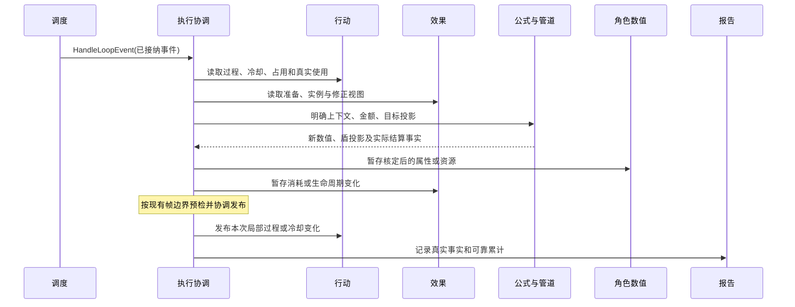

TASK_KEY: planning-engine-subsystem-refactor
DOC_TYPE: 详细设计
WORKSTREAM: planning
STATUS: draft
EXECUTION_MODEL: Codex 主负责人起草，内置代理独立只读复核
LAST_TRACKED_AT: 2026-10-29

# Wasm子系统接口设计草案

## 1. 本稿的用途与第一版取舍

本文承接[子系统职责与协作现状](../../概要设计/项目/Wasm子系统职责与协作现状及调整方向.md)，先约定各子系统可以提供什么能力、接受什么输入、返回什么结果以及怎样交接状态，供后续调整。源码核对基线为2026-10-29的 `e60ed79e70a86c1c64dca2e6f50dd76d5f4ca3cf`。

子系统由**职责、自己维护的状态及不变量、对外能力**共同组成。接口是协作入口；仅列函数名和参数，不能说明哪个调用可以发布状态，也不能说明失败后已经发生了什么。

第一版建议保留现有十项职责和基础六包：对已经合理的入口，沿用真实数据类型；重点提出调度与执行之间的有限交接。本文不是新增HTTP接口或新增Wasm导出的方案，内部参数也不要求全部编码为JSON。

| 标记 | 本文含义 |
| --- | --- |
| **沿用** | 当前存在的能力，本稿建议继续保留；表中只列代表性协作入口，完整公开方法集合仍以源码的能力声明为准 |
| **拟收敛** | 本稿提出的候选名称、参数和返回值，尚未实现，不能据此调用或认定已有支持 |
| **待调整** | 已给出第一版建议，用户可以修改取舍；不以“写入文档”代替决定和实现验收 |

本稿不改写现行数学、机制准入或正式字段语义。[运行时与分组设计](运行时子系统拆分与数值修正分组实施详细设计.md)、[共同公式契约](共同公式定义与校验详细设计.md)、[纯公式与计划设计](纯公式编译求值与执行计划拆分详细设计.md)继续拥有相应定义。本文列出的既有字段是阅读摘要；新增候选类型只在第5节定义一次。

## 2. 所有接口共同遵守的规则

### 2.1 调用范围与状态所有者

| 调用方 | 可以取得的能力 | 写入边界 |
| --- | --- | --- |
| 前端宿主 | 编译、运行、释放及字节运输 | 不直接调用角色、效果或调度内部接口 |
| 会话与根运行入口 | 编译计划、创建唯一循环及执行器 | 会话保存规则，单场状态另建 |
| 执行协调 | 角色／行动／效果的查询与暂存，公式和结算，排程与报告 | 负责跨子系统提交；不把整个执行器传给状态子系统 |
| 调度循环 | 执行层提供的有限决策、事件处理和观察回调 | 独占时钟推进、事件接纳计数及停止账 |
| 角色／行动／效果 | 各自局部状态、只读交换值和必要计算适配 | 不互相调用全局发布，不持有另一套事件堆 |
| 报告 | 真实尝试、已提交数值和观察值 | 不决定技能资格，不改战斗状态 |

所有内部调用默认同步、单线程。实际高频调用继续优先使用具体类型；文档中的能力分组不要求增加动态接口分派、服务注册器或转发层。

### 2.2 身份、时间、数值和返回值

| 内容 | 第一版约定 |
| --- | --- |
| 拥有者、来源、目标 | `ownerKey` 表示能力或实例归属，`sourceKey` 表示行为来源，`targetKey` 表示本次实际作用目标；三者不能随意互换，必须保留实际场景身份 |
| 角色／能力引用 | 沿用已准入的角色键、完整能力引用和挂载引用；不能只用技能键代替完整使用身份 |
| 过程／行动引用 | 沿用 `contract.ProcessRef/ActionRef` 的 `{Slot int, Present bool}`；0号槽合法，引用只在本场有效，恢复后重新登记 |
| 冷却身份 | 沿用 `CooldownIdentity` 的拥有者、挂载、能力、状态键、作用范围及目标等完整字段；不得只保留截止时间 |
| 时间 | `now/at/readyAt/expireAt` 是模拟绝对毫秒，`duration/interval/delta` 是时长；唯一时间来源为循环，子系统不读取系统墙钟 |
| 缺失与零 | 查询使用存在标记；有效0、空集合、未采集和不存在按各自契约区分，不统一补零或统一改为空数组 |
| 属性槽 | 沿用 `AttributeSlotDef` 的 `base/current/max/resolved` 及实际存在性；不能只传一个数抹去属性口径 |
| 资源槽 | 沿用 `ResourceSlotDef{Current, Max float64}`；是否存在由查询结果表达，资源计算的上限规则由管道负责 |
| 数值金额 | 在对应编译、门禁或结算入口检查有限性、符号和范围；不能把基础夹取函数当作全部业务校验 |
| 数值读取 | `Lookup(key)` 的存在标记与返回值一起使用；“剩余冷却为0”可以表示就绪，不独自证明冷却身份存在 |

### 2.3 五种使用性质

| 性质 | 调用者得到什么 | 能否跨后续发布保留 |
| --- | --- | --- |
| 纯计算 | 由明确输入计算出的值、新属性表或结果投影 | 按该值的所有权约定保留，不自动发布战斗状态 |
| 只读借用 | 当前对象的有限读取入口 | 只在约定期限内使用；活视图可能随发布看到新值 |
| 读取准备 | 经过元数据、惰性到期或缓存投影准备的视图 | 准备可以改变所属缓存或状态头；不能当作无副作用查询 |
| 历史冻结 | 指定时点可保留的状态或事实 | 依照实际冻结契约保留；复制外层列表不等于深复制 |
| 暂存与发布 | 一项局部变化，或所属子系统的新状态 | 写句柄不能跨冻结、共享或发布继续复用；局部发布不等于全局提交 |

### 2.4 错误、跳过与结束分别表达

沿用已有返回方式，不增加统一的“大结果对象”：

- 编译可以收集多项问题，返回 `ok=false/errors[]`；纯表达式返回结构化的首个问题。
- 内部运行错误使用现有 `*model.EngineError`；战斗公式和部分数值计算使用现有 `error`，由执行层补上程序、路径和场景身份。
- 条件未满足、冷却未就绪等正常跳过沿用跳过原因与等待结果，不全部改成异常。
- 有些布尔值表示“存在”“数值可接受”“可以保留明细”或“确有变化”，必须按方法解释，不能统一当作成功标志。
- 停止原因、运行完整性、明细截断分别输出。`DoneResult.ok=true` 不等于整场按预期完整完成，`recoverable` 也不表示失败事件已经回滚。

## 3. 宿主协议与会话接口

### 3.1 正式调用，沿用

下表的数字是现有帧类型。导出函数返回的 `int32` 只表示0或-1，业务内容从出箱读取；帧编码及JSON完整定义继续以源码为准。

| 能力 | 入参 | 业务响应 | 生命周期与失败 |
| --- | --- | --- | --- |
| `engine_compile(ptr uint32, size uint32) int32` | 指向200编译请求帧的地址和长度 | 210帧中的 `model.CompileResult` | 成功登记可复用计划；编译拒绝可返回210且 `ok=false`，解析等失败可返回212错误帧 |
| `engine_run(ptr uint32, size uint32) int32` | 指向201运行请求帧的地址和长度 | 211帧中的 `model.DoneResult` | 校验会话和规则身份，每次创建独立战斗状态；失败返回212错误帧 |
| `engine_release_session(ptr uint32, size uint32) int32` | 指向202释放请求帧的地址和长度 | 214帧中的 `GenericReleaseDonePayload` | 删除编译会话；重复释放返回 `session_not_found`，不是幂等成功 |

内部会话仍使用 `Session.CompileFrame/RunFrame/ReleaseSessionFrame(input []byte) int32`。JSON接线和正式导出共用同一会话语义，不另建子系统入口。

运输能力沿用 `alloc/dealloc` 与 `engine_outbox_ptr/len/clear`。宿主先复制出箱内容，再清理出箱；出箱借用在下次写入或清理后失效。清理出箱、释放输入、释放会话是三件事，当前正式清箱导出还执行垃圾回收。

源码：[正式导出](../../../wasm/tinygo_engine_v2/cmd/engine_wasm/main.go)、[会话能力声明](../../../wasm/tinygo_engine_v2/internal/runtime/session.go)、[帧类型与错误](../../../wasm/tinygo_engine_v2/internal/model/generic.go)。

### 3.2 编译请求与响应

**入参：`model.CompileRequest`。** 它是生产适配器转换后的通用定义，不是直接提交原始管理配置。

| 字段 | 类型／内容 | 输入含义 |
| --- | --- | --- |
| `schemaVersion/schemaHash/rulesHash` | 字符串 | 协议及规则身份，沿现有校验；不能直接当作未来浏览器数据版本 |
| `typeCatalog` | `TypeCatalog` | 明确类型目录及关系 |
| `combatants` | `[]CombatantDefinition` | 当前双角色定义：键、属性、资源、类型与挂载 |
| `sharedProviders` | `[]ProviderDefinition` | 可复用供值器及其能力、操作、过程、修正、监听和生命周期 |
| `rules` | `RulesContainer` | 共同规则、技能行动绑定及相关契约 |
| `formulas` | `[]NamedFormula` | 明确声明的公式 |
| `settings` | `GenericCompileSettings` | 编译选项和允许范围 |

**响应：`model.CompileResult`。** 保留 `ok/sessionId/schemaVersion/schemaHash/rulesHash/metadata/warnings/errors`。成功时宿主取得会话编号，编译计划留在Wasm内部。`metadata` 中的已核定静态值只对应本次成功编译，不构成任意公式求值服务。

完整结构：[编译请求](../../../wasm/tinygo_engine_v2/internal/model/generic_compile.go)、[结果与问题结构](../../../wasm/tinygo_engine_v2/internal/model/generic.go)。

### 3.3 运行请求与响应

**入参：`model.RunRequest`。**

| 字段 | 类型／内容 | 使用约束 |
| --- | --- | --- |
| `sessionId` | 字符串 | 必须引用仍存在的编译会话 |
| `expectedRulesHash` | 字符串 | 正式运行实际要求非空且匹配；不能因JSON标签含省略选项就当作可不传 |
| `schemaVersion/schemaHash/rulesHash` | 现有身份字段 | 按实际会话校验，不创建第二套身份 |
| `initialSnapshot` | `Snapshot` | 起始时刻、双方状态、过程及使用额度；必须满足对应机制的恢复／新鲜初态约束 |
| `driverPlan` | `DriverPlan` | 显式行动与自动／普攻／通用驱动配置；仅开放既有准入范围 |
| `stopPolicy` | `StopPolicy` | 时长、死亡、无事件等停止规则 |
| `safetyBudget` | 可选 `RunSafetyBudget` | 按现有驱动类型、具体字段及编译／运行预算规则校验，不统一解释成所有字段都只能收紧 |
| `outputMode` | 详细或汇总 | 省略沿现有详细模式；汇总模式只减少明细 |
| `sampling/recordBudget` | 采样及记录配置 | 与战斗执行、安全预算分别负责 |
| `processCommandFacts/skillUses/skillHitFacts/attackStartFacts` | 对应的有界事实数组 | 严格校验真实身份及来源，不能作为宿主任意伪造已成功事件的入口 |
| `runtimeOptions` | 现有 `json.RawMessage` 运输字段 | 当前原生执行不据其内容建立行为；未知或非对象内容沿现有忽略行为处理，宿主元数据不授予新机制资格 |

**响应：`model.DoneResult`。**

| 输出组 | 内容及消费者必须区分的口径 |
| --- | --- |
| `ok/summary` | 汇总数值、`stopReason`；存在执行完整性字段时，还需读取 `complete/incompleteReason/budgetCause` |
| `finalSnapshot` | 执行层组合的本场末态，不是报告子系统单独生成 |
| `recording` 及专项记录信息 | 哪些明细完整、截断或未保留 |
| 行动、使用、伤害、治疗、机制及专项明细 | 按模式和实际路径输出，不能假定所有数组永远同时出现 |
| `series/seriesSamplingEvidence` | 采样序列及其口径，汇总模式不自动关闭采样 |
| `warnings/evidence` | 警告、证据和计数，展示明细不能代替运行资格所需事实 |

完整结构：[运行与快照](../../../wasm/tinygo_engine_v2/internal/model/generic_run.go)、[运行结果](../../../wasm/tinygo_engine_v2/internal/model/generic_run_output.go)。

### 3.4 释放与错误

释放入参为 `ReleaseSessionRequest{sessionId, expectedRulesHash?}`，其中规则摘要可选；响应为 `{ok, sessionId, released}`。不存在会话、摘要不符、写出失败沿现有错误处理。会话已删除后若结果写出失败，不恢复登记。

`EngineError` 沿用 `ok/phase/code/message/path/ref/severity/recoverable/details/schemaHash/rulesHash/sessionId`。内部预算原因不直接作为同名JSON字段输出。宿主根据阶段、代码和路径定位问题，不凭是否收到响应推断状态回滚。

## 4. 内部九项协作能力

本节与第3节合计覆盖十项主要职责。表中类型均来自现有Go包；“沿用”不表示应公开更多私有方法，也不删除能力目录中未在本文逐一列出的公开方法。

### 4.1 规则编译与执行计划，沿用

| 能力 | 入参 | 返回值与契约 |
| --- | --- | --- |
| `compile.CompileGeneric` | `model.CompileRequest` | `compile.GenericCompileResult`，内部含 `OK bool`、`Session plan.CompiledSession` 和 `Result model.CompileResult` |
| 读取编译计划 | 成功编译后的 `plan.CompiledSession` | 规则身份、角色模板、供值器／能力／操作、公式、过程／命中绑定及索引；按只读约定消费 |
| 建立本场公式表 | `compiled.Formulas.CloneForRun()` | `*formula.GenericRegistry`，本场可以追加，不能污染共享计划 |

编译失败时不能消费返回的计划或失败注册的编号。计划中的切片、映射和程序内部不保证深不可变；只读约束仍需调用方遵守。`CloneForRun` 复制本场可追加的表及索引，不是全面深复制。

执行计划是数据，不增加“计划服务”。原始管理配置的解释与转换由前端生产适配器负责，Wasm编译器复核最终通用定义。

源码：[编译入口与返回结构](../../../wasm/tinygo_engine_v2/internal/compile/generic.go)、[执行计划](../../../wasm/tinygo_engine_v2/internal/plan/compiled.go)。

### 4.2 执行协调，沿用主入口，内部边界待收敛

| 能力 | 入参 | 返回值与副作用 |
| --- | --- | --- |
| `execution.New` | `compiled plan.CompiledSession, req model.RunRequest, loop *scheduler.Loop` | `(*Engine, *model.EngineError)`；建立本场状态，借用根入口的同一个循环 |
| `Engine.SelectLoopEvent` | `scheduler.GenericEvent` | `(scheduler.GenericEvent, *model.EngineError)`；处理既有同刻特殊选择，不能推进时钟 |
| `Engine.HandleLoopEvent` | 已接纳的 `scheduler.GenericEvent` | `*model.EngineError`；经门禁、操作和执行帧改变本场状态 |
| `ObserveBefore/ObserveThrough` | `at int64` | 无返回值；在规定观察点读取已提交状态 |
| `SettleLoopEnd` | 当前本场状态 | `*model.EngineError`；完成现有结束结算 |
| `Engine.Finish` | 循环已结束的本场状态 | `(model.DoneResult, *model.EngineError)`；组合末态、累计、完整性及输出 |
| `Frame.DamageStateBefore` | `key string` | `(float64, error)`；读取获得资格的逐伤前事实 |
| `Frame.LinkedShieldPresent/ReceivedLinkedShieldAbsorbed` | 编译后的 `index uint16` | `(float64, error)`；区分合法零值和缺少真实事实 |

根运行组合继续为：

```go
RunGeneric(compiled plan.CompiledSession, req model.RunRequest) (model.DoneResult, *model.EngineError)
```

门禁、操作路由、暂存、预检及提交保持执行包内部职责。当前 `Frame.commit()` 是私有无返回值方法，失败由 `fatal/fatalErr` 等私有状态传播；不存在一个已实现的公开 `CommitAll() error`。

第一版不承诺全链原子回滚。当前提交边界为现有预检、数值／冷却／效果／状态包发布、生命周期、过程、队列、事实和死亡关联处理；部分发布之后仍可能失败。每个调用点要能解释失败前已经发生的事实。

源码：[执行器](../../../wasm/tinygo_engine_v2/internal/runtime/execution/engine.go)、[循环适配](../../../wasm/tinygo_engine_v2/internal/runtime/execution/loop_driver.go)、[执行帧与提交](../../../wasm/tinygo_engine_v2/internal/runtime/execution/frame.go)。

### 4.3 调度与唯一时钟，现有接口及收敛范围

| 现有能力 | 入参 | 返回值与约束 |
| --- | --- | --- |
| `scheduler.NewLoop` | `start, duration int64, policy model.StopPolicy` | `*Loop`；起点与时长分开，不把duration当截止时刻 |
| `Loop.Run` | `driver LoopDriver` | `*model.EngineError`；驱动现有唯一循环 |
| 时钟／计数查询 | 无额外参数 | `TimeMs/StartMs/DurationMs` 返回 `int64`；`ProcessedEvents` 返回 `int` |
| `Loop.Advance/AcceptEvent` | `at int64` | 无返回值；只由循环推进时间，后者同时增加已接纳事件计数 |
| `Loop.Stop/Finalize` | 停止原因／`LoopStopState` | 无返回值；按现有优先级核定停止账 |
| `Loop.Queue` | 无 | `*GenericHeap`；当前实际可写堆，拟收敛为第5.1节有限能力 |

当前 `LoopDriver` 的事实输入为 `LoopState` 与 `LoopStopState`，另含选事件、处理事件、观察、结束、等待发布和预算回调。当前循环仍读取普攻／主动／手动等业务事实；第5.2节提出决策值交接，不把它写成已经实现。

事件沿用 `scheduler.GenericEvent`，至少需要正确填入时刻、类别、种类及对应业务身份；优先级、序号、过程步骤版本、等待版本和实例世代不能丢失。不用 `map[string]any` 另造一套通用事件载荷。

源码：[循环与驱动协议](../../../wasm/tinygo_engine_v2/internal/scheduler/loop.go)、[事件结构及稳定堆序](../../../wasm/tinygo_engine_v2/internal/scheduler/generic_heap.go)。

### 4.4 角色数值，沿用

| 能力 | 入参 | 返回值与契约 |
| --- | --- | --- |
| `actor.New` | `key string, attributes attribute.Table, resources map[string]model.ResourceSlotDef` | `actor.State`；由执行初始化提供完整核定值 |
| `State.Attributes/Resources/HPMaxAnchor` | 已提交状态 | 分别返回 `attribute.Table/model.ResourceView/float64` |
| `actor.Stage` | `State` | `ChangeSet`；建立局部暂存 |
| `ChangeSet.Clone` | 当前暂存 | `ChangeSet`；按所属复制规则建立分支 |
| `ChangeSet.SetAttributes` | `attribute.Table` | 无返回值；暂存已经计算好的属性 |
| `ChangeSet.SetResource` | `key string, slot model.ResourceSlotDef` | 无返回值；暂存已经核定的资源槽 |
| `ChangeSet.FreezeResources` | 当前暂存 | `model.ResourceView`；保留该时点资源读值 |
| `ChangeSet.Publish` | `base State` | 新 `State`；调用方在统一提交中安装，不发布其他子系统 |

角色数值不提供独立执行伤害的接口。伤害需要同时解释护盾、生命、行动和事实，仍由执行协调组合。角色也不直接保存技能行为对象。

源码：[角色状态、暂存与发布](../../../wasm/tinygo_engine_v2/internal/runtime/actor/state.go)。

### 4.5 行动、过程、冷却与等待，沿用

| 能力 | 入参 | 返回值与契约 |
| --- | --- | --- |
| 建立行动 | `NewSkillAction(seed SkillActionSeed)` | `*SkillActionView`；随后经 `State.RegisterAction/AddManualAction` 登记 |
| 接受与结束尝试 | `State.Accept(a *SkillActionView, use string, initial bool)`；`FinishAttempt(a *SkillActionView, now int64, err *model.EngineError)` | 前者局部转换无返回；后者返回 `model.SkillActionRecord`，不完成整场提交 |
| 建立与查找过程 | `NewProcess(seed ProcessSeed)`；`State.Process(ref contract.ProcessRef)` | `*ProcessView`；登记使用 `State.AddProcess`，查询缺失不当作0槽 |
| 暂存过程 | `StageProcess(original *ProcessView)` | `*ProcessChangeSet`；`View()` 借用暂存过程 |
| 发布过程 | `ProcessChangeSet.Publish(original *ProcessView)` | 无返回；原地更新稳定过程对象，旧活视图随后可见新值 |
| 保存历史 | `ProcessView.Freeze/Snapshot` | 分别返回 `*ProcessView/model.ProcessInstanceSnapshot`；与活借用区别使用 |
| 真实冷却查询 | `CooldownLedger.Entry(id contract.CooldownIdentity)`；`View()` | `(CooldownEntry, bool)`；`contract.CooldownView` |
| 启动／提交冷却 | `Start(id, duration, now)`；`CommitOrdinary(id, readyAt, now)`，时间参数均为 `int64` | 前者返回 `(changed, valid bool)`；后者无返回并保留实际普通冷却总时长来源 |
| 减少冷却 | `Subtract(id, delta, now)` | `(changed, expired bool, readyAt int64)`；减量与绝对就绪时刻分别解释 |
| 登记等待 | `RegisterWait(key CooldownWaitKey, dependencies []CooldownIdentity, notBefore, now int64)` | `CooldownWait`；局部登记，不直接向堆排程 |
| 检查／比较等待 | `WaitCurrent(key, at, version)`；`ChangedWaits(before *CooldownLedger)` | 是否仍有效／`[]CooldownWait`；由执行层据此预检和排程 |

行动构造的关键数据：

- `SkillActionSeed` 包含原行动计划、编译绑定、控制能力编号、前序行动位置、使用引用、已有摘要及可选自动规则。
- `ProcessSeed` 包含过程快照、编译过程定义、能力及完整引用、步骤编号、施放编号和使用引用。
- `CooldownEntry` 包含绝对 `ReadyAt`、`Active`、`Version`、`OrdinaryTotalMs` 及其存在标记。当前剩余时间不能代替真实普通冷却总时长。
- `CooldownWait` 包含等待身份、依赖、最早时刻、就绪时刻、版本及活动标记。自动优先级、前序一次性资格、冷却依赖分别负责。

普攻、自动行动和弹药沿用已有的初始化、局部转换及视图能力，完整入口从各文件能力声明阅读。行动子系统保存局部使用身份，完整接触／命中／监听因果仍归执行层。

源码：[过程](../../../wasm/tinygo_engine_v2/internal/runtime/action/process.go)、[行动构造](../../../wasm/tinygo_engine_v2/internal/runtime/action/skill_action.go)、[冷却与等待](../../../wasm/tinygo_engine_v2/internal/runtime/action/cooldown.go)、[自动行动](../../../wasm/tinygo_engine_v2/internal/runtime/action/automatic.go)、[弹药](../../../wasm/tinygo_engine_v2/internal/runtime/action/ammo.go)。

### 4.6 效果实例与生命周期，沿用并明确读取性质

| 能力 | 入参 | 返回值与契约 |
| --- | --- | --- |
| `NewInstances` | 供值器列表、护盾列表、属性／伤害解析器、资源贡献 | `InstanceState`；保存本角色效果集合及计算适配 |
| 实例定位 | `ProviderList.Find(ref string)`；`FindSourceTarget(definition, source, owner string, now int64)` | `(Provider, int, bool)`；索引只供当前集合对应操作使用 |
| 实例暂存 | `StageInstances(state InstanceState, now int64)` | `InstanceChangeSet`；支持挂载、替换、移除、修正及护盾暂存 |
| 实例发布 | `InstanceChangeSet.Publish(owner, source string)` | `InstanceState`；保留归属规范化及隔离复制 |
| 状态读取 | `BagState.Lookup(ref string)` | `BagView`；先检查 `Present()` |
| 状态读取准备 | `PrepareRead(ref string, create bool, fields *FieldMetadata, now int64, options ReadOptions)` | `BagView`；可以更新所属缓存或状态头，不能标成纯查询 |
| 状态写句柄 | `Edit(ref string, create bool)` | `BagChange`；提供数值、目标值、期限等有限写入 |
| 状态暂存与发布 | `StageBags(state *BagState)`；`BagChangeSet.Publish()` | `BagChangeSet`；冻结后的 `BagState` |
| 冻结与快照 | `BagState.Freeze()`；`Snapshot(cooldowns, owner, now)` | `BagState`；`map[string]interface{}`，仅用于现有快照边界，不作为内部任意写入口 |
| 生命周期载荷登记 | `TimeState.RegisterExpiry(payload ExpiryPayload)`；`RegisterAnchored(payload AnchoredPayload)` | `int`载荷下标；登记不等于已经排程 |

`ReadOptions` 沿用以下输入，不把真实冷却藏在全局上下文：

```go
type ReadOptions struct {
    Cooldowns contract.CooldownView
    OwnerKey string
    ExpireTarget, Defaults, TargetView bool
    TargetKey string
}
```

效果实例的必要身份包括定义、挂载引用、拥有者、来源、目标、期限及对应世代。身份登记器的本场编号不因删除而复用。期限清理和锚定周期载荷保留期望期限、目标与版本，执行回调必须重新核验。

集合的 `Snapshot` 不统一承诺任意可写的深副本；供值器列表复制外层后，其嵌套状态和修正快照仍按只读约定使用。护盾使用管道底层值和效果只读包装，暂存与发布仍有独立复制。写句柄在发布、冻结或再次共享后丢弃，需要时重新 `Edit`。

源码：[实例及计算适配](../../../wasm/tinygo_engine_v2/internal/runtime/effect/instances.go)、[状态访问](../../../wasm/tinygo_engine_v2/internal/runtime/effect/bag_store.go)、[读取准备](../../../wasm/tinygo_engine_v2/internal/runtime/effect/bag.go)、[时间载荷](../../../wasm/tinygo_engine_v2/internal/runtime/effect/time_state.go)。

### 4.7 战斗公式，沿用

| 能力 | 入参 | 返回值与契约 |
| --- | --- | --- |
| `GenericRegistry.Register` | `program GenericProgram` | `(GenericProgramID, error)`；失败不能消费编号 |
| `GenericRegistry.CloneForRun` | 当前共享注册表 | `*GenericRegistry`；建立本场可追加表 |
| `GenericRegistry.EvalContext` | `id GenericProgramID, ctx *GenericEvalContext` | `(float64, error)`；同步借用输入，返回数值而不发布状态 |
| `CompileGenericFormula` | 表达式、原路径、具名表达式表、递归访问标记和问题收集回调 | `[]GenericInstr`；问题通过回调收集，不是返回 `(Program, error)` |

求值上下文按实际用途提供：真实角色属性／资源、能力参数、供值状态及目标状态、过程开始／成本事实、事件／命中／逐伤事实、同帧输出，以及特殊事实的有限读取接口。不是所有字段都对所有用途开放；编译准入和实际派发共同决定读取资格。

失败保留作者问题、程序和原定义定位。普通当前读取、施加时快照、逐伤冻结不能互换；公式层不自行找目标、补业务默认值、写角色或排事件。

源码：[注册及本场隔离](../../../wasm/tinygo_engine_v2/internal/formula/generic_registry.go)、[求值上下文](../../../wasm/tinygo_engine_v2/internal/formula/generic_eval.go)。

### 4.8 数值结算，沿用

| 能力 | 主要入参 | 返回值与口径 |
| --- | --- | --- |
| 属性解析 | 原 `attribute.Table`、战斗求值上下文、公式表、供值器上下文 | `(attribute.Table, error)`；返回新表，不发布角色 |
| 伤害修正收集 | 命令、频道及结算阶段 | `[]CollectedDamageModifier`；保留稳定顺序和匹配证据 |
| `ApplyMitigatedDamage` | `raw, mitigated float64, view CombatantView, nowMs int64, capture bool` | `(DamageOutcome, CombatantView)`；无error返回，输入须由上游按原路径核定 |
| `ResolveCommand` | `cmd Command, view CombatantView, nowMs int64` | `(CommandResult, CombatantView)`；当前分发治疗、护盾及斩杀 |
| `ResolveHeal` | `cmd Command, attrs attribute.Table` | `(attribute.Table, float64)`；新属性与实际治疗量 |
| `ResolveShield` | `cmd Command, view CombatantView, nowMs int64` | `CombatantView`；新投影，不是整个效果状态 |
| `SpendSlot` | `slot ResourceSlotDef, exists bool, amount float64` | `(ResourceSlotDef, bool)`；新槽及局部可接受性，失败保留原槽 |
| `RefundSlot` | `slot ResourceSlotDef, amount float64` | `(ResourceSlotDef, bool)`；不负责等待、排程或发布 |

`DamageOutcome` 分别保留 `RawAmount/MitigatedAmount/ShieldAbsorbed/HPDamage/ShieldAbsorptions`，不压成含义不明的一个金额。`TotalAmount` 沿用现有防御后口径。逐盾事实未采集时的空指针，与已采集但没有吸收的空列表分别表达。

护盾排序只作用于独占工作表；有效盾过滤、发布规范化与嵌套只读状态按现有契约处理。资源槽只有在既有条件满足时应用上限，例如当前 `Max>0` 才钳上限，不能改写为所有资源一律钳到 `[0, Max]`。

增幅分组仍由业务侧核定成员、阶段、优先级、期限与消费，基础数值包只聚合明确因子。参数中出现增幅组标识不扩大现有机制准入。

源码：[数值结算](../../../wasm/tinygo_engine_v2/internal/pipeline/resolver.go)、[属性解析](../../../wasm/tinygo_engine_v2/internal/pipeline/attribute_resolver.go)、[伤害修正](../../../wasm/tinygo_engine_v2/internal/pipeline/damage_modifier.go)、[资源槽](../../../wasm/tinygo_engine_v2/internal/pipeline/resource.go)、[护盾值](../../../wasm/tinygo_engine_v2/internal/pipeline/shield.go)。

### 4.9 结果累计与观察，沿用

| 能力 | 入参 | 返回值与契约 |
| --- | --- | --- |
| 尝试、跳过和施放记录 | 对应实际引用及原因 | 更新报告状态，不反向产生战斗资格 |
| `RecordCommittedDamage` | `fact DamageFact, detailed bool` | `bool`表示是否允许随后保留明细，不表示伤害提交成败 |
| `RecordEvidence` | `item model.EvidenceItem, detailed bool, limit int` | 无返回；可靠计数与明细保留分别处理 |
| `Totals` | 当前报告状态 | `Totals`；供执行层组合可靠汇总 |
| `FinalizeSeries` | `final bool` | `([]model.SeriesPoint, bool)`；序列及是否降采样 |
| `Snapshot` | 当前报告状态 | `report.Output`；复制输出后仍可记录 |
| `Finish` | 已完成观察的报告状态 | `report.Output`；交出容器并清空状态，结束本次使用 |

`DamageFact` 携带完整归属及防御后金额、盾吸收、实际生命损失和吸血等事实。`report.Output` 保存明细、伤害分解及证据，**不包含整份DoneResult，也不包含Totals、Series或FinalSnapshot**。执行层先读取累计和曲线，再组合其他子系统末态与停止原因。

源码：[报告能力声明](../../../wasm/tinygo_engine_v2/internal/runtime/report/state.go)、[输出及所有权](../../../wasm/tinygo_engine_v2/internal/runtime/report/output.go)。

## 5. 本稿建议新增的有限交接

本节全部是**拟收敛**。名称和类型用于讨论，不是现有可调用方法，也不是要求为每组能力新增Go接口类型。可在既有具体类型上实现必要方法，避免多余分派。

### 5.1 用有限排程能力替代外借整个堆

建议仍由 `scheduler.Loop` 持有队列，向执行协调提供以下能力；行动、效果、报告不取得这些写入口。

| 候选方法 | 入参 | 返回值 | 约束 |
| --- | --- | --- | --- |
| `NextEventAt` | 无 | `(atMs int64, exists bool)` | 查询下一事件时间，不出队或推进时钟 |
| `CanEnqueue` | `count int` | `bool` | 现有容量预检，不保留容量票据，不保证稍后任何组合都成功 |
| `RemainingCapacity` | 无 | `int` | 供有限周期等既有预检使用 |
| `Enqueue` | `event scheduler.GenericEvent` | `model.ErrCode` | 沿用稳定堆序和现有容量错误；不执行事件或修改战斗状态 |
| 三类既有改期能力 | 普攻／自动行动的时刻与世代，或冷却尝试的索引、时刻及版本 | `bool` | 保留是否找到并改期的含义，不改业务资格 |
| `TakeAt` | `atMs int64` | `(scheduler.GenericEvent, bool)` | 仅同刻候选选择可用：只取堆顶时间恰好相同的候选，不推进时钟 |
| `RestoreCandidate` | 已取出的原 `scheduler.GenericEvent` | `model.ErrCode` | 仅恢复同刻候选，保留原序号，不伪造一次新事件 |

新增事件仍由队列分配序号；同刻候选恢复保留原序号。候选选择期间不能执行战斗；所有未选候选先恢复，再接纳实际事件。恢复失败按现有运行不变量错误处理，不能无声丢弃。

事件的语义校验仍在执行层：真实身份、期限、世代、步骤版本、因果及下一时刻是否允许，不能只凭入队成功判断。执行层负责将局部排程错误转换为有场景身份的错误或预算事实。

这些接口不新增批次全局事务，也不把所有现有入队都假设为已经在帧提交中。替代 `Queue()` 前必须覆盖初始化、周期、过程、唤醒、提交和同刻重选的真实消费者。

### 5.2 执行层给循环明确决策值

建议用 `DecideNext(observation LoopObservation) (LoopDecision, *model.EngineError)` 表达下一事件之前的继续／结束判断，收敛循环前置分支对普攻、主动、手动等模式布尔值的解释。类型放在调度协作边界，执行器实现决策，不传整个Engine。

候选输入：

```go
type LoopObservation struct {
    NowMs, EndMs     int64 // 绝对时刻
    ProcessedEvents  int
    HasNextEvent     bool
    NextEventAtMs    int64 // 仅HasNextEvent为真时有效
}
```

候选输出：

```go
type LoopDecisionKind uint8 // 决策种类，合法取值见下表

type LoopDecision struct {
    Kind       LoopDecisionKind
    StopReason model.StopReason
}
```

| 候选Kind | 含义 | 循环应执行的动作 |
| --- | --- | --- |
| `HandleNext` | 当前允许处理下一事件 | 仍经过同刻选择、前置观察、接纳和执行；必须有合法候选 |
| `EndAtLimit` | 当前分支应推进到运行终点 | 沿原路径做终点前观察，再推进到终点；不补造战斗事件 |
| `StopNow` | 当前分支应立即停止 | 使用候选停止原因，并由原最终核定规则保留优先级 |

`StopReason` 只在 `StopNow` 下有效且必须是现有合法原因；其余两种决策不携带停止原因。`HandleNext` 必须对应存在且未超过终点的事件，`EndAtLimit` 不能让时钟倒退。未知Kind或矛盾输出按运行不变量错误处理，不静默解释为成功结束。

错误与停止不是同一返回：致命执行失败沿原错误路径返回；预算停止仍按原自动／非自动路径区分。执行层可以读取自己的行动、死亡和预算事实作决策，循环继续独占时间、队列、计数和停止账。

`DecideNext` 只替换前置业务判断，**不推迟或代替事件后的核对**。第一版仍在 `HandleLoopEvent` 返回后立即调用现有 `LoopState()`，保留下列顺序：

1. 合并事件返回错误与执行器内部失败。某些路径可以返回空错误但已设置内部失败，仍须在观察之前处理；致命错误与自动运行的预算停止沿原路径区分。若原路径立即返回或跳出循环，下面的死亡核对和同刻观察不再执行。
2. 核对普攻参与者死亡，按现有路径发布等待并核定停止原因。
3. 重新查看下一事件时间；只有同刻事件已经处理完，才执行当前时刻的 `ObserveThrough`。
4. 检查停止账，再进入下一轮或现有结束结算；不得把这些判断延至下一次 `DecideNext`。

因此本稿不删除 `LoopState` 的实际后置消费者。`SelectLoopEvent/HandleLoopEvent`、观察、结束结算、等待发布与预算回调也继续保留；没有新增旧接口转发壳。未来若统一前后决策，需要另行写清两个阶段的输入与结果。上述三种Kind是否足以无损表达全部前置分支，是实施前要用组合用例验证的内容，不视为本稿已证明。

### 5.3 等待与周期的输入输出边界

第一版沿用现有状态和载荷类型，不增加“统一计时器子系统”。

| 交接 | 输入 | 输出及下一步 |
| --- | --- | --- |
| 冷却变化 → 执行协调 | 行动层产生的 `[]CooldownWait`，含就绪时刻和版本 | 执行层预检容量，改期或入队；回调复核等待版本 |
| 周期效果 → 执行协调 | 编译周期定义、实际挂载、来源／拥有者／目标、期限及机制要求的世代或激活时刻 | 产生相应 `GenericEvent` 及效果载荷下标；全部进入唯一循环 |
| 效果载荷登记 → 队列 | `TimeState` 返回的下标及明确事件时间 | 执行层构造对应种类的事件；下标本身不表示已入队 |
| 条件或资源等待 → 下一次尝试 | 现有门禁的跳过原因和就绪／重查时刻 | 当前仍保留必要的间隔重查；不在此次接口收敛中自动改为状态唤醒 |

普通周期通常只续排下一跳，部分目标绑定周期按其现有窗口排程。周期到点结算与定时检查能否执行分别表达。已知冷却使用真实就绪时间；减少条件重查属于另一项可能改变响应时机的优化，当前不承诺实现。

## 6. 基础六包的接口边界

基础层主要确认能力与关键契约，本稿不为六包分别设计改造路线。

| 包 | 代表输入与能力 | 返回值 | 必须保留的契约 |
| --- | --- | --- | --- |
| `base/abi` | 帧类型、标志、载荷 → `EncodeFrame`；输入字节 → `DecodeFrame`；出箱写入／读取／清理 | 编码字节；`(Frame, error)`；出箱字节借用 | 解码载荷借用输入；出箱借用到下次写入／清理，不拥有编译会话 |
| `base/attribute` | 属性布局、槽值、索引 → 表查询；`Edit → SetIndex → Finish` | 槽值及存在标记、不可变 `Table` | 编辑器值副本可以共享编辑态；发布后继续写仍隔离旧表 |
| `base/expression` | 共同定义与允许绑定 → `CompileDefinition`；明确读取器 → `Program.Evaluate` | `(*Program, *ContractIssue)`；`(Evaluation, *ContractIssue)` | 只认识数学和声明输入；问题为 `Code/Path`，路径采用JSON Pointer（JSON字段定位路径） |
| `base/inputbinding` | 程序与输入目录 → `Bind`；程序及明确值 → `Plan.Evaluate`；值 → `Reader` | `(*Plan, *ContractIssue)`；`(Evaluation, *ContractIssue)`；读取器 | Evaluate同步借用，Reader复制并保留值；存在标记区分缺失与零 |
| `base/numeric` | 数值及上下界 → 夹取；短组号及增幅因子 → `AmplificationGroups.Add/Product` | 有效值和边界证据；组聚合结果及实际校验结果 | 不判断来源、期限和成员资格；沿用有限且不小于1的增幅限制 |
| `base/typeset` | 作用域、类型键、目录与匹配器 → 注册／查找／匹配 | 编号及存在／成功标记；匹配布尔值 | 0编号合法；作用域不从名称猜测，注册失败不能消费编号 |

`expression.Evaluation` 保留 `Value/EvaluatedStages/ReadInputs`，不能为了统一接口压成单一数值而丢掉计算计数。类型目录及匹配器编译沿用实际问题收集方式，不增加“类型服务”。

完整能力及依赖：[基础层说明](../../../wasm/tinygo_engine_v2/internal/base/README.md)。普通业务迭代在外层组合，基础缺陷、明确基础契约变化或实测性能问题才需要重新评估基础实现。

## 7. 接口怎样组合成一项业务

### 7.1 一次伤害：结果计算与状态提交分开



这是正常协作示意，不表示所有伤害都会修改行动，也不覆盖全部嵌套派生或失败分支。精确提交次序由执行帧及现行机制契约定义；图不承诺全链回滚。

### 7.2 周期效果：状态、载荷与排程分别负责

效果层保存实例、期限和世代；执行层根据已准入定义安排下一次实际事件；循环跳到该时刻；执行层复核身份后执行操作，再按现有路径续排或结束。直接治疗能否成为某种生产场景的周期能力，仍需该场景适配及准入支持，不能只凭底层有治疗操作判定完整可用。

### 7.3 失败后的接口义务

| 失败位置 | 调用方必须如何理解 |
| --- | --- |
| 编译或注册失败 | 不登记或消费失败计划／程序编号，保留原问题集合和定位 |
| 暂存计算失败 | 不把该局部结果当作已发布；按实际帧边界处理其他已成功事实 |
| 局部数值计算返回false | 读取该函数的布尔含义，不能直接映射为会话损坏或全局回滚 |
| 发布后生命周期失败 | 不伪装成完全未执行；保留当前错误边界，不重放已经成功的操作 |
| 到期或等待回调已经失效 | 不继续施加数值，按现有失效处理结束；旧事件占据过队列不表示仍有资格 |
| 记录预算耗尽 | 可靠累计继续有效，记录完整性单独报告，不能因此撤销伤害 |

## 8. 第一版建议与后续调整入口

| 待调整项 | 本稿的第一版建议 |
| --- | --- |
| 角色是否成为拥有全部技能行为的总对象 | 先保留数值、行动和效果所有权；需要角色级入口时只组合能力，不让角色直接跨包提交 |
| 是否统一所有返回值 | 保留查询、计算、局部发布、记录额度及错误的不同含义，不增加万能Result |
| 是否为每个子系统新增一个Go接口 | 以真实消费者和变化点决定；保留现有能力目录，高频使用具体类型 |
| 调度接口先收敛哪里 | 采用第5节的有限排程与业务决策交接作为候选；同刻选择和停止语义必须保持 |
| 是否顺带消除全部定时重查 | 本稿只明确归属与输入输出；具体唤醒策略单独定义和验证 |
| 是否扩大提交原子性 | 保留现有失败边界；全局回滚不作为此次接口设计的默认目标 |
| 基础层需要看多细 | 确认能力、缺值、快照和数学契约；实现与分页取舍依据独立验证 |

后续讨论可以直接修改某一行的能力、参数、返回值或状态归属。涉及新字段、错误或时序时，同步回到其唯一共享契约明确语义，再据此实施；不把当前草案当作已经冻结的新运行协议。

本次范围为文档起草、现有源码核对及独立只读复核。只检查文档链接、任务映射和差异，不以此宣称候选接口已经实现、通过正式Wasm验证或具备浏览器支持。任务沿用 `planning-engine-subsystem-refactor`，状态不因新增本文而变化。
