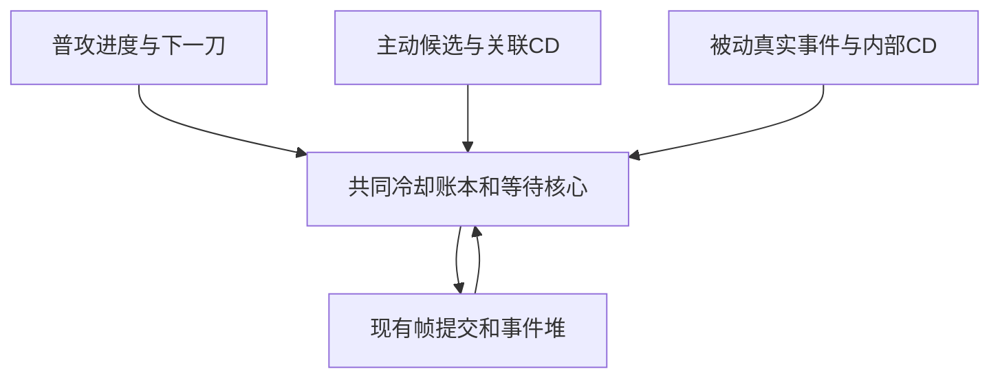

TASK_KEY: planning-automatic-skill-scheduling
DOC_TYPE: 详细设计
WORKSTREAM: planning
STATUS: active
EXECUTION_MODEL: 主负责人运行实现与集成，执行代理分端实现，独立复核
LAST_TRACKED_AT: 2026-10-14

# 主动技能自动调度与连招约束详细设计

本方案是主动技能自动循环、就绪优先级、关联冷却等待、一次性释放资格，以及普攻／主动／被动共用冷却等待核心的唯一共享定义。负责人已明确A完成后授予B、A不额外等待B消费资格，并要求三类技能走同一套冷却等待机制；随后授权开始开发。原生调度、共同冷却与页面接线已实现，最终产物、浏览器及真实Q-W样本验证见[开发验收](../../测试记录/项目/主动技能自动调度开发验收-2026-10-14.md)；本轮不新增调度数据库结构。

现有基线为四个主工作树共同包含的 `c01edb0ca`。本功能优先于快速汇总、参数对比和双属性网格。既有指定时刻计划继续以[阶段6设计](./阶段6主动技能接入与混合时间线详细设计.md)为准；本方案增加同页互斥的自动循环模式，不修改手动指令的一次尝试语义。

## 1. 目标与当前能力

用户选择攻击方已绑定、已开启且已学的主动技能，配置先后顺序及有限关联条件；引擎依据真实冷却、行动占用、机制资源与使用事实决定何时施放，不再要求用户为每次循环填写毫秒时刻。背景普攻可开关，技能、普攻与既有过程、恢复、周期及到期事件共用一个战斗时钟。

开发前基线已有1～64条指定时刻指令、技能冷却求值、有限过程及背景普攻；冷却未好或行动忙时只拒绝当前指令，不等待后重试。当时能力冷却有公共读写，但普攻进度等待、普通驱动重查、被动内部冷却状态尚未全部收敛到同一核心。本轮已经统一冷却等待，并接入自动选择和连招资格，沿用现有伤害算法。

| 当前入口 | 已有事实 | 本轮用途 |
| --- | --- | --- |
| [计划输入与页面](../../../web/src/pages/simulation/BasicAttackCompilePanel.tsx:1023) | 指定时刻、同刻顺序、真实阶段、背景普攻；明确不补放 | 复用真实技能选择、来源确认、结果失效和任务取消，增加自动模式 |
| [过程冷却](../../../wasm/tinygo_engine_v2/internal/runtime/generic_process.go:349) | 在作者指定时点求值并提交实际就绪时刻 | 自动调度读取这份冷却状态，急速与舍入不在前端重复计算 |
| [真实开始](../../../wasm/tinygo_engine_v2/internal/runtime/generic_frame_commit.go:78) | 仅成功提交后发布开始事实 | B成功开始时消费资格；开始前拒绝不消费 |
| [使用开始与终结](../../../wasm/tinygo_engine_v2/internal/runtime/generic_skill_actions.go:197) | 真实使用身份、开始、完成和失败 | 连接资格账本，不能从有限展示记录推断成功 |
| [场景选择](../../../server/data_manage/src/main/java/xyz/game/datamanage/service/simulation/SnapshotSelectionParser.java:53) | 已支持多个攻击方真实计划技能 | 读取全部自动选择来源的完整作者闭包，不存调度偏好 |

## 2. 已确认规则

### 2.1 已确认

本节中的A、B表示两项技能；攻击方、受击方仍使用现有场景角色标识，不能把技能B误当受击方。

1. 技能A每次释放前，必须满足自己的冷却就绪，以及技能B的冷却就绪。关联冷却只检查被引用技能的真实冷却，不递归检查该技能是否有资格、资源或行动许可，否则首次A与B会互相等待。
2. A每次成功释放只允许B释放一次。B不能在A第一次成功后永久独立循环；每次新的B都需要新的A授予资格。
3. B在真实开始帧成功提交时消耗资格。开始前拒绝不消费；开始后的取消、打断、失败或未命中不归还，不能只退资格而保留其它已提交成本和冷却。
4. A完整首次过程成功完成并提交后授予B资格；只开始、尚未完成、取消或失败均不授予。完成后的未命中或法术护盾阻挡不撤销资格。每个真实A使用至多处理一次授予，不能把引导每段、多个命中或重复终结当作多个A。
5. 每次新的运行使用独立初态，资格清零；不从上一次运行结果继承。
6. 自身冷却、行动占用、同来源活动过程、实际目标与必要机制资源继续经过原生门禁。关联条件不能替代或绕过这些门禁。

### 2.2 A重复施放与单份资格

负责人明确A已有自身CD，不增加“等待B消费后才能再放A”的联动锁。A满足自身CD、已配置的关联CD及原生门禁时即可再次施放；B有资格与否不额外锁住A。

首期每条资格边最多保留一份：B已有未消费资格时，新A完成不累积第二份，也不覆盖旧资格的授予身份。该次新A仍记为已处理授予，之后不能因重复回调补发。B消费后需要下一次真实完成的A才能获得新资格，不事后补领此前忽略的A。资格仅是一次释放许可，不冻结旧A的伤害或保证旧效果仍在，B仍读取执行当时的真实状态。

A完成授予与B成功开始消费分别以已提交过程事实判定；A完成帧及同步命中／监听尾部全部处理后，才选择同刻下一项B。没有要求负责人补录伤害或冷却数值；真实代表技能在实施前从现有管理配置核对，缺失的游戏事实另按真实对象报告。

## 3. 首期范围与顺序

首期仍为一对一、单攻击方，最多16个已绑定主动技能，使用已经准入的即时或有限延时首次过程。自动模式只执行首次施放；需要显式重施、主动取消或蓄力释放控制的对象继续使用手动计划。多段或引导暂不自动接入，避免混淆段释放与一次完整使用。

“顺序”在本方案中定义为就绪优先级：一次选择时，从前向后找首个同时满足全部条件的技能。前项因冷却、资格或自身条件不满足，不阻塞后面的独立就绪技能。选中技能实际提交并完成同步尾部后，再重新检查候选；不一次冻结多项成功施放。

技能同刻就绪时优先于自然普攻；真实施法占用期间不发出非法普攻，空档由已有原生普攻链继续计算。关闭背景普攻后，等待只推进真实未来事件，不人为补一刀维持时钟。

首期释放资格采用不分叉的有限链：每项技能至多一个资格来源、一个资格授予对象；支持独立技能、A→B及A→B→C。首期不定义共享资格、广播授予、多个来源的并且／或者关系。关联冷却可引用多个已选技能，含义为全部就绪。

现行已准入的普攻、主动能力CD和被动内部CD必须纳入第5节共同核心；被动仍由真实事件或既定周期触发，不作为无需事件的自动主动候选。没有冷却的普通被动继续按真实资格执行。

不纳入自动最优连招搜索、普攻重置作者接线、逐枚主动弹药新机制、双方自主攻击、完整控制系统、移动弹道、多目标、任意条件脚本或暂停后完整续跑。已有普通施法费用取舍、真实机制消费、伤害与吸血规则保持。

### 3.1 A→B→C及更长技能链

A、B只是规则示例名称，不是固定的两个联动槽。原生按规则列表和资格关系执行任意首期允许长度的链，最多16项技能；A→B→C、A→B→C→D以及多条互不相交的技能链使用同一算法，不在实现中写两技能或三技能专用分支。

| 技能 | 前置释放资格 | 可配置的关联冷却 |
| --- | --- | --- |
| A | 无，作为链的首项 | 至少可等待B；如果需要整套连招冷却都准备好，可以同时选择B、C |
| B | A完成后的一次资格 | 可等待C，避免B释放后C还在冷却 |
| C | B完成后的一次资格 | 没有额外关联时为空，仍检查C自身CD |

B同时是前一条边的消费者和后一条边的授予者：B成功开始消费A→B的一份资格，B成功完成才授予B→C的一份资格，C成功开始再消费。两条边分别保存状态与真实使用归属；B只开始但未完成时，不授予C，已经消费的A资格也不归还。

对应协议中，B的`releaseAfterRuleKey`指向A，C指向B；各项`waitForCooldowns`按实际选中的关联规则配置。链的长度不会改变共同冷却核心或资格消费规则，也不会让A额外等待整个链全部消费完。关联冷却不自动递归继承：想在A开始前等B和C，就明确配置两项。

每项仍需通过真实目标、行动占用、机制资源与作者条件，链不是一次性原子施放；B或C失败时保留已经提交的前项，不自动回滚或补放。首期不分叉、不汇合的范围限制针对关系形状，不能被解释为最多只有两个技能。

## 4. 一次资格的状态与提交

资格容量固定为每条边0或1，不额外阻止A施放，不支持累计多份。

每条A→B资格关系保存授予来源、消费对象、未消费资格0或1、授予使用身份和授予时刻。每份真实使用有独立身份；同一使用的授予去重标志独立于有限日志。资格属于本次运行的调度状态，不写入技能作者内部状态，也不复用同次命中的触发额度账本。

| 事实 | 状态变化 |
| --- | --- |
| 新运行 | 未消费资格为0 |
| A完整过程成功完成并提交，旧资格为0 | 0→1，绑定本次A使用；同次使用重复回调不再授予 |
| A完成时旧资格仍为1 | 保留旧1及旧授予身份，不累计、不覆盖；本次A标记已处理 |
| B尝试被拒绝，或开始帧未提交 | 保留1 |
| B开始帧成功提交 | 1→0，绑定消费的B使用 |
| B随后取消、失败、被打断或未命中 | 保留0，不退回 |
| 预算中断 | 只保留实际提交过的授予／消费，未提交变化不发布 |

资格变化与开始／终结提交保持一致；新增调度唤醒参加相应帧的队列容量预检。不能先消费再发现入队失败，也不能已经开始B后因为输出截断而恢复资格。后续同步监听失败沿既有部分结果口径保留已提交事实，不承诺整次施法回滚。

## 5. 普攻、主动与被动的统一冷却等待

### 5.1 单一状态与共同核心

同一套机制必须体现为同一状态所有者和真实调用链，不仅是共用时钟或几个相同函数名。首期在现有运行包收敛`generic_cooldown*.go`（共同冷却与等待代码），由它唯一负责冷却状态、就绪判断、剩余时间、等待登记、截止时刻变更、旧事件失效及到期通知；不新增只有一个实现的接口或第二套计时器。

| 责任 | 必须共用的规则 |
| --- | --- |
| 冷却身份 | 能力CD使用实际拥有者、完整挂载与能力引用；被动内部CD使用实际拥有者、挂载实例、状态键、作用域及必要的实际目标，不按英雄名、显示名或技能原键合并 |
| 唯一账本 | 每个冷却身份只有一份可写截止时刻、活动状态和版本；普攻进度状态只是计算输入，被动状态读值与到期表示只是账本视图，不保留另一份可独立修改的CD |
| 开始／修改 | 开始、设置剩余、减少、重置及内部CD清除经共同入口暂存，实际帧提交后发布；各自作者的起算时点和明确数值仍有效 |
| 就绪边界 | `nowMs < readyAtMs`表示未好，`nowMs >= readyAtMs`即可就绪；无活动冷却时剩余为0，不从0／1活动标记冒充毫秒 |
| 等待登记 | 同一冷却可有多个等待者；每个等待身份仅一份有效登记，读取同一截止和版本；主动关联等待、普攻等待及被动就绪恢复均使用它 |
| 改期与失效 | 修改CD后统一通知所有相关等待者，缩短、延长、归零及挂载移除均更新版本；旧事件无权重复恢复就绪或发动作 |
| 提交与预算 | 账本变化、等待改期和所需事件容量共同预检、共同提交；失败帧不发布。复用已有事件载体，不能仅为统一冷却给每刀增加一份事件而改变原预算 |

目前[公共门禁](../../../wasm/tinygo_engine_v2/internal/runtime/generic_gate.go:90)读取能力冷却表，[公共修改](../../../wasm/tinygo_engine_v2/internal/runtime/generic_execution.go:1901)只暂存写表，并没有统一等待通知；[普攻等待](../../../wasm/tinygo_engine_v2/internal/runtime/generic_basic_attack_wait.go:41)另外维护进度及事件代号，[普通驱动](../../../wasm/tinygo_engine_v2/internal/runtime/generic_run.go:999)另排就绪重查。因此方案不得在这些旁路外再加一份主动等待实现：先迁入共同核心，再由业务调用它。

### 5.2 三类行为的共同接入

| 行为 | 数值与触发来源 | 共同冷却接入与保持项 |
| --- | --- | --- |
| 普通攻击 | 现有作者普攻CD、攻速及真实过程 | 保留已经等待的进度、属性依赖与剩余比例，攻速变化先按现行算法算出新截止，再写共同账本、改期唯一下一刀；占用和弹药期限仍合并到实际行动许可 |
| 主动技能 | 作者过程CD及开始时点、优先级、释放资格 | 自身与关联CD均读共同账本；到期只唤醒候选选择，仍需重新检查目标、占用、资源和资格，不凭过期事件直接施放 |
| 事件被动 | 新的真实事件、冻结的作者资格和内部CD | 事件发生时读取共同就绪；冷却内不合格的旧事件不缓存、不延后补放；到期只恢复就绪，下一次新的合格事件才能触发 |
| 周期被动 | 现有真实周期事件、作者资格和能力／内部CD | 周期仍提供真实尝试时点，冷却检查与读写走共同核心；周期本身不当作CD，CD就绪不制造缺失的周期或补回旧周期 |

共用的是冷却状态与等待规则，CD时长仍由各自作者定义。普攻的进度重算不强行套给主动技能；主动的固定截止也不能覆盖普攻已经完成的等待比例。所有业务的实际冷却读写和等待改期都必须落入共同核心，不能保留一个继续自己写截止／代号的旧等待分支。

既有`whileReady`（未就绪时继续尝试）拒绝后的冷却等待也登记到共同核心，成功后仍沿原有有限驱动约定，不因这次收敛自动变成循环。纯主动、关闭背景普攻及只有被动CD的场景，也必须能登记真实到期通知；不能沿[当前状态到期接线](../../../wasm/tinygo_engine_v2/internal/runtime/generic_execution.go:1071)以“存在背景普攻”作为是否安排CD到期的前提。

被动[当前装配](../../../web/src/engine/simulationTriggeredEquipment.ts:417)把`INTERNAL_COOLDOWN`（内部冷却）转换为0／1限时状态。现有[状态用途字段](../../../wasm/tinygo_engine_v2/internal/model/generic_compile.go:91)`stateKind`目前只有`ammo`（弹药）用途；本轮新增`cooldown`（内部冷却）枚举值，由前端在对应`initialStateSchema`状态字段明确发送。Web类型扩充为`'ammo' | 'cooldown'`，原生同步扩充白名单、编译分派与执行计划字段，不是仅加一个未被接收的字符串。

当前[编译入口](../../../wasm/tinygo_engine_v2/internal/compile/generic.go:310)将用途字段交给[弹药处理器](../../../wasm/tinygo_engine_v2/internal/compile/generic_ammo.go:25)，非`ammo`会拒绝。实施时改为已知用途分别分派：保留弹药处理与恢复语义，内部冷却编译为共同账本绑定，未知用途明确拒绝；`cooldown`字段不能携带`ammoRecovery`（弹药恢复定义）。未标记的普通状态仍是普通状态，不按名字、期限或刷新策略猜为CD，也不为被动制造假能力。

`cooldown`用途要求现行已准入的0默认值、1上限、正的作者期限及`start_on_first_write`（首次启动后不续期）规则。前端沿作者`SKILL`（技能自身）／`TARGET`（实际目标）作用域运输现有状态读路径和操作类型，不提交动态拥有者或目标：前者读`provider.state`并用`state_scope/provider`，后者读`provider.target_state`并用`state_scope/provider_target`。原生以实际拥有者、挂载实例、命名后的状态键及作用域绑定账本，目标作用域再加入执行帧真实`targetKey`；不能把目标当拥有者或跨目标共享同一CD。

原有状态读取路径从账本派生活动0／1；现行只与0比较的就绪条件不变，不把活动值当剩余毫秒。START（开始）在就绪时启动，冷却内重复开始不延期；RESET（清除）恢复就绪；减少剩余时间只改当前截止，不重新求整周期。能力的冷却重置与该内部状态清除，均映射到共同账本的真实归零操作。

内部CD的运行时到期只保存在共同账本。需要输出原状态到期时，由账本只读生成，不做状态期限与能力冷却期限的双写。实例移除、目标状态变化和旧到期事件都以完整实际身份和版本核对。

状态视图、公式与属性依赖缓存、冻结事件快照读取共同账本的对应版本；到期、清除或实际改期后重新核对真实依赖。既有事件入口冻结语义保持，不能让旧快照跟随新写入，也不能因状态不再存独立TTL而继续复用过期活动值。

监听完整子能力若声明能力CD，也必须在真实触发时经过共同冷却就绪判断；不能像[当前子施放入口](../../../wasm/tinygo_engine_v2/internal/runtime/generic_execution.go:2734)一样直接执行而只记录CD不检查。直接操作监听只服从已经声明的作者资格；冷却内减少CD的操作不能因整个监听被一刀切门禁而丢失。保持当前事件条件先冻结再执行的口径，同一真实触发中的配套操作不能被误当作多次独立触发。

同次使用的触发额度、按施放身份节流、过程时长、普通状态期限、周期和弹药恢复不是跨次技能CD，继续保留自身已确认语义。它们可提供行动许可或状态推进事件，但不得独立维护同一技能CD的副本。

### 5.3 主动关联唤醒与停止

冷却长度与开始时点使用现有作者过程定义，在原生实际执行时求得。关联等待读取该技能本次绑定的首次控制能力冷却，不读取名称相同的其它来源，也不固定按“施放时刻＋基础CD”预展开整场。

冷却未好时，下一检查时点由共同等待核心返回实际就绪时间；冷却减少、增加或重置后，所有相关等待统一改期。提前缩短不能仍睡到旧期限，延长不能按旧事件抢跑。

行动占用解除、过程退出、资格授予、相关冷却提交以及必要机制资源恢复，均在共享事件堆中唤醒自动候选。同刻沿原顺序先处理初始化、过程、周期、到期及恢复，再选技能，最后自然普攻；一个使用的同步尾部结束后再选下一项。

每个拥有者最多一份有效的下一次自动选择事件；重复唤醒合并，旧代号不执行。已有明确期限时直接等待期限，不按1毫秒轮询。条件重查只能在仍有实际未来状态推进来源时有界进行；自动选择和条件重查本身不能成为维持战斗的证据。没有实际未来事件且条件不会变化时，不再制造重查；只有纯时间变化才能成立、又无法绑定明确未来检查时点的条件，不在首期自动准入范围，返回具体条件路径，不能补默认值或错误当作恒假。

停止仍服从双方死亡、观察时长和执行预算。整场没有未来战斗事件时，复用现有`no_events`（无事件）策略；没有就绪技能但仍有冷却、活动过程、周期、恢复、到期或普攻事件时继续运行。不能把周期效果、反伤或恢复遗漏后误报死锁，也不能沿有限手动列表提前套用“列表耗尽等于观察结束”的分支。

资格图与冷却图分别检查。资格自依赖和初始全零、没有外部授予来源的资格环拒绝；A等B冷却、B依赖A的一次资格是合法组合。相互等待冷却也不按资格环拒绝；运行时条件长期不成立属于正常等待或停止，不返回虚构的成功连招。

## 6. 共享输入与错误提案

新增运行计划字段`driverPlan.automaticSkills`（自动技能计划），与`skillActions`（指定时刻指令）和外部`entries`／事实数组互斥；可与已有`basicAttack`（背景普攻计划）共存。编译继续使用真实`skillActionBindings`（技能能力绑定），不让用户输入任意能力引用。

规范请求必须显式提供`driverPlan.entries: []`、`driverPlan.skillActions: []`以及`skillUses: []`、`skillHitFacts: []`、`attackStartFacts: []`、`processCommandFacts: []`。这些位置不接受null或非空事实；自动模式的`automaticSkills`必须为对象并包含`rules`数组，省略表示未启用自动模式，空对象、null或空规则数组拒绝。关闭背景普攻时省略`basicAttack`，开启时发送完整现行普攻计划；`conditionRecheckIntervalMs`继续沿现有范围与默认值校验。前端类型、原生模型和字段白名单同步扩充，不能仅在前端增加一个未被原生接收的属性。

自动计划包含1～16项规则，按下表严格校验。字段名称是本方案的协议定义，后续开发时由类型与解析器实现，不代表当前已能接收。

| 字段 | 作用与约束 |
| --- | --- |
| `ruleKey` | 本场规则稳定标识，唯一，符合现有键格式；技能A／B关系引用它 |
| `bindingKey` | 本次编译的真实技能绑定，必须属于攻击方、启用且已学；每份绑定只配置一项自动规则 |
| `sortOrder` | 唯一的0～15整数优先级，较小者先检查；不从后端稳定来源排序推断用户顺序 |
| `target` | 现有实际对象标识，必须与作者过程、目标形状及命中绑定一致 |
| `hitBindings` | 复用已编译命中绑定与明确命中／未命中预设；不能用未命中预设裁剪作者闭包 |
| `waitForCooldowns` | 唯一的其它已选规则引用数组，全部冷却就绪才允许开始；只检查真实冷却，不递归检查对方资格 |
| `releaseAfterRuleKey` | 可空的前置规则标识，非空表示每次施放必须消耗该来源完成释放后授予的一份资格；容量始终为1 |

自身冷却与原生门禁总是检查，不能通过空数组关闭。选中的所有技能都要进入场景快照与编译，不把“只用于冷却检查”的技能引用当可忽略配置；引用未选、已关闭或等级为0的来源时返回具体字段路径。

规则的表列字段全部显式提供，仅`releaseAfterRuleKey`允许null；没有额外关联冷却时`waitForCooldowns`为`[]`，没有目标命中绑定时`hitBindings`为`[]`。自动计划与规则对象拒绝未知字段，关联数组拒绝重复和自身引用，不把省略字段解释为另一种默认连招。

重复规则、优先级、绑定或关联引用，未知字段，空计划，超量规则，自引用，不支持的过程形状，资格分叉／汇合以及封闭资格环均在运行前拒绝。编译校验负责绑定与能力形状；运行入口核对本次规则、引用、模式互斥和初态，不能由前端检查单独保证安全。

新模式首期仅从0时刻空运行态开始，资格清零。最终输出可以披露剩余资格及授予归属，但不声明恢复入口已支持完整自动计划。

## 7. 模块责任与页面

后端继续拥有完整管理配置与场景闭包，复用`plannedSkills`（所选计划技能）的真实来源、等级与首次阶段。优先级、关联冷却和资格关系是本场计算输入，不新增管理表、持久化方案或后台计算接口。实施时核对自动重复使用的可能事件全部可达，不借一次性闭包裁掉必要监听。

自动模式必须从规则列表直接生成`selection.plannedSkills`：每项包含真实`origin`（角色来源）、`skillKey`（技能标识）、`skillLevel`（所选等级）及`phaseKinds: ["INITIAL"]`（首次阶段）。所选技能按真实来源去重，稳定排序只服务快照身份，不改变自动优先级。前端增加独立的自动请求装配入口，不调用要求非空固定动作列表的手动装配器，也不伪造0毫秒手动指令来运输闭包。

前端在现有模拟页提供“固定时刻计划／自动循环”互斥选择。自动输入只提供技能、等级、目标、命中预设、上下移动顺序、等待哪些技能CD以及由哪个技能授予资格。删除或禁用已被引用技能时明确报错并要求修正关系，不能静默删除条件后执行另一种连招；原草稿和失败请求保留。

页面不要求填写每次施放毫秒时刻或手算CD。来源或作者摘要改变沿现有流程重新确认，优先级、关联条件或目标变化使旧结果过期。固定时刻模式与自动模式不混合提交；切换保留各自草稿，计算、取消、离开和释放继续沿当前线程生命周期。

Wasm（浏览器内计算引擎）负责规则绑定、资格状态、优先级选择、共同冷却等待、同刻顺序与原生运行。每次自动开始生成新的使用身份，复用既有过程、命中、管道和提交；不在Web用定时器逐次调用，不预生成1～64条固定时刻指令来伪装循环。前端按作者内部状态显式运输冷却用途，不能继续运输一套通用TTL计时来代替本轮共同CD。

结果沿实际提交累计各技能尝试、成功开始、完整释放、命中、失败、伤害和治疗。新增自动规则汇总、资格授予／消费及最后等待状态；关闭明细或采样不改变资格与数值。配置项数量与实际循环次数分别统计，不沿用手动`plannedCount`（有限指令数）宣称无限循环已排完。

等待原因至少区分自身CD、关联技能CD、缺前置资格、行动占用、已有活动过程、必要机制资源或作者条件。等待记录有界，仅保留状态变化，不每次检查都生成一条拒绝；最后等待原因不能代替完整累计。

### 7.1 自动结果契约

自动模式必须返回以下新字段；其它模式不返回这些字段，既有数值、最终快照与执行完整性仍按现行协议返回。这里与请求字段共同作为原生及前端的唯一共享定义。

| 字段 | 形状与计数口径 |
| --- | --- |
| `automaticSkillSummary` | 完整累计对象，含`ruleCount`、`attemptCount`、`startedCount`、`rejectedCount`、`abortedBeforeStartCount`、`completedCount`、`failedCount`、`inFlightCount`及下列`rules`、`qualifications`数组；所有计数为非负整数 |
| `automaticSkillSummary.rules` | 按优先级排列，每项含`ruleKey`、除`ruleCount`之外的上述计数及`waiting`；计数之和分别等于总计 |
| `rules[].waiting` | 无等待时为null；否则含`reason`（固定原因）、`relatedRuleKeys`（关联规则数组）及`nextCheckAtMs`（已知下一检查毫秒时刻，未知为null）；它不是承诺释放时刻 |
| `automaticSkillSummary.qualifications` | 每条资格边一项，含`grantorRuleKey`、`consumerRuleKey`、`grantedCount`、`consumedCount`、`remainingCount`、`lastGrantUseRef`、`lastConsumeUseRef`；未发生相应事实时使用引用为null，计数为0 |
| `automaticSkillRecords` | 有界自动记录数组，每项含`sequence`、`timeMs`、`kind`、`ruleKey`、`useRef`、`relatedRuleKey`、`relatedUseRef`、`reason`及`nextCheckAtMs`；不适用的引用、原因和时刻为null，标识、序号、时间及类别不可空 |
| `automaticSkillRecording` | 完整记录计数对象，含`totalCount`、`returnedCount`、`omittedCount`、`droppedCount`及`truncated`；按下段区分未请求与真正截断 |

`attemptCount`只在进入真实过程尝试时增加；扫描候选或检查等待不计尝试。成功开始帧提交后增加`startedCount`；普通拒绝增加`rejectedCount`，开始前运行或预算中止增加`abortedBeforeStartCount`。开始后发生的错误不能改成开始前中止。实际完整终结增加`completedCount`或`failedCount`，尚未实际终结的使用保留在`inFlightCount`。A授予、B消费只在第4节相应提交点增加账本计数。

完整累计须满足：`attemptCount = startedCount + rejectedCount + abortedBeforeStartCount`，`startedCount = completedCount + failedCount + inFlightCount`，每条资格边`grantedCount = consumedCount + remainingCount`；有前置资格的规则成功开始数必须等于其入边消费数。`remainingCount`仅为0或1。新A完成时旧资格未消费，不增加`grantedCount`，不覆盖仍有效的旧授予身份。

记录类别固定为`ATTEMPT_REJECTED`（尝试拒绝）、`ABORTED_BEFORE_START`（开始前中止）、`STARTED`（成功开始）、`COMPLETED`（成功终结）、`FAILED`（失败终结）、`QUALIFICATION_GRANTED`（资格授予）、`QUALIFICATION_CONSUMED`（资格消费）及`WAIT_CHANGED`（等待变化）。记录使用单调序号区分同刻顺序，关联资格的授予和消费分别保留双方真实使用引用；记录只呈现事实，不驱动资格状态。固定等待原因、记录类别和中文标签进入既有共享固定枚举定义，不让三端各写一套含义。

授予记录的`ruleKey/useRef`指向A及本次A使用，`relatedRuleKey`指向B，尚未发生的B使用以`relatedUseRef: null`表示；消费记录的`ruleKey/useRef`指向B及本次B使用，`relatedRuleKey/relatedUseRef`指向授予来源A及实际授予使用。普通使用记录的关联字段为空，等待变化记录的`useRef`为空，不编造使用身份。

等待原因固定为`OWN_COOLDOWN`（自身冷却）、`RELATED_COOLDOWN`（关联冷却）、`RELEASE_QUALIFICATION`（缺资格）、`ACTION_OCCUPIED`（行动占用）、`PROCESS_ACTIVE`（同来源已有过程）、`MECHANIC_RESOURCE`（机制资源不足）及`AUTHOR_CONDITION`（作者条件不成立）。返回实际核对链的首个等待原因，关联技能按优先级排序；数值非法、缺必需输入和未知引用仍是运行或协议错误，不能折成普通等待。

新增`recordBudget.maxAutomaticSkillRecords`（自动明细保留数），省略为1000，允许整数0～4096，0表示不保留明细。详细模式返回前`min(totalCount,预算)`项，`omittedCount=0`，`droppedCount=totalCount-returnedCount`，仅实际丢弃时`truncated=true`；汇总模式明确返回`automaticSkillRecords: []`，`returnedCount=0`、`omittedCount=totalCount`、`droppedCount=0`、`truncated=false`。两种模式始终保留完整累计与最后等待状态，采样开关独立。

纯自动模式不返回手动`summary.skillActions`及手动`skillActionRecords`／`skillUseRecords`等专用字段；通用`summary.skillUses`和原数值累计仍可按现行口径完整返回。前端按模式选择自动或手动结果校验，不以自动生成的使用身份匹配预先给定的手动`instructionKey`和时刻。资格账本守恒、记录预算与明细模式分别验证，不能因明细为空就把资格或总伤害改成0。

## 8. 实施顺序

1. 独立复核本次已确认的释放资格与共同冷却等待方案。内部函数命名由实现者决定，公共语义、冷却状态所有者和验收不可由各模块另定。
2. 先收敛现有普攻和能力CD到共同核心，锁定已有正确行为；再将已准入被动内部CD显式绑定、读写、就绪和到期迁入同一核心，补齐监听子能力的CD核对。结构迁移与门禁修复分别保留差异及证据，不保留第二份旧冷却实现兜底。
3. 原生完成自动模型／计划／编译及入口校验，增加候选与资格，所有等待调用第2步核心；用明确构造证明A→B、A未消费不被锁住及普通独立技能。
4. 前端完成同页输入、规则映射、状态用途运输、互斥校验和结果解释；后端只补实际证明必要的闭包运输，不新增调度持久化。
5. 核对同一真实角色两份已准入主动技能、背景普攻和一项带内部CD的真实被动，完成最终Wasm、真实浏览器工作线程和页面验收，再交付本功能。实库缺组成时另报最小作者缺口，不把跨英雄拼接构造当真实角色证明。

负责人已授权实施，以上顺序用于原生核心、自动调度与前端的实际交接；方案评审与运行验收分别记录，作者数据修改需要具体任务授权。

## 9. 必要验收

| 场景 | 必须证明 |
| --- | --- |
| A自身先就绪，B稍后就绪 | A等到B真实CD就绪后才开始，等待期间允许合法普攻 |
| 初始B无资格，双方CD已就绪 | A能先放，不因递归检查B资格造成首次死锁 |
| 一份A资格与两次B候选 | 只有一次B能成功开始，第二次等待新的A |
| 三技能链及更长链 | A完成授予B，B开始消费后完成授予C；相邻边独立记账，中间技能失败不授予后项；4项及最多16项使用相同原生路径 |
| B开始前拒绝／预算失败 | 不消耗资格，不造开始、伤害或成功事件 |
| B已开始后取消、失败、未命中 | 资格不归还，不单独重放B；其冷却和已提交效果保留 |
| A开始但未完成／失败／同次多次回调 | 未完成或失败不授予；真实完成最多授予一次，与伤害是否命中分开 |
| 旧资格未消费，A再次就绪 | A依自身及关联CD正常施放，旧资格保留1、旧归属不覆盖；不补领、不累计、不加联动锁 |
| 多技能同刻就绪 | 按配置优先级，独立后项不被冷却未好的前项堵住，技能与普攻顺序确定 |
| 动态冷却缩短、延长、重置 | 正确改期，旧事件不抢跑、不重复；作者形状不准入时明确拒绝 |
| 三类技能共同截止与等待 | 普攻、主动关联候选和被动ICD均读写共同核心；同一冷却被多处等待时，变更统一通知且无第二份可写期限 |
| 普攻冷却中途攻速变化 | 已完成等待进度与原实现一致，下一刀及事件预算不因抽取核心而改变 |
| 被动CD内事件／到期无事件／到期同刻新事件 | 旧触发不补放，无事件不施放；新合格事件按精确就绪边界可触发 |
| 内部CD重复开始、清除、减少剩余及实例移除 | 重复开始不续期，清除与减到0恢复就绪；只作用于真实身份，旧事件不恢复被移除或重建实例 |
| 监听子能力CD与冷却内减CD监听 | 声明能力CD的子施放不能绕过共同门禁；合法减CD监听仍可执行，不被统一入口误屏蔽 |
| 周期被动与同次触发节流 | 周期不代替CD、不补旧周期；同次使用约束不被误改为跨次CD |
| 资格环与冷却环 | 封闭资格环拒绝；合法A等B-CD与B等A资格通过；普通条件不成立不误报死锁 |
| 占用、周期、恢复、到期与死亡同刻 | 共用原事件顺序；死亡后不因新资格继续施放，不漏算已提交尾部 |
| 关闭记录、汇总模式及采样 | 完整数值、资格消费、执行完整性与停止结果一致 |
| 同会话重复运行、错误后重跑 | 新运行从独立初态开始，不继承上一轮使用或资格 |
| 无就绪技能但有未来事件／真正无事件 | 分别等待推进和按现有策略停止，不用空轮询制造战斗事实 |
| 条件恒假、纯技能且无任何状态推进事件 | 自动选择与条件重查不保活；按无事件策略停止或观察到终点 |
| 完整累计与明细预算0／截断／汇总输出 | 尝试、开始与终结计数一致，资格守恒；未请求与真正丢弃明确区分 |
| 页面模式切换、旧摘要和失效引用 | 草稿保护、重新确认、结果过期和路径错误正确，无隐式条件删除 |

原生逻辑收尾按模块规则执行全量Go测试与原生基准；最终构建后执行Node编译／运行／释放及自动调度专项，再验证同一摘要的浏览器工作线程和实际页面。真实作者回查、原生构造、Node、最终Wasm与浏览器证据分别记录，不相互替代。

共同机制还必须通过源码调用与状态所有权独立检查：普攻、主动过程、自动候选、普通驱动及被动CD的正式入口都调用同一核心，原专用等待不再独立写CD／版本，被动不保留独立可写到期表。动态改期、目标隔离和无背景普攻场景分别跑最终Wasm与浏览器验证；仅有相同结果或相同函数名称，不能替代同一机制的接线证据。

方案阶段的发现与处理证据保存在[方案静态审查记录](../../测试记录/项目/主动技能自动调度方案审查-2026-10-13.md)。开发验证证据单独记录，不与当前行为定义并列；各层完成状态以对应实际检查为准。
