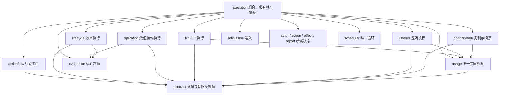

TASK_KEY: planning-engine-subsystem-refactor
DOC_TYPE: 详细设计
WORKSTREAM: planning
STATUS: draft
EXECUTION_MODEL: Codex 主负责人及内置只读分析与独立评审代理
LAST_TRACKED_AT: 2026-11-01

# 执行协调层功能执行与组合重构技术方案

## 1. 结果、范围与当前基线

本轮把普攻、技能过程、效果生命周期、数值操作、命中、监听、复制续接的实际业务执行迁入对应功能包。执行根包只负责运行装配、有限的跨功能次序、帧预检与统一提交、唯一队列的接线，以及结果汇集。拆分必须同时改变业务执行对象和私有状态的归属，不能仅移动纯函数、缩短大文件或增加转发文件。

本方案基于 `22970cc431052346748a32f1d3157d7c2cb6dcb1`。该版本的 `wasm/tinygo_engine_v2/internal/runtime/execution/` 根目录有98个实现文件、140个测试文件，已经具有准入、命中、监听、运行求值四个子包。以下源码路径除特别注明外相对 `wasm/tinygo_engine_v2/`。

[第一轮职责约束](执行协调层按职责拆包实施方案.md)描述当前已实现状态，[第一轮验收](../../测试记录/项目/执行协调层拆包验收-2026-11-01.md)描述已经执行的验证。本文是下一轮待实施方案；实施完成前，不把下述包、对象和内部协作方法当成现有能力。第一轮的数值、身份、读值和提交语义继续有效，本文调整的是实际执行职责的分布。

本轮明确不包含：

- 新增或扩大游戏机制、作者配置准入、主动资源成本支持、控制效果或快照恢复范围。
- 修改外部请求／结果字段、编译／运行／释放导出、共享规则和公式含义。
- 实施[子系统接口草案](../../概要设计/项目/Wasm子系统接口设计草案.md)中的有限排程或循环决策改造；现有调度循环及其同刻选择、事件后核对保持。
- 重构前端适配、管理页面或数据库；前端仅承担必要分发产物、构建身份和既有正式证明更新。
- 建立公共总状态、新的指令语言、通用事件总线、服务注册器、第二个调度器、兼容层或整体回滚事务。

本次会话只授权技术方案；运行代码、产物和正式证明的更新属于后续开发范围。本文中的运行验证均为实施验收要求，不表示本轮已经重跑。

## 2. 当前耦合与拆分切口

| 源码依据 | 当前实际职责 | 拆分要求 |
| --- | --- | --- |
| [单场执行器](../../../wasm/tinygo_engine_v2/internal/runtime/execution/engine.go) | 持有子系统组合、帧身份、命中使用捕获、额度和续接等多类事实 | 各功能执行对象拥有自己的局部运行事实，根层只组合唯一实例 |
| [操作执行](../../../wasm/tinygo_engine_v2/internal/runtime/execution/frame_operations.go) | 操作预算、条件、动态效果准备、路由、数值及状态变更混在同一帧方法中 | 数值与状态操作由功能执行；预算、读取准备和跨功能调用保持显式阶段 |
| [伤害结算](../../../wasm/tinygo_engine_v2/internal/runtime/execution/damage_settlement.go) | 扣盾血后同步盾耗尽，重算属性，再结算吸血和受伤事实 | 不能预先求出整批金额，也不能推迟耗尽同步和吸血 |
| [技能过程](../../../wasm/tinygo_engine_v2/internal/runtime/execution/process.go) | 启动、付款、冷却、阶段循环、计时与同步尾部均依附在 `Engine`、`Frame` 上 | 过程执行对象决定业务，根层只提供真实帧执行与提交边界 |
| [自动技能](../../../wasm/tinygo_engine_v2/internal/runtime/execution/automatic_skills.go) | 遍历候选、登记全部等待、选择和消费真实资格 | 优先级、一次资格、冷却和等待分别保留，不改为找到候选就提前结束遍历 |
| [命中事件](../../../wasm/tinygo_engine_v2/internal/runtime/execution/skill_hit.go) | 命中判断、候选执行、监听、快照刷新及强化尾部混在一起 | 命中包拥有候选及规则组执行，根层组合命中、监听与强化等跨功能次序 |
| [监听派发](../../../wasm/tinygo_engine_v2/internal/runtime/execution/listener_dispatch.go) | 冻结列表和条件、实时挂载复核、额度、子能力执行及复制收集 | 监听包拥有完整遍历及成功判断，执行子帧通过有限同步交接 |
| [效果生命周期](../../../wasm/tinygo_engine_v2/internal/runtime/execution/provider.go) | 应用、刷新、移除、监听和弹药清理、属性重算及计时混合 | 效果执行包拥有规则及局部变化，跨行动／监听／队列步骤由根层原位组合 |
| [统一提交](../../../wasm/tinygo_engine_v2/internal/runtime/execution/frame_commit.go) | 预检后先发布部分所属状态，后续生命周期仍可能失败 | 保留局部发布的真实边界，禁止用单一成功布尔值假装整体原子性 |
| [队列预检](../../../wasm/tinygo_engine_v2/internal/runtime/execution/frame_commit_queue.go) | 同时核对状态到期、锚事件、普攻、冷却、弹药、周期、过程和盾计时容量 | 功能分别准备请求，根层组合一次真实容量核对，按原位置发布 |

Go要求方法与所属类型位于同一个包，子包也不能直接访问父包私有字段。因此本轮不搬运原来的 `Engine` 方法：先形成具体功能对象及其局部帧状态，再迁移业务方法；根层通过具体值、所属变更对象和必要的有限同步协作组合它们。

## 3. 目标目录与对象

### 3.1 目录和所有者

在现有四个执行子包上新增五个功能包，不按每种技能、每个操作或每个文件各建一个包。

```text
internal/runtime/
  execution/
    engine.go                  单场装配与结束汇集
    loop_driver.go             对接唯一调度循环
    frame*.go                  私有帧、有限读取准备、统一预检及提交
    event_dispatch.go          跨命中、监听、强化的固定组合次序
    execution_budget*.go       同一事件与同步链的预算
    *_bridge.go                必要的窄协作适配，按功能组织
    admission/                 准入与初始恢复校验，已有
    evaluation/                准备后运行求值与缓存，已有
    hit/                       命中判断、候选／规则组与强化命中执行，扩充
    listener/                  监听选择、冻结遍历及触发执行，扩充
    actionflow/                行动执行，新增
    lifecycle/                 效果生命周期执行，新增
    operation/                 数值与状态操作执行，新增
    continuation/              复制伤害、延迟续接及同步因果，新增
    usage/                     同次使用共同额度，新增
  actor/                       角色数值及变更对象，已有
  action/                      行动、过程、身份、冷却与等待状态，已有
  effect/                      效果实例、状态袋、护盾及变更对象，已有
  report/                      累计、记录、采样与结果整理，已有
  contract/                    跨所有者身份及有限交换值，已有
```

表中的英文是拟定Go包路径，中文为实际职责。`actionflow` 与 `action` 分别表示行动执行与行动状态；`lifecycle` 与 `effect` 分别表示效果执行与效果状态，二者不能各存一份相同状态。文件名可按实现阅读需要调整，功能和权限边界按本方案执行。

| 所有者 | 拟形成的具体对象 | 拥有的实际执行 | 保留在其他所有者的内容 |
| --- | --- | --- | --- |
| `actionflow` | 普攻执行对象、技能行动执行对象、过程执行对象及局部帧事实 | 驱动准入后尝试、普攻开始／命中／等待、有限和自动行动、过程启动／步骤／终结、恢复业务校验 | `action.State` 中的使用身份、过程、资格、冷却、占用和等待；共同弹药不能变成普攻私有状态 |
| `lifecycle` | 效果执行对象、局部帧变更及计时计算 | 来源初始化、效果应用／刷新／移除、状态写入与期限变化、动态投影、关联盾、周期／到期处理 | `effect` 中的实例、状态袋、盾、身份和期限；不获得全局监听或队列控制 |
| `operation` | 操作执行对象、数值操作局部帧状态 | 操作条件与路由、伤害／治疗／吸血／资源及斩杀、逐伤证据、操作输出和数值暂存 | 数学实现继续复用 `pipeline`；公式及缓存复用 `evaluation`；暂存写入使用真实 `actor`／`effect` 变更对象 |
| `hit` | 命中执行对象及候选局部状态 | 合格接触、候选条件、规则组、阻挡、主体替换及强化候选执行 | 使用身份仍归 `action`；不自己触发普通监听或另存共同额度 |
| `listener` | 监听执行对象及单次派发局部状态 | 冻结列表、冻结条件、活资格复核、节流、执行遍历及是否成功触发 | 子帧、子能力与跨功能尾部由根层同步接线；不能借出动态可写列表 |
| `continuation` | 复制收集器、续接执行对象、同步因果栈 | 收集与稳定排序、冻结复制防御、重复资格、下一续接和实际复制执行的领域阶段 | 时钟及真实入队仍归循环；同步因果不能写入持久过程或导出快照 |
| `usage` | 单场共同额度账及预留凭据 | 完整身份检查、预留、提交、失败释放、恢复校验和有限快照投影 | 每场只新建一份，由根层组合给命中、监听和续接共同使用；不另算成功或自行排程 |
| 根执行包 | `Engine`、私有 `Frame`、按功能划分的窄适配 | 单场装配、跨功能固定次序、读取准备、预算身份、统一预检与发布、唯一队列写入、结果汇集 | 不继续持有完整的普攻、过程、数值或效果业务算法 |

普攻、有限／自动技能和过程之间共享使用身份、占用、冷却及同步步骤，因此本轮放在同一个行动执行包，用三个具体对象区分。不存在独立变化点时，不继续制造三个互相回调的子包。

### 3.2 目标依赖

箭头仅表示Go导入，接口的同步调用方向不等于导入方向。



图省略各包对 `model`、`plan`、公式、数值管道及所属状态视图的合法依赖。实施时在 `scripts/check-package-boundaries.mjs` 按具体包逐项声明：

- `actionflow`、`lifecycle`、`operation`、`hit`、`listener`、`continuation` 六个执行所有者之间不互相导入；跨功能执行由根层组合。它们不导入父执行包、根运行包或调度器。
- `operation`、`lifecycle` 可以调用 `evaluation`；命中、监听、续接可以借用同一个具体 `usage` 额度账。`evaluation` 和 `usage` 不反向依赖这些执行所有者。
- 所属状态包仍不取得执行控制，也不导入上述执行包。执行包可以借用本职责需要的所属只读视图或变更对象，不能因此取得另一功能的全局控制。
- 跨功能事件事实、身份和阶段确认值放入现有 `runtime/contract`，只依赖其真实需要的值类型；允许必要的公式／管道只读快照类型依赖，禁止导入执行包或状态对象。避免另建公共总上下文包。
- 不新增运行时插件注册表。有限操作分派继续使用现有编译种类，主要对象继续使用具体类型。能力目录仍按现有 `类型名API` 组织，不要求把字段和参数都改成动态接口。

上述是待实施依赖。当前四包规则、模块说明和依赖脚本在对应迁移阶段一起更新，方案阶段不提前把未来依赖写成已实现关系。

## 4. 解决 `Engine`、`Frame` 依赖的组合方式

### 4.1 状态留在真实所有者，帧组合功能局部状态

根 `Frame` 继续私有，不整体迁入公共包，也不把所有字段改成公开访问。其内容分为两类：

1. 根层协调字段：帧身份、真实来源目标、帧入口、预算与错误状态、统一暂存集合、提交阶段和跨功能交接。
2. 功能帧对象：`operation` 持有数值／逐伤／输出／待报告事实，`lifecycle` 持有效果变更／动态投影／到期及周期请求，`actionflow` 持有过程及等待相关准备，`hit` 持有本次候选和强化准备，`continuation` 持有复制收集。各对象字段私有，根层按既定阶段取得有限发布视图。

角色数值、过程与效果实例不复制到这些功能帧对象；它们只拥有本功能的暂存控制及事实，实际变更仍使用 `actor.ChangeSet`、`action.ProcessChangeSet`、`effect.InstanceChangeSet`／`BagChangeSet` 等已有所属对象。不能给各包传包含全部角色、过程、效果和报告的同一个可写集合。

共享事件值只包含实际身份、指定时点的属性／资源／伤害事实及存在标记。命中候选索引、规则计划和强化执行上下文归命中包，不能继续把完整的冻结命中执行上下文塞进通用事件。需要共享的命中事实由命中所有者给出有限只读视图，不再复制一套独立计算或快照。

### 4.2 三类交接，各自限制权限

| 交接形式 | 使用位置 | 约束 |
| --- | --- | --- |
| 明确输入与阶段结果 | 数值结算、效果局部迁移、候选选择、等待和计时计算 | 直接调用具体对象；只传本阶段需要的值和所属变更对象，不预求后续阶段金额 |
| 固定的跨功能阶段调用 | 盾耗尽→属性重算→吸血，卸载→弹药／监听清理，候选→监听→强化 | 根层保留少量明确组合语句；算法及领域判断在对应包，不建立通用流程解释器 |
| 有限同步协作能力 | 行动执行当前过程时点、监听触发真实子帧／能力、复制执行真实数值帧 | 协作能力由消费它的功能包声明，根层适配；只允许列明的调用，不暴露整个执行器、帧、队列、任意状态查询或发布入口 |

前两类优先使用具体类型。第三类只用于现有同步控制跨越包边界的真实需要：子包看不到适配内部的根对象，适配不包含业务判断，也不逐个转发原 `Engine` 方法。不能把若干窄能力重新组合成一个“万能宿主”。

数值操作的高频计算、局部暂存与效果算法优先整段迁移，通过固定阶段衔接；不新增逐属性、逐修正或逐护盾的动态回调。已有公式供值回调保持原读取权限和捕获规模，不捕获整张公式表，不为每次调用创建新的大闭包。

### 4.3 必须明确的同步协作契约

下表冻结的是职责和确认含义，不要求提前冻结内部函数名。阶段请求复用既有编译种类、真实使用引用和步骤标记，不形成新的作者指令语言。

| 消费者及需要的能力 | 输入 | 根层执行 | 返回和借用约束 |
| --- | --- | --- | --- |
| 行动执行：运行当前过程时点 | 实际过程／使用身份、局部过程变更、真实时点、既有时点种类与操作范围 | 准备真实帧；调用过程包的付款／冷却／阶段业务及操作包；统一提交；处理原有同步尾部 | 返回真实接受、发布、内部失败及错误；不能把原 `applyProcessMoment` 算法留在适配器内 |
| 行动或监听：执行真实能力／候选子帧 | 已解析来源目标、编译引用、真实使用／施放身份、冻结事件事实及因果 | 组合当前门禁、局部执行、提交与同步派发，执行完才返回 | 跳过、执行成功、发布后失败区分；返回后重新核对活过程／挂载，不缓存调用前结论 |
| 操作执行：委托当前帧内的专用操作 | 既有操作种类及编译操作、真实身份、本帧必要的所属变更对象和有限读值／输出 | 在同一个私有帧中同步调用命中、效果或行动执行；复用原入口、暂存和操作输出，业务规则仍在所属包 | 不创建子帧，不自行提交、入队或立即派发；返回后才继续原操作序列，错误沿当前帧原路径处理 |
| 监听或续接：派发已生成事实 | 已拥有的有限事件快照及当前因果 | 按既定命中、普通监听、阻挡、强化次序同步派发 | 不改变事件时间、不排成新调度事件；子帧入口不得覆盖原事件入口 |
| 功能执行：准备需要的新读值阶段 | 实际双方、读取用途、当前所属暂存视图 | 仅在原位置处理惰性到期、动态效果及属性同步，交付准备好的有限视图 | 普通暂存、帧入口、事件冻结和复制防御明确区分；不能把读取准备伪装成纯查询 |
| 功能执行：提交计时或等待请求 | 本功能有限请求，含实际时刻、完整身份、世代／步骤版本、原排序信息 | 按原路径统一容量核对并写入唯一队列；原本直接入队的位置仍保持 | 只返回真实接受或错误；不借出堆、不推进时钟、不承诺新全局事务 |

一次过程时点的接线可理解为：根层建立私有帧 → 过程对象执行本时点业务 → 操作对象处理操作 → 根层提交及同步尾部 → 过程对象根据真实结果继续。过程业务不会因为根层提供帧而重新回到根层。

同帧专用操作与执行真实子能力是两种不同能力，不能共用一个默认“新建并提交子帧”的入口。例如 `resolve_skill_hit` 在原帧完成命中及判盾准备、冻结事实并追加待派发事件，后续操作仍能读取这一帧的真实暂存；不能迁成独立提交或当场派发。效果状态、冷却及弹药相关专用操作同样按当前实现选择本帧所属变更对象，不偷偷创建第二份暂存。根层适配只选择对应功能及有限视图，不复刻专用操作规则。

适配调用和局部视图仅在当前同步阶段有效。允许现有递归触发；每次调用的上下文独立，禁止把“当前帧”存成某个执行对象的单一可覆盖字段。嵌套子帧不能覆盖外层条件冻结、操作输出、复制收集、额度预留或步骤进度。现有链深和命令预算继续约束同步链，不新增异步任务。

阶段确认沿用现有错误和已发生事实。内部确认至少区分：正常拒绝或过期跳过、预检前失败、已发生局部发布、完整完成及真实错误；具体值按阶段选择，不创造一个跨全系统的统一大结果对象。预算原因、死亡、内部失败和致命错误仍由原优先级处理，空错误返回不能掩盖已记录的内部失败。

### 4.4 唯一共同额度与真实身份

根层每场新建一个 `usage` 额度账，命中、监听和续接借用同一个实例。预留凭据沿现有嵌套范围传递；实际提交和失败释放仍发生在原位置，不能统一推迟到整次派发成功之后，也不能提前消费额度。

使用身份继续归 `action`。发动前状态捕获、命中历史、弹药捕获和冻结事件各归消费它们的执行所有者，只引用真实身份，不另登记一份使用。施放、帧和伤害编号继续在原位置生成；准备请求不是提前分配编号的理由。

同步因果栈保存链深及复制收集等当前调用信息，和调度续接载荷明确区分；未来计时事件不能继承已经结束的同步调用栈。

## 5. 必须保持的业务顺序

### 5.1 操作与伤害

操作仍按现有次序进行链深／条件检查、命令预算、适用的动态效果准备、阻挡写入判断和实际目标解析。不能因为新的包接口把命令消费移到条件之前或把动态准备统一前移到帧开始。

同笔伤害采用固定阶段：

```text
原位置准备读值与必要冻结
→ 数值操作对象求金额、暴击、修正和作者防御
→ 核对实际吸收因果与伤害身份，写入本帧盾血暂存
→ 效果执行对象同步耗尽护盾及动态效果
→ 原有两遍属性更新
→ 数值操作对象处理吸血、伤害记录、受伤及逐伤事实
→ 原边界提交及派发
```

具体阶段中原有的短路、编号分配、快照绑定错误和缺失／有效0保持原位；上图不是允许重排算法的重新定义。复制伤害继续使用原伤害冻结的完整防御双方。明细关闭或截断不影响可靠金额、命中、额度、吸收和最终状态。

### 5.2 过程、技能和普攻

- 过程开始先核对资格及预算，再准备属性和条件；全部成本共享付款前视图，逐行和聚合检查完成后才暂存扣款，不能扣一项再求另一项成本。施放身份按原成功阶段分配。
- 开始帧提交及同步尾部之后检查过程是否仍活动；开始事件派发之后再次检查。两个检查不能合并，监听可能终止过程。
- 即时过程继续在同一同步调用中推进。每个开始、执行、完成时点单独执行、提交及核对；不一次性预展开所有步骤，不改成后续调度事件。
- 实际时点提交和尾部之后才处理绑定命中及过程完成事实。有限分段只在真实进入时冻结窗口；恢复和后续事件不得重新求公式覆盖历史。
- 自动技能完整遍历规则以登记全部真实等待，再按原顺序选择首个可用项。排序优先级、前驱一次资格、本人与关联冷却、占用和弹药分别判断。
- 普攻真实开始事实、开始能力、唯一冷却等待和强化预留顺序不变；真实命中及尾部完成后才标记攻击完成。死亡或内部失败仍阻止原本不应安排的下一等待。
- 过程、弹药和等待事件核对完整身份、索引、世代、步骤版本、执行序号及真实时刻。非法引用报错和已失效事件跳过不合并。

### 5.3 命中、监听与续接

根层保留当前跨功能次序：普攻受击通知 → 原序命中候选或规则组 → 事件当前属性和资源刷新 → 普通监听 → 法盾阻挡监听 → 强化尾部。组内仍共用原帧及额度预留，逐候选清理其可读操作输出并生成真实伤害。

上述派发发生在现有事件边界；`resolve_skill_hit` 的原帧准备及待派发事实生成不等于已经进入派发。当前帧尚未走到原发布点时，命中包不能提前运行候选子帧或监听。

命中序号及合格接触等既有计算事实仍在原尝试时点登记，不能因为强调暂存与统一提交而全部改成成功提交后登记；失败时保留哪些事实继续遵守原边界。

监听先冻结动态列表，再在任何监听操作之前按原序冻结条件；逐项执行前重新核对实时挂载资格。监听包拥有此遍历规则，根层不保留第二份监听循环。动态卸载不能改写冻结列表，但失效挂载不能继续执行。节流和共同额度均按真实成功边界记账。

复制收集、稳定排序、同步幻影和延迟续接保持当前区别；冻结的来源、防御、操作和事件因果不能从后续活状态重建。同步复制不改成新的调度任务，延迟续接仍只在原位置建立下一真实事件。

### 5.4 效果及提交

应用、刷新和卸载按原有局部阶段执行。挂载的实例／修正变化、属性更新、到期／周期安排、报告和监听绑定不得统一延后；卸载中的关联盾、弹药、监听、冷却、实例状态、修正和属性同步保持原序。状态到期和周期触发真实操作时，仍创建原边界的真实帧，执行和提交后同步派发。

统一提交继续由根层明确组织：

```text
动态投影和护盾生命周期准备
→ 全部必要预检及组合容量计算
→ 逐角色发布数值、冷却、实例、状态
→ 未投影生命周期执行及投影生命周期收尾
→ 过程与强化事实
→ 死亡冻结
→ 原位置队列发布
→ 帧事实和报告
→ 死亡过程后续处理
```

预检失败不能发布本应受预检保护的变化；局部发布之后发生错误则保留真实已发布事实。当前帧不是整场或整条派生链的原子事务。原本不在统一提交里的直接入队和初始化路径也要逐项迁移，不默认为已经受上述预检保护。

## 6. 当前98个实现文件的迁移归属

下表逐一覆盖基线根目录的实现文件。主归属表示主要算法的目标位置；同一行标注的组合或状态归回仍须分离，不是整文件机械移动。新的文件组织和内部方法名由实施者在这些边界内决定。

| 主要目标 | 当前文件 | 必须拆清的部分 |
| --- | --- | --- |
| 根层装配、状态集合和循环 | `engine.go`、`loop_driver.go`、`actor_store.go`、`combatant_initialization.go` | 保留运行组合及初始化次序；角色物化、效果恢复和各功能准入调用归真实所有者，不把整个初始化算法长期留根 |
| 根层私有帧、预检与提交 | `frame.go`、`frame_staged_collection.go`、`frame_commit.go`、`frame_commit_queue.go`、`frame_context.go` | 功能字段归局部帧对象，求值绑定归运行求值；根层只保留读取准备及发布协调 |
| 根层预算和跨功能次序 | `execution_budget.go`、`execution_budget_frame.go`、`event_dispatch.go`、`cast_context.go` | 预算和编号原位保留；事件事实构造归所属功能，有限共享值归 `contract`；事件派发文件仅保留组合次序 |
| 根层结果汇集与报告 | `report_projection.go`、`sampling_cursor.go`、`output_mode.go`、`basic_attack_output.go` | 根层收集真实末态；纯结果投影、采样计算、输出保留规则归 `report`，不从明细反推累计 |
| 行动执行：驱动与技能行动 | `driver_actor.go`、`driver_attempt.go`、`gate.go`、`ability_cast.go`、`skill_actions.go`、`automatic_skills.go`、`recast.go` | 解析、门禁次序、选择和接受判断归行动执行；帧和跨功能能力调用由窄协作接线 |
| 行动执行：普攻与共享等待 | `basic_attack.go`、`basic_attack_start.go`、`basic_attack_wait.go`、`basic_attack_ammo.go`、`attack_start_state.go`、`action_occupancy.go`、`ammo.go`、`cooldown_wake.go`、`resource_wait.go` | 普攻专用捕获单独持有；弹药与等待同时服务主动技能，不复制已有行动账；统一队列预检留根 |
| 行动执行：技能过程 | `process.go`、`process_repeat.go`、`process_resolved.go`、`process_snapshot.go`、`process_start_state.go`、`total_cooldown_refund.go` | 过程业务和恢复约束归行动执行，状态迁移归现有 `action`；同步因果栈不混入持久过程 |
| 数值操作执行 | `frame_operations.go`、`damage_settlement.go`、`damage_modifiers.go`、`damage_groups.go`、`damage_events.go`、`damage_state_before.go`、`incoming_capped_flat.go`、`received_shield.go`、`received_shield_absorption.go`、`settled_event_heal.go`、`vamp.go`、`resource_max.go` | 操作分派及实际数值暂存迁移；涉及命中、效果、过程的专用操作通过原位跨功能交接；资源上限效果识别归生命周期 |
| 数值操作与运行求值 | `authoring.go`、`skill_formula.go`、`attribute_cache.go` | 作者操作执行归操作包；公式错误保留和准备后绑定归 `evaluation`；当前状态同步时点留根 |
| 效果执行：实例、动态投影和状态 | `provider.go`、`dynamic_provider.go`、`provider_state.go`、`provider_state_snapshot.go`、`provider_duration_change.go`、`provider_elapsed.go`、`materialized_provider_context.go`、`modifier_snapshot.go`、`bound_modifiers.go`、`staged_attribute_mounts.go`、`state_operations.go`、`cooldown_state.go` | 效果局部执行归 `lifecycle`；纯实例／状态恢复与列表变更归 `effect`；共享冷却账归 `action`，跨双方组合留根 |
| 效果执行：期限、周期和目标状态 | `source_initialization.go`、`source_state_expiry.go`、`target_state_expiry.go`、`target_state_remaining.go`、`target_timing.go`、`provider_tick.go`、`anchored_tick.go`、`state_on_expire.go`、`permanent_character_periodic.go`、`permanent_resource_max.go`、`target_mark.go` | 资格、身份、期限和实际效果执行迁移；产生操作、行动清理及入队在原同步位置交接 |
| 效果执行：护盾与状态生命周期 | `dynamic_linked_shield.go`、`shield_lifecycle.go`、`frame_lifecycle.go`、`status.go`、`status_moment.go` | 局部生命周期与动态规则归效果执行；能力付款及冷却规则归行动执行；帧提交仍由根协调 |
| 命中与监听实际执行 | `skill_hit.go`、`skill_hit_groups.go`、`empowered_attack.go`、`empowered_window.go`、`primary_replacement.go`、`listener_dispatch.go`、`listener_recovery.go`、`received_events.go` | 命中算法归 `hit`，监听遍历归 `listener`；受伤事实构造归操作包；跨功能顺序仅有根层一份 |
| 复制与续接、共同额度 | `replay.go`、`process_execution.go`、`use_trigger.go` | 复制及同步因果归 `continuation`；真实共同额度归 `usage`；发动事实／初始输入校验分别交给行动执行或准入 |
| 准入与有限交换值 | `source_admission.go`、`state_on_expire_admission.go`、`equipment_health.go`、`event_snapshot.go`、`format.go` | 准入归 `admission`；冻结事件值归 `contract`，捕获时点留根／所属执行；整数格式化随真实使用位置处理，不建杂项服务包 |

根目录预计保留约15～20个有实际组合职责的实现文件，包括必要的窄适配；这只是评估规模，不以文件数单独验收。最终逐项核对上表：根层不得再保留完整过程循环、自动候选遍历、数值结算、效果生命周期规则或完整监听循环。若出现大量适配方法且它们必须了解同一批业务字段，应调整功能边界，不能用增加适配文件掩盖耦合。

## 7. 分阶段实施与允许写入范围

实施前先确认实际主干及无关改动。基线固定使用本轮开发开始时的提交、正式构建和输入；本文基线用于方案定位，不要求覆盖后续合法变更。

| 阶段 | 实际交付 | 最小阶段验收 |
| --- | --- | --- |
| 0. 冻结与切口验证 | 保存正式基线、完整结果及分配／耗时；在原包形成局部帧对象，验证一个真实伤害阶段、一个同帧专用操作和一个同步过程时点的窄交接 | 原用例结果及错误不变；证明确实能在子包执行业务，不需要公共总状态；先检查高频调用与嵌套的实际成本 |
| 1. 共同事实与额度 | 有限交换值、单份 `usage` 账、复制收集／同步因果的所有权，保留原预留和释放边界 | 完整身份、零号引用、原始／物化准入、监听和命中共享额度、嵌套失败释放通过 |
| 2. 数值操作执行 | 迁入 `operation`，形成私有局部帧对象及固定阶段调用，根层删除对应业务算法 | 同帧多操作、盾耗尽后读取、两遍派生、复制防御、吸血和部分失败对照通过 |
| 3. 效果生命周期执行 | 先应用／刷新／移除，再动态投影、周期和状态到期；状态方法必要时归回 `effect` | 挂载与卸载次序、共享冷却／弹药／监听、精确到期、旧世代、上限变化及统一容量对照通过 |
| 4. 行动执行 | 先恢复约束和过程执行，再有限／自动行动，最后普攻与共享等待；三个对象属于同一包 | 即时过程监听中断、成本付款前视图、有限分段、完整等待遍历、真实资格及背景普攻通过 |
| 5. 命中、监听及续接收尾 | 扩充 `hit`、`listener` 的真实执行；完成 `continuation` 的同步／延迟路径；根层仅留明确组合 | 规则组、条件冻结、活挂载复核、主体替换、强化尾部、共享额度及复制因果完整结果不变 |
| 6. 清理与最终验收 | 删除原实现和无用转发，迁测试，更新规则及当前架构；正式产物和证明绑定最终源码 | 本文第8节全部满足；独立评审最终差异及证据，不能只验中间版本 |

每个阶段形成可运行的单一路径，不保留长期双轨或新旧功能开关。业务缺陷与结构移动分开处理；不能借重构补默认值、放宽恢复或修改作者含义。

允许的后续开发写入范围：

- `wasm/tinygo_engine_v2/internal/runtime/execution/**`、`internal/runtime/contract/**`、必要的 `actor/action/effect/report` 所属方法及 `tests/runtime/**`。
- 所属规则、模块README、架构图和 `scripts/check-package-boundaries.*`、能力布局检查的必要对应更新。`internal/model`、编译器、通用公式和数值管道算法不作为顺便重构范围；发现真实依赖时由主负责人重新定界。
- `web/src/engine/wasm/` 的正式分发与构建身份、既有正式验证文件，限最终产物与证明更新；前端业务源码保持本轮非目标。
- 本技术方案、现状入口、必要验收摘要及既有任务映射。原始结果、诊断源码和日志写入被忽略目录，不提交整份输出。

跨包结构和共享值先由主负责人完成。后续有可独立分支时，行动执行、效果执行、数值操作和命中监听可分别委派；每次仅授权互不重叠的文件／新包。根 `Engine`、`Frame`、统一提交、共享契约和依赖规则只设一个集成负责人，不并行改写。执行者不得覆盖其他任务改动。

## 8. 验证和完成标准

### 8.1 源码、依赖与测试归属

1. 按第6节核对每个原实现及其新所有者。新功能包必须有领域执行和私有局部状态，不能只有根层转发；根层不得继续藏同一份业务规则。
2. 依赖检查逐项覆盖合法边，以及子包导入父包／调度器、执行所有者互相控制、状态包反向取得执行能力等失败例。不使用整个执行目录的通配白名单。
3. 私有不变量测试随所有者迁移，行动／效果状态测试继续留所属包；跨数值、效果、监听、过程和队列的组合回归通过 `tests/runtime/` 的真实运行入口。根层仅保留组合、帧提交和适配测试，不能为了迁移公开可写测试钩子或复制生产循环。
4. 纯移动片段使用语法树或结构差异核对；对象、签名和阶段必然变化的片段靠前后完整结果及边界测试证明，不宣称所有新代码都可逐函数机械等价。

在 `wasm/tinygo_engine_v2/` 按阶段运行受影响检查，收尾执行：

```powershell
go test -count=1 ./...
node scripts/check-package-boundaries.mjs
node --test scripts/check-package-boundaries.test.mjs
go run ./scripts/check-contract-layout
go run ./cmd/bench
powershell -ExecutionPolicy Bypass -File .\scripts\build-wasm.ps1
node .\scripts\smoke-node.mjs
```

### 8.2 行为等价矩阵

| 必须覆盖的边界 | 实施时应复用的现有证据入口 |
| --- | --- |
| 门禁顺序、原始和物化快照、缺失与有效0、错误路径和真实身份 | 准入、来源初始化、恢复、属性拥有者及公式错误测试 |
| 同帧加盾再伤害、专用命中／状态操作后继续读暂存、盾耗尽后读值、双方修正、两遍派生、冻结防御复制、吸血 | 数值／护盾／属性／暂存命中／复制组合测试及对应固定机制 |
| 全部成本付款前求值、即时步骤多次提交、监听中断、有限分段恢复 | 过程、过程开始事实、有限周期、重施放、背景普攻测试 |
| 自动资格只消费一次、全部候选等待、冷却边界、占用、共享弹药和唯一下一刀 | 自动技能、首次重置、普攻等待、冷却唤醒、主动弹药及混合行动测试 |
| 候选原序、规则组共享帧、事件冻结、实时卸载、额度嵌套释放、强化和同步复制 | 命中分组、监听快照、使用额度、主体替换、强化及复制测试 |
| 状态／盾精确到期、周期阻挡及续排、旧世代失效、上限变化 | 生命周期、供值状态、周期、目标时序及上限测试 |
| 预检失败无发布、局部发布后错误、队列容量组合、预算致死但尾部不完整 | 帧提交、动态批次、执行预算、死亡恢复及混合边界测试 |
| 简要／详细／明细截断／采样改变后计算一致，多次运行和释放 | 输出模式、只读计划及会话隔离测试，真实Wasm和代表浏览器流程 |

不为文件移动新增只复述实现的测试；只在已有回归不能锁定新的真实边界时补有独立期望的用例。

### 8.3 正式产物、机制与浏览器

固定机制按[机制说明](../../../web/tests/mechanisms/README.md)经生产适配和正式分发Wasm执行。对冻结输入同时保存拆分前后的完整结果，核对数值、逐笔顺序、来源、错误、停止原因、预算完整性和最终状态；不能只比总伤害或已有简要投影。非语义的构建身份单独记录，不无声删除业务字段或排序事实数组。

在 `web/` 使用现有入口：

```powershell
npm run test:mechanisms
npm run check:wasm-build
npm run check:mechanism-coverage
```

按[模块规则](../../../web/AGENTS.md)完成最终分发及受影响检查。最终完整单测已经包含固定机制时，不重复运行同一套仅为增加次数。浏览器选择连续普攻、有限过程、混合自动行动三个现有固定场景，使用真实页面、最终分发产物和浏览器工作线程；合成接口与实库证据分别报告，跳过不算通过，不把宿主单测当成浏览器证明。相关入口包括 `web/tests/e2e/simulation-continuous-attack.spec.ts`、`web/tests/e2e/p6-runtime.spec.ts` 和 `web/tests/e2e/simulation-mixed-skills.spec.ts`，按现有配置明确筛选真实Worker用例。

全部必要源码提交后，依[开发与独立评审流程](../../项目说明/开发与独立评审流程说明.md)刷新正式证明：正式参数重建最终提交，逐字节核对分发，执行机制回归，只更新真实引擎身份和回归元数据，核对已有对象内容／依赖摘要未变。本轮不新增对象准入或伪造管理数据验证。

### 8.4 高频调用、内存和性能

本轮会改动逐操作、逐候选及同步过程的对象和调用，必须以正式TinyGo工具链生成真实Wasm进行分配和耗时对照。原生Go仅辅助定位，不能用其耗时代替Wasm收益。

- 先复用第一轮五类冻结输入：普攻、监听组合、多候选命中、有限过程、周期效果；各跑简要与详细模式。补一个已有的嵌套监听中断或额度失败输入，检查新的同步适配；不为了性能改掉作者配置。
- 同时冻结基线与候选的源码、正式构建身份、诊断插桩差异和完整实际结果。诊断产物输出先分别与对应正式产物逐字节核对，再比较分配。
- 对每组记录运行窗口内的分配调用和字节；用不同攻击／操作次数检查是否出现新增线性分配。不得新增逐事件适配对象、闭包捕获、属性页复制或整表快照；固定初始化对象的变化单独说明。
- 正式往返对照至少三轮交替运行，每轮预热10次、测量200次，按各轮中位数的中位数比较；任一组持续退化超过5%不合入。往返包括运输及出口清理，不能声明纯计算收益。
- 新同步调用如果产生热点分派或逃逸，调整为更连续的具体阶段、明确输入和可复用局部对象；不能扩大成公共总状态或把全部业务退回根层来绕过验收。阶段0先验证这个切口，避免到最后才发现成本不可接受。

### 8.5 本轮真正完成的判据

同时满足以下条件才算实施完成：功能有可辨识的目录及执行对象；原98个实现文件各有真实归属；根层仅有装配、跨功能次序、预算、读取准备和统一发布；无新的循环或全局能力泄漏；完整行为及失败边界等价；最终Wasm、分配性能、机制和代表浏览器证据对应同一最终版本。

遇到以下情况返回主负责人重新定界：需要改变外部协议／作者语义／恢复范围；无法用有限能力保留原同步嵌套；新增逐事件分配或持续超性能门槛；迁移必须触碰其他任务脏改；基线本身失败或真实事实与文档矛盾。不得静默补兼容层、改预期结果或把问题归入“后续优化”后宣布完成。

## 9. 文档及任务归属

沿用 `planning-engine-subsystem-refactor`，不为内部包或实施阶段新增任务；整个任务状态保持任务规则中的真实状态。本文是本轮目标设计的唯一入口，当前源码说明仍描述已经实现的第一轮关系；实施后再更新当前架构并精简已经由源码承接的施工细节。

本次文档交付维护本文及现有入口链接，并将本文加入 `db/task_doc_governance/task_rules.json` 的既有任务映射。只执行治理只读检查，不重建SQLite或批量修正文档头；已存在的未映射草稿及其暂存内容保持原状，不借本方案修复。
