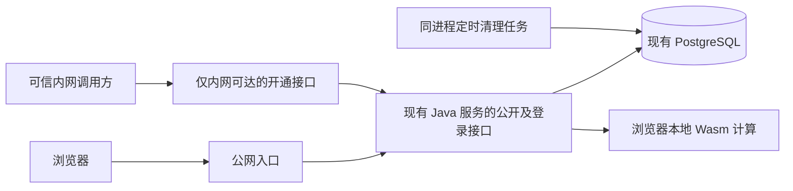
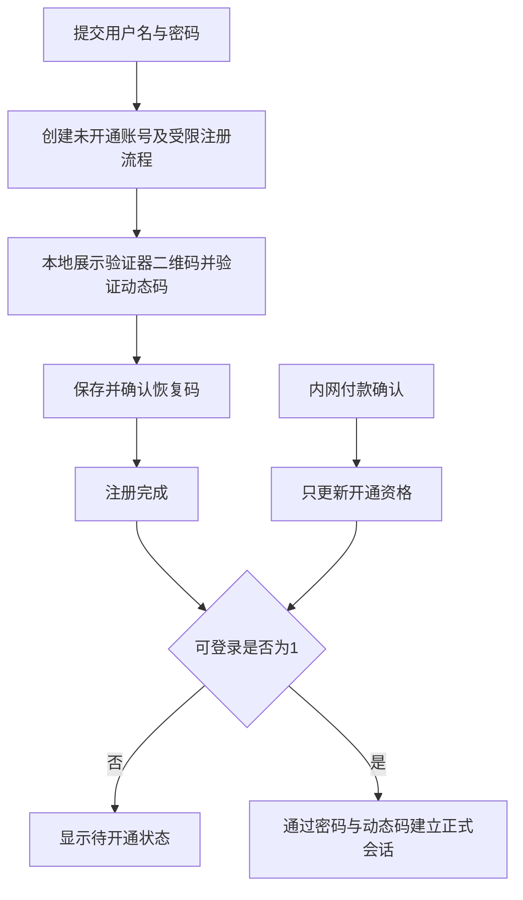

TASK_KEY: server-user-manage-api
DOC_TYPE: 详细设计
WORKSTREAM: server
STATUS: tracked
EXECUTION_MODEL: Codex 主负责人
LAST_TRACKED_AT: 2026-11-05

# 账号注册登录与权限接入技术方案

本方案统一定义账号、开通、登录会话、接口权限和清理规则，供后端、前端与 Wasm 并行开发使用。业务范围已于 2026-11-04 确认；同日补齐待完成注册续办、初始化请求及完成态回查边界后，通过实施前独立只读评审。当前实现入口与共享行为以下文为准；数据库安装与密码存量边界见[账号数据库说明](../../../db/user_manage/README.md)，运行和验证入口见各模块 README，历史验收过程从Git追溯。任务状态以[任务规则](../../../db/task_doc_governance/task_rules.json)为准。

## 1. 已确认范围

本次讨论已确认：

- 普通玩家可以自行注册，不接邮箱和手机号。
- 所有游戏业务数据允许匿名查询，包括角色、装备、技能、构筑、规则、图片、关系、计算可用性及场景快照；读取不检查是否登录或付费。账号、凭证、会话及人员审计记录属于独立的账号数据。
- 账号有“可登录”字段 `can_login`，它就是已付费标记，默认 `0`，付款后开通为 `1`；注册成功不代表可以正式登录。该字段供登录和 Wasm 计算授权检查，不限制游戏数据读取，不再另设一个重复的付费字段。
- 开通由仅内网可调用的接口完成，该接口不对公网暴露。本期账号服务不承接收款、订单或支付渠道回调。
- 从注册时间起算，超过 7 天、从未开通过且仍不可登录的账号，由定时任务清理。已开通账号即使后来被禁用，也不进入这项清理。
- 全员强制使用用户名、密码及基于时间的一次性动态码（TOTP）。忘记密码用动态码与恢复码，丢失验证器用密码与恢复码；不为普通玩家保留免绑定路径。
- 本期接入 Wasm 授权票据与内部验签，并保留早期可关闭的开关。开关仅控制 Wasm 内的授权检查，具体构建、发布与验收规则由第 10 节统一定义。

本期使用现有 Java 服务和 PostgreSQL，不增加认证服务、Redis、短信或邮件服务。账号开通与编辑权限分开，付款不能取得编辑权限。

## 2. 实施前基线与改动面

源码核对基线为 `3b955094938e7077a148e8613cc1ccbe50ec8739`，核对日期为 2026-11-04；表中事实描述实施前状态，最终源码入口见各模块说明。

| 当前入口 | 已核对事实 | 目标变化 |
| --- | --- | --- |
| `server/data_manage/pom.xml` | Java 21、Spring Boot 3.5.0，已有签名令牌相关依赖 | 在现有进程内增加账号模块，按现有依赖管理选库 |
| `support/auth/AdminAuthFilter.java`、`JwtVerifier.java` | 管理路径统一验证 ES256 签名令牌，并要求编辑权限 | 游戏读取直接放行；账号私有操作、游戏写入和计算授权检查会话；内网开通使用服务凭证 |
| `support/auth/AuthContext.java` | 身份依赖 `email`、`canEdit`、`paid` | 改为稳定内部账号编号及数据库中的当前权限 |
| `db/user_manage/schema.sql` | 旧用户表以邮箱为标识；另有编辑日志和访问统计 | 新账号不依赖邮箱；旧数据处置在实施前核实，不能由静态脚本推断实库为空 |
| `AdminEditLogHelper`、`PostgresWriteStore`、`mapper/edit_log/` | 编辑身份使用邮箱，部分日志入口写失败后继续返回成功 | 身份改为账号编号；账号安全事件另用明确的事务规则，不套用编辑日志的容错方式 |
| `web/src/App.tsx`、`services/apiClient.ts` | 手填管理令牌，保存在浏览器本地存储；客户端发送 Bearer 请求头 | 登录界面、会话恢复和退出代替手填令牌，凭据改用浏览器安全 Cookie |
| `pages/simulation/simulationSelectionOptions.ts`、`SimulationBuildConfigurationEditor.tsx` | 计算页同时调用角色、等级、装备、技能、构筑、图片等管理读取接口 | 继续复用现有游戏读取接口与客户端，移除读取对管理令牌和登录状态的依赖 |
| `web/src/engine/genericEngineClient.ts`、`workers/genericEngineWorker.ts`、`wasm/tinygo_engine_v2/internal/runtime/session.go` | 已有编译、运行和释放链；当前没有计算授权票据 | 加入显式票据字段、编译／运行入口验签和构建开关，保持战斗结算规则不变 |

表中后端短路径相对 `server/data_manage/src/main/java/xyz/game/datamanage/`，前端短路径相对 `web/src/`。模块规则和验证入口分别见[后端说明](../../../server/data_manage/README.md)、[前端说明](../../../web/README.md)及[引擎说明](../../../wasm/tinygo_engine_v2/README.md)。

## 3. 部署关系与权限边界

公网只开放前端及明确允许的 `/api/**` 路径。Java 服务的直连端口只允许指定内网来源访问；公网代理明确拒绝转发 `/internal/**`。机器没有独立内网时采用回环地址和本机调用，不能把公网监听地址称作内网隔离。部署验收必须从外网实测内网接口不可达。

内网接口还校验独立的服务调用凭证，通过加密连接或本机回环传输；凭证由私有配置管理，不交给浏览器，不复用玩家会话。不能只依据请求携带的来源地址头、跨域规则或前端隐藏按钮判断内网身份。

本期采用两个固定标记，不建立通用角色系统：`can_login=1` 表示已付费，账号正常且完成注册后可正式登录并申请 Wasm 计算授权；`can_edit` 表示可以维护管理数据。另设 `status` 区分正常与禁用，禁用不把 `can_login` 改回 `0`。编辑资格通过受控运维入口按账号编号授予，内网开通接口无权修改它。

| 调用者 | 允许行为 |
| --- | --- |
| 未登录访客 | 查询所有游戏数据，准备场景；注册、登录证明及限定用途的账号恢复；Wasm 验签关闭时可直接本地计算 |
| 未开通账号的流程凭证 | 继续对应注册或安全流程；游戏数据仍可匿名查询，不能申请计算授权或写入管理数据 |
| 正常且已开通的玩家会话 | 本人会话与安全操作、申请 Wasm 计算授权；游戏读取与访客相同 |
| 正常且已开通、具有编辑资格的会话 | 玩家能力及现有数据管理写入 |
| 指定内网调用方 | 按账号内部编号开通登录；不能修改密码、验证器或编辑资格 |
| 被禁用、会话过期或已撤销的账号 | 拒绝账号私有操作、计算授权和管理写入；仍可以访客身份查询游戏数据 |

所有正式会话都必须满足验证器已确认的条件，Wasm 验签开关不影响这一要求。

## 4. 数据模型

账号使用现有 PostgreSQL 的 `auth` 命名空间；完整建表语句（DDL）已落到正式脚本，见第 4.1、4.2 节。字段、索引和数据库约束以脚本为唯一来源，本节保留跨端语义。

| 表 | 主要字段与约束 |
| --- | --- |
| `auth.accounts` | `id uuid` 主键；`username` 规范化后唯一；`password_hash`；`status` 为 `pending/active/disabled`；`can_login smallint NOT NULL DEFAULT 0 CHECK (can_login IN (0,1))`；`can_edit boolean DEFAULT false`；`login_enabled_at`；唯一的 `enablement_reference`；`auth_epoch` 为登录凭据版本；`recovery_batch_id`；`created_at/updated_at` |
| `auth.totp_credentials` | `account_id` 主键及外键；种子密文、加密密钥编号、`credential_version`、`last_used_step`；只有已确认的正式种子进入此表 |
| `auth.recovery_codes` | 账号外键、批次编号、随机恢复码的摘要、消费时间；只接受账号当前批次，消费必须原子完成 |
| `auth.sessions` | 账号外键；随机会话值的唯一摘要、对应防跨站请求伪造值的摘要、签发时的 `auth_epoch`、创建与到期时间、撤销时间 |
| `auth.flows` | 随机流程值的唯一摘要；账号、固定用途、当前阶段、原始到期时间、签发时的 `auth_epoch`；可选来源会话；候选种子及待确认恢复材料的短期密文 |
| `auth.rate_limits` | 按规范化账号和可信来源地址分别计数；窗口、尝试次数、限制截止时间、清理时间；并发更新使用数据库原子语句 |
| `auth.security_events` | 时间、事件类型、目标账号、调用方类别、操作结果及经过筛选的关联编号；账号被删除时外键置空，不能连带删除全部安全事件 |

关键约束如下：

- `id` 使用随机 UUID，不以用户名或邮箱作为外键。用户名仅允许 3～32 位字母、数字和下划线，入库统一小写，首期不提供改名。新密码至少 12 个 Unicode 字符、UTF-8 编码最多 72 字节；拒绝空字符和不完整的 Unicode 编码，不自动去空格、规范化或截断。
- `status=pending` 仅表示注册凭证尚未完成；`active` 表示注册已完成，不能代替 `can_login=1`。内网开通可以先到账，账号仍须完成注册才能登录。
- `can_login` 只允许 `0 → 1`。值为 `1` 时，开通时间和开通关联编号必须存在；二者用于区分从未开通账号。开通关联编号唯一，防止同一通知开通不同账号。
- 为清理候选建立部分索引：以 `created_at, id` 排序，只覆盖 `can_login=0 AND login_enabled_at IS NULL`。会话与流程摘要有唯一索引，关联账号按主键读取。
- 会话和流程使用至少 256 位随机值，数据库只保存摘要。一次性恢复码每批 10 个、每个至少 128 位随机值；永久表只保存摘要，不用密码算法拖慢高熵随机值的匹配。
- 种子使用带完整性校验的加密保存。附加认证数据明确绑定账号、用途和凭证版本，防止把别人的密文换过来；候选种子切换为正式种子时重新加密，不能直接复制不同用途的密文。
- 账号凭证、会话与未完成流程随清理账号一并删除；安全事件默认保留 30 天，限流窗口和过期流程另作有界清理。所有期限使用数据库时间计算。

旧 `"user".email` 不自动转成新账号，也不生成假邮箱。实施前核对实际记录，本方案不授权清空旧用户数据。编辑留痕使用内部账号编号及当时的用户名快照，第 4.2 节给出保留历史记录的一次性变更草案；新代码不再使用邮箱身份。

### 4.1 完整建表脚本

全新账号存储执行[正式 DDL](../../../db/user_manage/schema.sql)，包含七张账号表、索引和账号身份编辑日志表。所有 UUID 由应用生成。初始化条件和执行入口见[账号数据库说明](../../../db/user_manage/README.md)。

流程用途固定为 `register/login/reset_password/replace_totp/change_password/change_totp/regenerate_recovery_codes`；阶段固定为 `started/totp_verified/recovery_codes_ready/completed/revoked`。只有 `active` 且 `can_login=1`、验证器和当前恢复批次齐全的账号可以建立正式会话。

### 4.2 已有编辑日志的一次性迁移

已有旧 `"user".edit_log` 执行[原子迁移脚本](../../../db/user_manage/migrations/20261104_account_identity.sql)。脚本在同一事务创建账号七表，把历史邮箱列改名为 `legacy_email` 并允许为空，新增账号编号和用户名快照；原编辑记录保留。旧邮箱身份和访问统计不参与新认证，迁移不自动清除它们。

脚本执行前核对实际前置结构及备份，应用不自动建表或迁移。新库脚本与已有库迁移按实际结构选择一个，不能连续执行两份。

## 5. 内网开通接口

唯一开通入口：`POST /internal/accounts/{accountId}/enable-login`。

| 项目 | 契约 |
| --- | --- |
| 身份 | 通过内网访问边界及专用服务凭证；普通玩家和编辑会话都不能调用 |
| 请求 | `enablementReference`：调用方提供的稳定、非敏感开通关联编号；不得仅凭用户名定位账号 |
| 成功响应 | `accountId`、`canLogin: 1`、`enabledAt`、`changed`；首次开通为 `changed=true`，同一开通重试为 `false` |
| 重复调用 | 相同账号和关联编号返回原成功结果；账号已由另一编号开通则返回“已开通”，不覆盖首次开通记录 |
| 冲突 | 同一关联编号用于不同账号，返回 `409 AUTH.ENABLEMENT_CONFLICT`，整个操作回滚 |
| 账号不存在 | 返回 `404 AUTH.ACCOUNT_NOT_FOUND`；不能按同名新账号补开通，也不能自动重建已清理账号 |
| 修改边界 | 只写开通标记、首次开通时间及关联编号，追加安全事件；不修改注册完成状态、禁用状态、密码或编辑资格 |

事务顺序为：锁目标账号行 → 核对状态与关联编号 → 更新 `can_login` → 写安全事件 → 提交。开通及其安全事件必须同时成功。重复通知不增加权限，也不把禁用账号恢复为正常。

账号服务信任经认证的内网调用方已完成付款核实，本接口本身不证明付款。调用方须保存账号编号与关联编号，处理超时重试和失败对账。超过 7 天后，在记录尚未被清理时开通仍可成功；清理已经提交后，迟到通知按“账号不存在”处理，由调用方核对，不能误开通后来注册的同名账号。

## 6. 七天清理与并发规则

同一 Java 进程每小时执行一次定时任务，每批最多 200 个账号，单轮最多 20 批；批次之间重新查询候选。无需额外安装数据库定时任务扩展。

唯一删除条件为：`can_login=0 AND login_enabled_at IS NULL AND created_at < CURRENT_TIMESTAMP - INTERVAL '7 days'`。不依据 `updated_at`，重试登录、重新发起绑定都不延长保留期。满 7 天整尚不满足“超过”；实际删除发生在之后一次任务执行时。

每批在短事务中按 `created_at, id` 顺序取得候选账号行锁，跳过其他事务已锁定的账号（`FOR UPDATE SKIP LOCKED`），取得锁后重新核对上述条件；然后删除从属凭证、流程与会话，处理安全事件关联，最后删除账号。不能先查一批编号，再不带条件直接删除。

| 同时发生的操作 | 必须得到的结果 |
| --- | --- |
| 内网开通先取得账号锁并提交 | 清理重新检查时跳过该账号，已开通数据保留 |
| 清理先取得账号锁并删除 | 开通等待后得到账号不存在，不新建、不按用户名转移授权 |
| 两个清理任务重叠 | 行锁保证同一账号不会被重复处理；重复执行无额外副作用 |
| 清理失败或进程重启 | 当前批次回滚，之后可重试；不能留下孤立凭证或部分删除的账号 |
| 已开通账号被禁用 | `login_enabled_at` 保留，不进入七天候选集合 |

运行记录只保存批次数、删除数、耗时和失败类别，不输出密码、种子、恢复码、会话或服务凭证。真实数据清理上线前先核对候选统计、关联范围与备份；开发验证仅在隔离库执行清理逻辑。

## 7. 注册、安全恢复与登录流程

全员强制绑定验证器，并采用下述双证明恢复规则；不存在仅凭密码建立正式会话的分支。

注册接口只创建 `can_login=0` 的账号并签发受限流程凭证；不自动创建正式会话。绑定二维码由本地库生成，不使用第三方二维码服务。候选种子先放受限流程，动态码确认并保存恢复码后再提交正式凭证；完成前退出不会覆盖已有正式凭证。待开通页展示注册结果和本人账号编号，开通后重新登录；本期不提供按任意账号编号轮询开通状态的接口。

注册流程过期或浏览器丢失流程 Cookie 后，用户可以从登录入口提交原用户名与密码。`POST /api/auth/login` 正确核验后，如账号仍为 `pending`，就在账号锁内撤销旧注册流程并签发新的 `register` 流程，前端据用途继续绑定；不创建新账号，不改变原 `created_at`、开通标记或首次开通记录。注册完成后重新按密码与动态码正常登录。

日常登录分为密码校验、动态码校验两个步骤。密码正确只签发登录流程凭证；最后一步在事务中再次核对账号状态、开通标记及凭据版本，消费动态码时间步并建立会话。未开通账号只能得到受限的本人状态结果，不能取得正式会话或 Wasm 授权；其游戏数据读取继续匿名放行。登录最后一步成功但响应丢失时重新登录，不重放已消费动态码或明文会话值。

| 操作 | 必需证明 | 成功提交的变化 |
| --- | --- | --- |
| 忘记密码 | 当前验证器动态码及一枚未使用恢复码 | 更换密码、消费恢复码、提升 `auth_epoch`、撤销全部会话及其他流程；保留原种子和已用时间步 |
| 验证器丢失 | 当前密码及一枚未使用恢复码 | 验证候选新种子并确认新恢复码后，切换种子和恢复批次、消费旧码、撤销全部旧会话及流程 |
| 正常更换验证器 | 当前会话、当前密码及当前动态码 | 候选新种子确认前旧种子继续有效；完成时更换恢复批次并撤销旧会话 |
| 正常修改密码、重新生成恢复码 | 当前会话、当前密码及当前动态码 | 对应凭证或恢复批次切换，提升版本并撤销旧会话；未完成不替换当前材料 |
| 两项证明都丢失 | 没有足够自助恢复证据 | 明确提示无法自助恢复，不以用户名、截图或内网开通接口重置凭证 |

登录流程总有效期 5 分钟，其他受限流程 10 分钟，不滑动续期；普通会话从完成登录起固定 30 天，不做每请求续期写入。已有会话保留原到期时间，重新登录后采用新期限。安全流程完成后重新登录，不能把受限流程升级为任意接口凭证。

恢复码明文只在当前受限流程中短期加密保存，供“尚未确认保存”的页面在响应丢失后重读；点击确认后清除明文密文，永久表只留摘要。恢复流程开始时核验并绑定所用恢复码的编号与批次，最终提交时再锁定并消费；动态码证明在取得受限流程时消费时间步。每个账号最多有一个未完成的凭证变更流程，新流程在账号锁内撤销旧流程；登录流程不占用这个名额。

更换凭证时，重新核对恢复码仍属当前批次且未消费，消费旧码、激活新材料、撤销会话及写安全事件在同一事务提交，中途失败不能只消费旧码。新密码由对应的受限完成请求提交并做哈希，不在日志或流程中保存明文。验证器及恢复批次切换由“确认已保存恢复码”的最后一步提交；过期流程禁止再读材料，清理任务擦除其密文。

流程状态回查只返回用途、阶段与原截止时间。已完成流程在原有效期内仅能回查“已完成”，不得再次执行或返回材料；这一回查不要求本次操作已撤销的旧会话继续有效，但仍检查原流程摘要、期限及撤销标记。其他未完成操作必须完整检查账号版本和来源会话。

需要完成态回查的流程在完成响应中保留原流程 Cookie 至原截止时间，不能先清 Cookie 再依赖它回查。终态只允许状态查询，其他操作拒绝；撤销来源会话时可清正式会话 Cookie，但不延长或升级受限流程。

## 8. 会话、密码学库与事务边界

正式会话 Cookie 采用 `__Host-dv_session`：`Secure`、`HttpOnly`、`SameSite=Strict`、`Path=/`，不设置 `Domain`。受限流程使用独立的 `__Host-dv_flow`，不能拿它访问业务接口。浏览器不把会话、流程值或密码保存到本地存储、URL 或日志。

生产环境采用前端与 API 同源的加密访问。现有任意 API 基址和手填管理令牌入口退出正式流程；本地开发通过代理保持同源，并明确处理安全 Cookie 所需的本地加密环境。跨域配置不能继续用任意来源加凭证；确需跨来源的开发环境显式配置精确来源。

所有浏览器状态变更及计算授权签发要求精确 `Origin`、JSON 内容类型及固定客户端请求头；缺失、`null` 或未允许的来源拒绝。已有会话或流程的这类请求，额外核验防跨站请求伪造值（CSRF）：独立的可读安全 Cookie、`X-CSRF-Token` 和数据库摘要三方一致。会话与流程各用自己的值，不能只判断请求有无某个头。匿名游戏读取不要求这些凭据；只读的 `POST /simulation-snapshot` 同样不检查登录或 CSRF。认证响应设置 `Cache-Control: no-store`；内网接口使用独立服务鉴权。

固定客户端头为 `X-Damage-Client: web`。正式会话的可读 CSRF Cookie 为 `__Host-dv_csrf`，流程的为 `__Host-dv_flow_csrf`，两者与各自 HttpOnly Cookie 一样使用 `Secure/Path=/`、不设 `Domain`。`register/login/recovery` 三类初始化请求根据请求中的证明建立新流程，不依赖残留 Cookie 或旧 CSRF；`security` 起点用会话 CSRF，`flow` 操作及 `login/totp` 用流程 CSRF，同一次请求不要求两套凭据同时有效。

所有创建流程的响应、私有流程读取／变更及 `login/totp` 响应，通过 `X-Damage-Flow-CSRF` 响应头回显该次实际流程的 CSRF 原值，不暴露 HttpOnly 流程值。前端从该次响应固定绑定，不能在响应后再从可能已被其他标签替换的 Cookie 推断所属流程。`flow/status` 与恢复材料 GET 同样发送固定 `X-CSRF-Token` 并做三方核验；材料响应头必须与已绑定值一致才展示。仅用户显式点击「查询当前进度」时，才使用当前 Cookie 查询、清除旧材料并接管当前流程。完成态回查仍只返回完成标记，Cookie 保留原截止，受控跨域场景暴露此响应头。

| 用途 | 采用的成熟实现 | 项目自己承担的规则 |
| --- | --- | --- |
| 密码哈希 | PostgreSQL 的 `pgcrypto` 扩展，`crypt()` 与 `gen_salt('bf',10)` | 新生成使用 bcrypt 成本 10；已有成本 12 仍按自身编码验证；输入校验、查询保护及限流由应用负责 |
| 动态码 | `com.github.bastiaanjansen:otp-java` | 固定算法与窗口、按账号持久化已用时间步、事务与限流 |
| 种子及短期恢复材料加密 | `com.google.crypto.tink:tink` 的带附加认证数据加密接口 | 密钥保存在数据库外，持久化及受控备份，账号／用途／版本绑定 |
| 二维码 | 前端本地库或 `com.google.zxing:core` | 仅本地编码绑定地址，不向第三方发送种子 |

密码生成和验证在 PostgreSQL 内执行，Java 不再执行 Argon2。密码操作在调用者线程直接执行，实际并发由现有数据库连接池与请求处理承接；不再使用密码专用串行线程池、四项等待队列或一秒排队期限。输入约束、认证限流及数据库查询保护继续生效，数据库容量或保护条件不足返回 503。游戏读取不查登录会话，账号私有操作、计算授权和管理写入不重复计算密码或动态码。本轮交付并行及成本 10 新版并进行旁路测试，不自动切换已发布服务。

### 数据库密码与随机材料

本次按用户提供的[PostgreSQL 密码处理讨论](https://chatgpt.com/share/e/6aebd97e-93b4-83ec-a987-fc412dad9fca)采用数据库原生 bcrypt；新生成成本按用户后续确认调整为 10。`bf` 只处理前 72 字节，因此前后端必须在调用前拒绝超长输入，不能让后半段密码被忽略。验证仅接受完整的 `$2a$10$` 或 `$2a$12$` 编码，已有成本 12 不自动改写，其他成本和 Argon2 等编码拒绝。未知账号或不支持的编码执行当前成本 10 的虚拟校验，结果始终不能作为登录成功；混合成本期间，已有成本 12 的失败验证仍更慢，不保证所有账号与未知账号的耗时一致。

| 材料或操作 | 生成／执行位置 |
| --- | --- |
| 密码哈希及验证 | `public.crypt()`；新盐由 `public.gen_salt('bf',10)` 生成，既存合法成本 12 由自身编码控制验证 |
| 验证器种子 | `public.gen_random_bytes(20)`；用现有编码库转成 Base32，随后仍由 Java 加密保存候选／正式种子 |
| 会话、受限流程及其 CSRF 值 | 一次查询生成两份独立的 32 字节随机值，编码为现行 43 字符凭据 |
| 恢复码 | 一次查询生成十份独立的 16 字节随机值，沿用现行编码、摘要及确认保存规则 |
| 持久化加密密钥、Ed25519 密钥对、内网服务凭据 | 保留受控运维工具及系统随机源，文件保存在数据库外；不通过数据库生成或保存 |
| TOTP 动态码、二维码、带认证加密及 Ed25519 签名 | 保留现有成熟库和用途约束，不为搬入数据库重写算法 |
| 账号／流程编号及票据随机编号 | PostgreSQL 支持原生 UUID；本轮保持现有编号生成位置，不为轻量编号单独增加查询 |

密码与随机材料共用一个职责明确的数据库密码组件，执行固定的参数化 SQL。该组件在同一实际查询连接上检查扩展查询协议、数据库及客户端 UTF-8 编码；传入密码前核对绑定参数及错误参数日志关闭，数据库审计和驱动跟踪日志不得记录这些参数。运维按应用角色和目标数据库设置 `log_parameter_max_length=0`、`log_parameter_max_length_on_error=0`；不向应用授予修改全局日志的权限。非回环／非本地连接要求加密传输，部署使用验证服务器身份的数据库连接配置。缺少扩展、日志或传输条件不满足时，账号操作失败关闭，匿名游戏读取不依赖该组件启动探测。

已有的 `20261104_account_identity.sql` 和 `20261105_postgres_password_material.sql` 均为历史迁移，不改写或重放；后一脚本属于成本 12 版本的扩展安装与编码检查，不能在已含成本 10 账号的数据库重跑。原 Argon2 等不支持编码不能无明文转换，仍需独立的数据处置决定，不能清空账号或伪造转换。并行调用、失败额度预占和新生成成本 10 均不修改表结构，本轮无需新迁移；本机只创建隔离验证库，云端旁路测量沿用已部署的加密连接与日志配置。

动态码固定为 6 位、30 秒、HMAC-SHA1，接受服务器当前时间步及前后各 1 步。匹配到的真实时间步必须大于已用步，并与登录或安全操作原子提交；不能只调用一个无状态的“验证码正确”函数。未知账号使用受限的当前成本密码校验，登录错误不返回“用户名存在／不存在”的区别。

账号与来源地址分别限流：密码按账号 15 分钟最多 5 次失败、来源地址 10 分钟最多 30 次；动态码按流程生命周期最多预占 5 次，账号每 15 分钟最多预占 10 次。密码证明开始前，在独立短事务中按账号、来源地址顺序联合预占失败额度，任一额度不足则整批回滚并返回 429；不持锁跨密码计算。同一账号或来源的未决证明也暂占额度，因此并发预占满时可能短暂限流，但成功不永久消耗失败预算。

密码错误保留本次预占；正确证明或技术错误完成后，只按本次返回的原窗口键退回一次，不能扣减之后的新窗口。原有恢复验证失败在同一证明结束时保留一次，不能先退款再补计；后续动态码、账号状态错误按既有密码计数规则退回。未正常结束的进程预占最多保留至原固定窗口过期。注册另按来源地址限制。达到限额返回 429 及 `Retry-After`，数据库容量或保护条件不足返回 503；失败额度独立提交，不随业务认证异常回滚。来源地址只读取直连地址，不接受浏览器提交的转发来源头。

认证过滤器先按业务操作区分匿名读取与受保护操作：游戏读取直接进入现有读取服务，即使浏览器携带无效或过期 Cookie 也不因此拒绝查询。只对账号私有操作、计算授权和管理写入做一次索引查询，核对会话摘要、到期／撤销、账号状态、开通标记和 `auth_epoch`，再把结果放请求上下文。无需先请求额外的“验证令牌”接口。

修改密码、种子、恢复码及禁用账号都提升 `auth_epoch` 并撤销旧会话和流程。密码计算放在短事务之外，进入提交事务后重新核对密码版本及账号版本。普通管理写入在既有业务事务内持有账号共享行锁并复核资格；禁用与权限变更取得账号排他行锁。锁顺序统一为账号（多账号按编号排序）→ 凭证／流程／会话 → 游戏及业务对象，不在过滤器中开启覆盖整个请求的长事务。

安全状态变更与对应安全事件一起提交。账号模块不能调用现有会完整记录请求正文的编辑日志助手，不能记录密码、种子、恢复码、Cookie 或服务调用凭证。

## 9. 公开接口与前端接入

以下为现行接口，对应流程和凭证要求由第 7 节统一定义。

| 接口 | 责任及授权 |
| --- | --- |
| `POST /api/auth/register` | 创建账号及注册流程；禁止请求体设置开通与编辑标记 |
| `POST /api/auth/login`、`POST /api/auth/login/totp` | 密码证明、动态码证明；最后一步才可能建立正式会话 |
| `GET /api/auth/me` | 查询正式会话对应的 `accountId/username/canLogin/canEdit/expiresAt`；无正式会话返回 401，前端保持访客模式 |
| `POST /api/auth/wasm-grant` | 用正式会话核对数据库中的 `can_login=1`，签发 Wasm 可验的付费授权；返回字段见第 10 节 |
| `POST /api/auth/logout`、`POST /api/auth/logout-all` | 撤销当前或全部会话，清理浏览器凭证；退出当前会话重复调用可返回 204 |
| `GET /api/auth/flow/status` | 仅查询当前受限流程，不允许用任意账号编号查询；已完成流程只回查完成标记 |
| `POST /api/auth/flow/totp/setup`、`POST /api/auth/flow/totp/verify`、`POST /api/auth/flow/recovery-codes/confirm` | 只接受当前用途与阶段允许的操作；候选种子创建重复调用返回同一候选，不无限生成 |
| `GET /api/auth/flow/recovery-codes`、`POST /api/auth/flow/complete` | 前者仅在待确认保存阶段重读短期恢复材料；后者仅完成密码变更类流程，提交新密码并清除对应流程材料 |
| `POST /api/auth/recovery/password`、`POST /api/auth/recovery/totp` | 验证第 7 节对应的两项证明后，创建限定用途流程 |
| `POST /api/auth/security/password`、`POST /api/auth/security/totp`、`POST /api/auth/security/recovery-codes` | 正常登录状态下的安全变更起点，复核密码及动态码，创建对应流程 |

### 跨端请求与响应字段

账号接口直接返回下述 JSON，错误仍用现有错误包装；动态码必须用字符串以保留前导零。空请求使用 `{}`，不接受浏览器提交开通或编辑标记。

| 接口 | 请求 JSON | 成功响应 |
| --- | --- | --- |
| `register`、`login` | `{username,password}` | `FlowView`；登录中的待完成账号返回 `purpose=register` |
| `login/totp` | `{totpCode}` | `SessionView`，同时设置正式会话及其 CSRF Cookie |
| `flow/totp/setup` | `{}` | `{otpauthUri,qrCodeDataUrl}`，二维码由后端本地生成 |
| `flow/totp/verify` | `{totpCode}` | 更新后的 `FlowView`，成功后进入恢复码保存阶段 |
| `flow/recovery-codes` | 无请求体 | `{codes:string[],expiresAt}`，只在待确认保存阶段返回 |
| `flow/recovery-codes/confirm` | `{}` | `{phase:"completed"}` |
| `recovery/password` | `{username,totpCode,recoveryCode}` | `purpose=reset_password` 的 `FlowView` |
| `recovery/totp` | `{username,password,recoveryCode}` | `purpose=replace_totp` 的 `FlowView` |
| 三类 `security` 起点 | `{currentPassword,totpCode}` | 对应 `FlowView`；重新生成恢复码直接进入保存阶段 |
| `flow/complete` | `{newPassword}` | `{phase:"completed"}`，仅完成密码变更类用途 |
| `logout`、`logout-all` | `{}` | HTTP 204 |
| `wasm-grant` | `{}` | `{grant,expiresAt}` |

`FlowView={accountId,purpose,phase,expiresAt}`，用途和阶段使用第 4.1 节固定字符串，账号编号只属于当前持证流程本人；未完成状态查询返回该结构，已完成状态查询只返回 `{phase:"completed"}`。`SessionView={accountId,username,canLogin:1,canEdit:boolean,expiresAt}`，与 `/me` 结构一致。所有 `expiresAt` 使用带 UTC 时区的时间字符串。

游戏数据继续复用现有接口、响应结构及选择器，不另建重复的“已付费玩家读取”接口。下表描述目标权限，路径中的管理前缀不再代表读取需要编辑权限。

| 现有路径或操作 | 目标权限及行为 |
| --- | --- |
| `GET /api/games`、`GET /api/games/{gameId}/images` | 匿名读取，沿用现有游戏列表和图片同步语义 |
| `GET /api/admin/games/{gameId}/**` 中现有的游戏数据读取 | 全部匿名读取，覆盖角色、属性、装备、构筑、技能分类、技能完整配置、伤害类型、状态、乘区、计算规则、图片及关系等 |
| `GET /api/admin/games/{gameId}/simulation-availability` | 匿名读取，保留完整对象准入及当前引擎／适配器身份核对，不因付款改变对象运行验证状态 |
| `POST /api/admin/games/{gameId}/simulation-snapshot` | 明确的只读查询例外，匿名读取，保留现行一致性快照事务、输入校验及大小限制 |
| 游戏创建、修改、删除及其他实际写入操作 | 正式会话及 `can_edit=true`；继续执行原有引用保护、事务和编辑留痕 |
| `/api/auth/**` 中的本人资料、安全材料及 `/internal/**` | 按各自会话／流程／服务凭证授权，不能因游戏数据公开而放开 |

以明确的游戏读取路径和控制器操作判定权限，不能把所有 GET 都放行，也不能仅凭 POST 就认定为写入。读取入口不要求 `AuthContext`，不注入假账号或默认编辑身份。游戏公共读取支持不带凭据的跨域访问；账号与写入仍使用受控来源。原计算选择器继续按现有规则读取技能、分类、构筑等，不把游戏解释逻辑搬入账号模块。

前端新增注册、登录、待开通、验证器绑定、恢复和账号安全界面；全局会话由统一状态入口持有，刷新时通过 `/me` 恢复，游戏资料加载不等待这项账号查询成功。公共游戏读取不附带会话或 CSRF，账号私有请求、计算授权及写入由 `apiClient.ts` 统一附带对应凭据，移除业务客户端的手填管理令牌参数。403 显示未开通、禁用或无编辑权限等对应原因，不误报为需要登录。退出或账号切换撤销旧授权并销毁旧计算工作线程，公开的游戏资料与选择界面仍可继续使用；旧工作线程结果不能重新发布到页面。

### 登录入口与拦截提示

全局顶栏右上角放置「登录」「注册」入口。用户主动点击后才打开对应表单：登录按用户名与密码、TOTP 动态码两步完成；注册沿第 7 节分步完成。正式登录后，入口改为「用户名 · 已开通」，下拉菜单提供「账号安全」「退出登录」「退出全部设备」。注册完成但未开通时只显示注册结果和待开通说明，不显示已登录身份。

用户主动发起需要登录的操作时，若未登录或会话已过期，只显示提示弹窗：标题「需要登录」，正文「请先通过右上角入口登录，再进行此操作。」，仅有「知道了」按钮。计算场景可使用正文「需要登录后才能计算，请通过右上角入口登录。」。拦截不自动打开登录表单、不跳转页面；关闭提示后保留当前页面和场景输入，由用户自行登录并重新发起操作，不自动重放原请求。

初始化 `/me` 返回 401 时静默保持访客状态，不弹提示；游戏资料查询不触发登录拦截。登录表单中的凭据错误只在表单内提示，不再唤起上述弹窗。Wasm 验签关闭时，访客编译／计算不需要登录提示。

账号安全表单中的当前密码或动态码错误也留在表单内提示；若同一个 401 错误无法直接区分证明失败与会话失效，可静默查询 `/me` 判断，只有会话确实失效才显示「需要登录」提示，不重放原安全操作。

统一错误仍采用现有 `error.code/message/details` 包装：401 表示凭据或会话无效，403 区分 `AUTH.LOGIN_NOT_ENABLED`、`AUTH.ACCOUNT_DISABLED`、`AUTH.EDIT_REQUIRED`；409 表示流程或开通冲突，410 表示流程已过期。开通、禁用等具体原因只在已经证明本人身份后返回，不能通过未认证登录探测账号状态。

## 10. Wasm 授权票据与验签开关

本期实现完整票据签发与 Wasm 内验签，同时支持在早期构建中关闭 Wasm 授权检查。登录与后端权限可以先完成联调，最终交付必须覆盖开关两种状态。

### 构建开关

开关命名为 `WASM_AUTH_REQUIRED`，由项目维护者在 Wasm 构建时设置；缺省为 `true`，只接受明确的 `true/false`，非法值使构建失败。早期需要关闭时显式配置 `WASM_AUTH_REQUIRED=false`，不能因缺密钥、票据无效或服务不可用而自动关闭。

| 构建取值 | Wasm 编译与运行入口 | 前端行为 | 后端权限 |
| --- | --- | --- | --- |
| `true`（默认） | 必须携带有效授权票据，编译会话绑定账号，每次运行重新检查；缺失或无效即拒绝 | 访客可读取资料、选择场景；开始编译／计算时按第 9 节显示登录提示，由用户从右上角主动登录后再发起计算 | 游戏读取公开；签发票据核对登录、TOTP 和付费资格；写入另核对编辑权限 |
| `false`（早期显式关闭） | 不要求票据；仍执行既有输入、规则身份和会话生命周期检查 | 访客可匿名取数，直接按现有编译／运行／释放链计算，不申请票据 | 游戏读取公开；账号私有操作、票据签发及编辑写入的权限要求保持 |

开关固化在实际 Wasm 产物中，不作为浏览器存储、URL 参数、Worker 消息或 `runtimeOptions` 中的可改布尔值。前端不能通过传入 `false` 跳过启用版本的检查，也不新增绕过鉴权的正式导出。

PowerShell 与类 Unix 构建脚本使用相同取值语义，随构建生成包含 `authorizationRequired`（是否要求计算授权）、授权协议版本和启用时公钥编号的产物元信息，连同字节数与摘要交付。前端复用现有引擎身份入口读取该元信息，不再维护第二个独立开关；它只决定是否申请票据，实际放行由 Wasm 自己决定。默认启用构建缺少可信公钥时失败，不能产出意外关闭版。

启停开关需要重新构建、同步前端元信息并发布匹配产物；服务端重启或改浏览器配置不会改变已下载 Wasm 的行为。构建对照和正式证明对应实际取值及实际分发字节。早期关闭版被下载后，后续启用不会收回这些旧文件；后端继续控制账号、授权签发及编辑写入，游戏数据读取始终公开。

### 票据与入口检查

`POST /api/auth/wasm-grant` 就是留给 Wasm 的付费校验入口：用正式会话查询数据库，确认当前账号正常、验证器已确认且 `can_login=1` 后，签发短期计算授权票据。成功返回 `grant`（原始签名票据）和 `expiresAt`；缺少会话返回 401，无付费资格或被禁用返回对应 403。接口不接收前端传来的“已付款”布尔值，也不能被用作后端编辑凭据。Wasm 开关不放宽这个接口的身份要求。

采用 Ed25519 数字签名和标准的紧凑 JWS 编码（带签名的三段式数据），固定算法标识为 `Ed25519`。头部精确使用 `alg=Ed25519`、`typ=dv-wasm-grant+jwt` 和预置信任的 `kid`（密钥编号）。正文固定为 `iss="damage-viewer"`、`aud="damage-viewer-wasm"`、`sub`（账号 UUID）、`canLogin:1`、`scope:["engine:compute"]`、整数秒 `iat/nbf/exp`、整数 `authorizationVersion:1` 和随机 UUID `jti`。必须满足 `nbf=iat`、`exp=iat+300` 及 `now>=nbf && now<exp`；不携带密码、种子或恢复材料。Wasm 检查签名及其中的付费资格，不以 `/me` 的未签名布尔值作为授权证明。

Java 使用成熟签名实现或 Java 21 标准签名接口，Wasm 使用 Go 标准库 `crypto/ed25519`，不实现椭圆曲线运算。依据 RFC 9864 的明确算法名称，不再额外接受旧的泛称、其他曲线或其他算法。必须先验证实际 Java 依赖对该标识的处理；若需适配，只适配固定算法签名接口，不引入可协商的算法集合。

- 下列票据要求适用于开关启用的构建。Wasm 内置可信公钥；不能由 JavaScript 同时提供任意公钥和票据。私钥只在服务端的受控配置中，轮换公钥需要重建并分发引擎。
- 编译与每次运行请求携带原始票据，Wasm 内部验签后检查 `canLogin` 必须是整数 `1`，以及用途、能力、协议版本、账号与期限。编译会话绑定票据中的账号，同一账号续取新票据后可以继续运行已有编译会话。
- 只在编译／运行入口校验；已经开始的运行允许完成，不在每次命中或效果结算中验签。释放会话不要求未过期票据，沿用现有释放语义。
- 将授权字段放在显式协议字段，不塞入 `runtimeOptions`，不让战斗规则解释账号资格。保持数值结果和调度规则不变，不提供请求级的跳过验证开关。
- 原始票据限制为 4096 字节，验证原始签名字节；拒绝重复 JSON 键、错误类型、未知头字段、未知算法／密钥、超长有效期、错误接收方及缺失字段。`scope` 必须是精确为 `["engine:compute"]` 的字符串数组。允许同一账号在有效期内复用票据，不宣称它是一次性票据。
- 票据有效期固定为 300 秒，响应的 `expiresAt` 是签名 `exp` 对应的整秒时间。前端据此计算生效时点；签发方略快时最多等待 5 秒再提交计算，偏差更大时提示同步设备时间。等待期间账号变化使原请求失效，Wasm 继续严格检查 `now>=nbf && now<exp`。
- 浏览器内验签可以拒绝伪造的接口结果，但浏览器没有可信时钟，也能替换整个 Wasm。退出后正常前端销毁工作线程；已经发出的离线票据不能被后端即时收回，不能把这套设计解释为防破解或计算结果可信证明。

两种构建的包体、入口耗时与 Java → TinyGo 互通证据保存在开发验收中。测试密钥只用于隔离构建；本机部署公钥启用版必须接收实际 Java 服务签发的短期票据。正式分发不内置信任测试密钥，公开夹具不保存长期票据。

## 11. 实现入口与维护责任

| 范围 | 维护入口 |
| --- | --- |
| 后端账号、开通与清理 | `server/data_manage/src/main/java/xyz/game/datamanage/support/account/`；原 `support/auth/` 负责与游戏接口接合 |
| 数据库 | `db/user_manage/`；执行条件与一次性迁移见该目录 README |
| 前端界面与会话 | `web/src/pages/auth/AccountControls.tsx`、`web/src/services/authClient.ts`、`authState.ts`、`apiClient.ts` |
| 计算客户端与工作线程 | `web/src/engine/genericEngineClient.ts`、`workers/genericEngineWorker.ts`、`wasmIdentity.ts`；按实际产物身份申请票据 |
| Wasm 验签与固化构建策略 | `wasm/tinygo_engine_v2/internal/authorization/`、`internal/runtime/session.go`、`scripts/build-wasm.ps1` 及 `scripts/build-wasm.sh` |

跨端字段、路由、错误和权限在本方案统一维护，模块 README 保存配置和验证入口；历史修复与运行证据归入开发验收。授权检查只在计算入口，不进入数值结算所有者。

## 12. 验收门槛与本轮证据边界

| 层面 | 必须验证的结果 |
| --- | --- |
| 游戏读取 | 未登录、未开通、会话过期及禁用账号均能查询全部游戏数据；无 Cookie、无效 Cookie 及缺少 CSRF 不妨碍只读快照；只读操作不写业务数据 |
| 账号与接口 | 注册不能设置开通／编辑资格；开通前不能建立正式会话或取得授权票据；开通后可按已确认凭证登录；禁用阻止旧会话；无编辑资格不能修改游戏数据 |
| 内网边界 | 外网无法访问开通接口；内网无服务凭证同样被拒绝；重试不重复开通，关联编号冲突不部分提交 |
| 清理及真实数据库 | 不满／刚满／超过 7 天；未完成注册与注册完成未开通；已开通及已开通后禁用；开通与清理两种锁顺序；删除依赖及失败回滚 |
| 安全流程 | 全员不能仅凭密码登录；同一步动态码并发只成功一次；恢复码并发只消费一次；未确认候选不覆盖正式凭证；响应丢失可回查；版本变化、过期及来源会话撤销后拒绝旧流程 |
| 浏览器 | 访客直接浏览、查询与准备场景，初始化 `/me` 返回 401 不弹提示、不跳转；右上角手动进入登录／注册；操作被拦截只弹「需要登录」提示，不自动打开表单或重放请求，关闭后保留输入；注册、待开通、真实开通后登录、刷新恢复、退出、超时及双标签页失效；Cookie 属性与 CSRF；编辑页面仍可保存 |
| 回归 | 后端受影响测试后运行 `mvn test`、`mvn package`；前端运行 `npm run lint`、`npm run typecheck`、`npm run test`、`npm run build` 及受影响页面和非 Wasm 桌面检查 |
| Wasm 验签启用 | 真实签发票据通过；无票据及伪造／非付费资格／错误用途／错误密钥／错误账号／过期票据被拒绝；未登录不能申请票据，但仍能取游戏数据；过期仍能释放；浏览器伪造关闭标记不能绕过 |
| Wasm 验签关闭 | 访客匿名取数并完成编译／运行／释放；既有规则身份检查仍生效；无会话申请授权票据或提交游戏写入仍被拒绝 |
| 构建与运行 | 缺省启用、非法开关值及启用时缺公钥的构建拒绝；两种取值的产物及元信息一致；按各自实际取值做正式构建对照、固定机制回归和真实 Worker 验证；测量包体及入口耗时 |

验证命令在各模块目录执行，完整命令及证明刷新规则沿用模块 README 和[开发与独立评审流程](../../项目说明/开发与独立评审流程说明.md)。记录原始输出到被忽略目录，交付时报告各层实际检查结果与限制，不能把方案存在、静态 SQL 或历史探针当作功能通过。

实施前的静态 SQL 检查与评审属于历史证据；最终源码、实库迁移、服务、浏览器和真实 Wasm 仍须分别验证。历史执行结果从Git及对应证据目录追溯，模块 README 保存运行、配置与持续验证入口。
