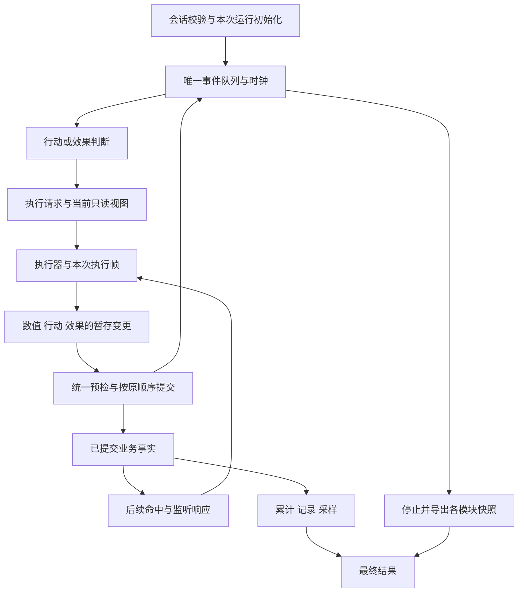

TASK_KEY: planning-engine-subsystem-refactor
DOC_TYPE: 详细设计
WORKSTREAM: planning
STATUS: tracked
EXECUTION_MODEL: Codex 主负责人实现，执行代理分端实现，领域独立只读复核
LAST_TRACKED_AT: 2026-10-26

# 运行时子系统拆分与数值修正分组实施详细设计

## 1. 交付目标与文档边界

本文件落实[通用计算引擎概要方案](../../概要设计/项目/通用计算引擎子系统拆分与公式数据驱动重构方案.md)中剩余的“模块组合收敛”，是本轮包边界、文件迁移、数值修正分组和实施顺序的唯一详细设计。既有公式结构和数学原语仍由[共同公式契约](共同公式定义与校验详细设计.md)定义；纯求值、输入绑定和只读计划仍由[纯公式与执行计划设计](纯公式编译求值与执行计划拆分详细设计.md)定义，本文件不重复定义它们。

正文定义本轮实施目标；当前实现、独立复核与分层验证进度由[既有验收摘要](../../测试记录/项目/共同公式与引擎重构验收摘要.md)记录。设计评审完成不等于代码、真实数据库或正式 Wasm 已完成改造。

交付按以下顺序独立验收：

1. 明确状态归属、依赖方向和行为对照基线。
2. 删除没有消费者的 `wasm/tinygo_engine_v2/internal/trigger`。
3. 将稳定基础能力归入 `base` 路径，再将 `runtime` 拆成真实子系统，随所属代码整理测试。
4. 在管理配置到真实 Wasm 链路支持“同组增幅相加、组间倍率相乘”。
5. 测量属性写入和复制，再决定是否调整分页布局。

基础能力统一归入 `wasm/tinygo_engine_v2/internal/base/`，继续留在同一 Go 模块中。`base` 是人和AI可直接识别的受保护目录，子目录各自保持独立包，默认不接受普通业务迭代的修改；不新增 `go.mod`，也不把 ABI、属性和公式合并成一个公共大包。变更例外及验证要求由第6.3节定义。本轮不引入插件、反射、并发执行或任意战斗流程脚本。结构迁移不扩展英雄范围、控制语义、资源恢复或快照恢复能力。普通施法费用继续沿现行产品的忽略口径，显式资源操作继续执行。

## 2. 当前基线与风险判断

源码调查日期为 2026-10-25，仓库基线提交为 `37703cf2a897c40bf334aa07336277bdf4b70797`。实施开始前重新核对提交、工作树及正式产物，不能把本次调查提交号当作未来固定基线。既有未提交修改必须保留，不为建立基线而重置、清理或暂存其他工作。

| 当前事实 | 源码入口 | 对设计的约束 |
| --- | --- | --- |
| `runtime` 有87个实现文件，多数行为依附同一运行状态或执行帧 | `wasm/tinygo_engine_v2/internal/runtime/generic_run.go`、`generic_execution.go` | 拆分状态和操作入口，不能只移动文件。 |
| 过程持有执行收集器，使用对象持有过程和行动指针 | `wasm/tinygo_engine_v2/internal/runtime/generic_process.go`、`generic_skill_hit.go`，均相对引擎模块根目录 | 先用稳定身份和只读视图解除交叉，再建立不同 Go 包。 |
| 一次提交涉及数值、冷却、效果、过程、队列和事实 | `wasm/tinygo_engine_v2/internal/runtime/generic_execution.go` 的 `commit`；`generic_frame_commit*.go` | 保留一个提交协调入口，不能让子系统各自提前发布。 |
| 有些旧生命周期路径在部分状态发布后仍可能报错 | `generic_execution.go` 中未投影的 `providerOps` 分支 | 不能宣称当前全部原子提交；结构迁移保留现有错误边界。 |
| 使用、命中和触发额度参与后续判断 | `generic_skill_hit.go`、`generic_use_trigger.go`、`generic_frame_commit.go` | 这些事实与显示记录分开，关闭明细不能丢失它们。 |
| 属性页大小为8，目录对新增属性名排序，扩展时追加 | `wasm/tinygo_engine_v2/internal/attribute/table.go` 的 `Layout.Extend` | 当前分页不是随机；排序靠前本身不保证少复制。 |
| 属性支持平加、基准百分比平加、乘算和剩余比例等；伤害支持乘算、覆盖和平减 | `wasm/tinygo_engine_v2/internal/pipeline/attribute_resolver.go`、`damage_modifier.go` | 缺的是显式分组聚合，不能将已有规则统称为只有乘法。 |
| `trigger` 没有代码消费者，也不在正式入口依赖中 | `wasm/tinygo_engine_v2/internal/trigger/trigger.go`；`go list -deps ./cmd/engine_wasm` | 可以删除该包，不需要向监听器迁移其骨架。 |

实现位置采用仓库相对路径；表格中的同族文件名按已注明的目录定位。命令的工作目录由第11节明确给出，不依赖本机绝对路径。

已有单测能显著降低风险，但数量不能代替边界证明。跨包可见性、别名共享、初始化入队次序、同刻事件顺序、条件冻结点和 TinyGo 分配变化，都可能在总伤害不变时出现问题。因此本设计优先复用现有有效测试，只为没有被锁住的边界补测试；不因已经有单测而省略正式 Wasm 组合回归。

本次文档编写未执行 Go、数据库、Wasm 或浏览器验收。第11节列出的是实施时必须提供的证据。

## 3. 目标目录与依赖方向

### 3.1 目标目录

以下为 `wasm/tinygo_engine_v2/` 下本轮落地结构。含Go实现的叶目录各自形成一个包，子目录中的同名包不会自动与父包合并。`base` 仅作为归集路径，本层不放Go实现，不形成一个名为 `base` 的公共包。

```text
internal/
├── base/                  # 稳定基础层，默认不随业务迭代修改
│   ├── AGENTS.md          # AI与开发者共同遵守的变更边界
│   ├── README.md          # 能力清单、依赖与验证入口
│   ├── abi/               # 二进制帧、内存与输出缓冲区
│   ├── attribute/         # 属性槽、分页、不可变快照与编辑器
│   ├── expression/        # 纯公式校验、编译和数值求值
│   ├── inputbinding/      # 声明输入到只读数值的绑定
│   └── typeset/           # 类型编号、位集合与匹配
├── formula/               # 战斗公式用途、上下文与读值绑定
├── pipeline/              # 属性/伤害修正及结算规则
├── scheduler/             # 当前事件定义、队列及唯一循环算法
├── model/                 # 共享协议结构
├── plan/                  # 只读执行计划
├── compile/               # 规则校验与计划生产
├── runtime/
│   ├── session.go         # 编译、运行、释放与会话登记
│   ├── run.go             # 创建唯一循环，协调初始化、运行与结束
│   ├── validation.go      # 本次请求的会话及摘要身份校验
│   ├── contract/          # 内部身份、只读视图、请求、已提交事实
│   ├── actor/             # 双方属性、资源值和生命上限锚点
│   ├── action/            # 使用、过程、普攻、调度、冷却、弹药
│   ├── effect/            # 挂载、状态、标记、护盾与生命周期
│   ├── execution/         # 能力、操作、命中、监听与统一提交
│   └── report/            # 累计输出、展示明细、采样和曲线
└── testkit/               # 现有测试构造器及固定样例
tests/runtime/             # 仅经导出入口验证的跨子系统组合测试
```

优先建立这些真实边界，不按每个小辅助函数继续拆包。各包内部文件按职责命名，例如 `action/process.go`、`action/cooldown.go`、`effect/provider.go`、`effect/expiry.go`、`execution/damage.go`、`execution/listener.go`、`execution/commit.go`。移入包后移除多余的 `generic_` 前缀；不以减少文件数量为理由将多个机制重新合成大文件。

根入口按固定顺序组合 `execution.New`、同一个循环及 `execution.Engine.Finish`；后两者内部只能由执行协调调用所属子包，不将私有状态公开回根层。初始化与结束没有再增加只转发一次调用的独立文件，完整状态装载、既有末态刷新和报告容器转移仍在执行协调中保持原顺序。

### 3.2 允许的运行包依赖

| 包 | 可以导入的本轮运行子包 | 其他必要依赖 |
| --- | --- | --- |
| 根 `runtime` | `execution`、`actor`、`action`、`effect`、`report`、`contract` | `scheduler`、`model`、`plan`、`formula`；仅会话接线依赖 `compile`、`base/abi`。 |
| `execution` | `actor`、`action`、`effect`、`report`、`contract` | 现有公式、属性、资源、数值管道、类型和事件队列。 |
| `action` | `contract` | `model`、`plan`、`formula` 及必要的不可变基础类型。 |
| `effect` | `contract` | `model`、`plan`、`formula`、`pipeline`、`status`、`shield`；`base/attribute` 提供只读数值类型，`command` 仅为既有纯数值结算的参数/结果类型，不承接操作路由。 |
| `actor` | `contract` | `base/attribute`、`model`。 |
| `report` | `contract` | `model` 及数值统计所需标准库。 |
| `contract` | 无其他运行子包 | `model`、`plan`、`base/attribute` 等必要的数据类型。 |

所有运行子包禁止导入根 `runtime`；`action` 与 `effect` 不互相导入，也不导入 `execution`。它们通过只读视图、执行请求、暂存变更和已提交事实协作。`execution` 是上层协调者，可以组合这些子系统；其自身不得成为公开全部可写状态的新容器。

现有基础依赖如 `formula -> attribute` 在迁移后变为 `formula -> base/attribute`，数学和读值语义保持不变。基础层只接受第6.2节白名单依赖，禁止反向导入根 `runtime` 及其子包；`plan` 不依赖 `compile` 或任何运行子包。`contract` 中不得出现总运行状态、执行器、收集器指针或业务控制回调。

## 4. 状态所有权与包间数据

### 4.1 唯一可写所有者

| 所属模块 | 自己拥有的可写状态 | 对外提供 |
| --- | --- | --- |
| 根 `runtime` | 当前时间、事件堆、观察范围、停止状态、各模块的生命周期 | 当前时间和规则的值上下文；最终组装结果。 |
| `actor` | 双方属性表、资源槽、生命上限初始锚点 | 只读角色视图、数值暂存变更、数值快照。 |
| `action` | 使用与过程身份、过程步骤、普攻等待、自动候选、前序资格、冷却、弹药、行动占用 | 使用/过程视图、尝试结果、执行请求、排程意图、行动暂存变更。 |
| `effect` | 供值器和护盾实例、内部状态、目标标记、状态贡献、生命周期编号、修正器集合及解析器 | 效果视图、生命周期暂存变更、有效修正集合、周期/到期意图。 |
| `execution` | 帧/施放/伤害身份、命中分组和冻结判定、触发额度、施放节流、延续负载、事件快照及派生缓存 | 执行结果、已提交事实、需要外层继续处理的事件。 |
| `report` | 输出累计、可截断显示记录、伤害时间历史、采样游标 | 结果片段和曲线；不提供战斗控制命令。 |

所有者持有私有字段。其他包只能通过约定方法取得值或只读视图，不能拿到可写 `map`、切片或内部对象指针。共享编译计划仍只读；临时驱动公式仍进入本次独立公式表，不能因拆包又写回会话。

“累计”并不自动归报告层。例如现有 `abilityCastCount` 被监听逻辑用于判断一次能力是否真实成功，这个成功事实归 `execution/action`；报告只消费其结果。伤害历史仅供曲线计算的部分可以归 `report`，事件回放所需的伤害身份和冻结金额仍归 `execution`。

### 4.2 内部交换数据的有限范围

`contract` 只允许以下数据；它不是新的通用公共包，也不替代外部 `model` 和只读 `plan`：

| 数据 | 必须携带 | 不能携带 |
| --- | --- | --- |
| 身份引用 | 角色、使用、过程、施放、帧等稳定身份 | 另一个模块的可写对象指针。 |
| 本次值上下文 | 当前毫秒、参与者、原使用/施放身份、链深度及必要错误定位信息 | 完整运行状态或隐式取值回调。 |
| 只读视图 | 属性表、按身份查询的使用/过程/效果值；必要的修订编号 | 可直接修改底层存储的集合。 |
| 执行请求 | 能力或已编译操作引用、参与者、来源、使用/过程身份、必要冻结上下文 | 原始作者 JSON 或一套新操作语言。 |
| 已提交事实 | 实际生效的变化、完整身份和原有发生顺序 | 仅由显示日志反推的伪造事实。 |
| 排程意图 | 新增/重排事件、时刻、类别、版本和稳定关联身份 | 独立时钟或自行执行队列的能力。 |

各模块自己的 `ChangeSet`（暂存变更）留在所属包，由 `execution.Frame` 持有并协调。视图使用借用的不可变页或值拷贝，不为每次查询深拷贝整个角色；真正需要冻结的事件视图沿现有快照规则复制或共享不可变数据。

### 4.3 必须先解除的交叉引用

1. 过程中的执行收集器移到 `execution`，按过程/使用身份定位；`action` 只保存身份和过程状态。
2. 现有 `skillUseRuntime` 拆成行动使用状态与执行接触/命中状态，以原使用身份关联。执行层读取 `UseView`（使用只读视图），不持有行动可写指针。
3. 行动判断效果是否仍挂载时读取 `EffectView`（效果只读视图）；效果读取使用事实时使用只读使用视图或已冻结事件。二者不互相导入。
4. 现有 `commitFrameFacts` 分为业务事实发布和报告消费；命中事实、过程事实、使用前弹药/状态快照、触发额度和施放身份不迁入报告层。

## 5. 运行与提交如何组合



### 5.1 创建与事件处理

根层创建各模块的空容器及本次独立公式表；构造器不暗中排队。之后按当前 `newGenericRunState` 的准入、装载与播种顺序初始化，保持事件序号分配位置。自动技能、手动指令及后台普攻继续复用同一事件堆；不增加每个子系统独立的运行循环。

2026-10-26实施收口时，唯一循环算法由现有 `scheduler` 包的具体类型 `Loop` 承载，根 `run.go` 创建并拥有该实例；时钟、堆、处理次数及停止状态只保存一份。执行协调借用同一实例，经有限的 `LoopDriver` 接口交换选中事件、状态值、观察时点和执行结果，不回传总运行状态或业务控制回调。此位置调整已由未参与该部分实现的代理独立复核，保留全部原有分支及顺序；接口派发的成本须经正式Wasm复核。包内测试只用短接线组合真实循环与执行器，外置组合测试再验证根入口，不复制循环算法或增加生产测试钩子。

行动或效果模块处理一个事件后，返回明确的执行请求/排程意图；根层调用具体执行器。监听器派发保留在执行层，调用行动或效果的只读判断及暂存方法，不能通过回调反向取得整个根运行状态。

事件堆自身继续由 `scheduler` 维护，排序和同刻特殊处理沿现行实现。队列新增和重排只能由根层初始化/调度以及执行器提交这两个明确入口完成；行动和效果模块不自行分配事件序号。

### 5.2 当前帧投影与冻结视图

一个执行帧包含数值、行动、效果的暂存变更。后续操作读取暂存后的当前投影，入口快照和事件发出时快照继续分别冻结。资源上限、关联盾和动态属性在下一次数值读取前需要可见的变化，仍按现有可见段刷新，不能一律延到帧末。

保留已有按需写时复制；连续修改同一页、资源表或效果状态时复用当前暂存副本。共享页和已冻结事件不能被后续操作改写。缓存命中必须包含原有完整依赖和到期判定，不因换包丢失来源、目标或修订身份。

### 5.3 提交顺序与失败边界

迁移必须保持以下现行顺序：动态效果投影及关联盾移除准备 → 原有参与者/生命周期/队列容量预检 → 按稳定参与者顺序发布当前暂存状态 → 剩余生命周期处理及生命上限同步 → 过程和强化待击状态 → 死亡事实冻结 → 弹药等待、普攻等待、冷却唤醒、到期、周期、过程计时入队 → 业务事实及报告消费 → 死亡导致的过程失败处理。伤害与监听事件仍沿当前调用路径在相应提交后派发。

已覆盖的原子操作组必须保留“失败不发布组内部分变化”的保证。此前已提交的候选或事件不因后续失败整体回滚。现行未完全预检的旧生命周期分支先保持相同顺序、错误和可见状态；需要修正时作为独立正确性改动处理，并增加能重现问题的测试，不能混入文件搬迁后宣称整场事务完成。

子系统可在暂存阶段求值、检查和构造变化，但不能自行发布跨模块结果。统一提交协调入口保留在 `execution`；已提交业务事实再交给报告层，不由日志反向驱动战斗。

## 6. 文件迁移与基础能力保护

### 6.1 迁移归属表

下表的文件族指当前 `wasm/tinygo_engine_v2/internal/runtime/` 内文件；含混合职责的文件先拆方法和状态，再移动，不能整文件强行归类。任何本表未逐字列出的实现文件，实施前按同一所有权规则登记落点，不能默认留在根包。

| 当前入口或文件族 | 目标 | 必须分开的内容 |
| --- | --- | --- |
| `session.go`；`generic_run.go` | 根层会话、初始化、主循环、结束组装 | 运行字段分别交给所属模块；结果不再遍历他包可写对象。 |
| `generic_output_mode.go`、`generic_sampling_cursor.go`、`generic_basic_attack_output.go`；统计与记录方法 | `report` | 真正参与执行判断的计数和事实先分离。 |
| 角色属性/资源存储、生命上限锚点与快照物化 | `actor` | 效果贡献和修正器集合归 `effect`，跨模块上限结算归执行协调。 |
| `generic_process*`、`generic_recast.go`、`generic_skill_actions.go`、`generic_automatic_skills.go` | `action` | 执行器指针、事件复制收集器和命中冻结状态移出。 |
| `generic_basic_attack*`、`generic_action_occupancy.go`、`generic_cooldown*`、`generic_ammo.go`、`generic_total_cooldown_refund.go` | `action` | 变更计算与等待账本归行动；跨模块提交、已生效报告分别调用对应模块。 |
| `generic_provider*`、`generic_dynamic_provider.go`、`generic_status*`、`generic_target_*`、`generic_state_on_expire*`、来源状态到期 | `effect` | 生命/资源数值操作和实际触发执行由执行器消费请求。 |
| `generic_shield_lifecycle.go`、`generic_dynamic_linked_shield.go`、挂载修正、来源初始化、常驻周期和各类准入 | `effect` 为主 | 涉及操作/队列的协调部分归执行器或根初始化；不将准入留成另一个总包。 |
| `generic_damage*`、`generic_received*`、`generic_vamp.go`、`generic_settled_event_heal.go`、`generic_incoming_capped_flat.go` | `execution` | 纯数值排序/运算继续复用 `pipeline`，不复制一套伤害管道。 |
| `generic_skill_hit*`、`generic_use_trigger.go`、`generic_cast_context.go`、强化待击与主体替换 | `execution` 为主 | 使用/过程状态归行动，实际接触、冻结和额度归执行。 |
| `generic_execution.go`、`generic_frame_*`、执行预算、公式上下文和派生缓存 | `execution` | 分为能力、操作路由、读值、命中、监听、提交等文件，不重建一个大文件。 |

迁移时保留对外 `Session`、`RunGeneric` 及 compile/run/release 导出语义，内部调用直接使用新包，不留下旧包类型别名或转发兼容外壳。每个实施小步完成后才删除被替代定义，最终不保留两套可写状态或两条正式执行路径。

### 6.2 基础层统一路径与稳定范围

以下目标均在 `wasm/tinygo_engine_v2/` 下，叶包名保持不变，只改变导入路径。迁移本身仅移动代码、测试和必要路径引用，不改变算法、协议、读值口径或错误行为。

| 当前包 | 目标包 | 归入基础层的内容 | 允许的项目内直接依赖 |
| --- | --- | --- | --- |
| `abi` | `base/abi` | 帧、内存、输出缓冲区及错误运输 | `model` 中既有协议结构。 |
| `attribute` | `base/attribute` | 槽位存在性、分页、不可变表、编辑器、快照隔离和既有最小数值读写 | `model` 中属性槽结构。 |
| `expression` | `base/expression` | 纯公式校验、依赖编译、数学原语和数值求值 | 无项目内依赖，仅标准库。 |
| `inputbinding` | `base/inputbinding` | 声明输入到明确只读数值的绑定 | `base/expression`。 |
| `typeset` | `base/typeset` | 类型编号、目录校验、位集合和匹配 | `model` 中类型目录和匹配结构。 |

这里的 `base/...` 是目标包路径简写，完整仓库路径为 `wasm/tinygo_engine_v2/internal/base/...`。`model` 当前无项目内导入，作为基础层必要协议数据的例外依赖保留；不为搬目录把整个模型包也迁入基础层。该例外不能扩展为在 `model` 中引入执行逻辑或反向依赖 `formula`、`compile`、`pipeline`、`runtime`。共享槽位/协议结构变化时，即使没有修改基础层文件，也要运行受影响基础测试。

当前 `formula` 还包含技能参数、事件快照、弹药、过程和供值器读值权限，因此保留在基础层之外。数学运算和纯程序执行由 `base/expression` 提供，`formula` 组合这些能力并绑定战斗上下文。新增技能读值入口优先在这个外层完成，不能为了让目录看起来统一，把经常随业务变化的上下文塞进基础层。

`pipeline` 承担本轮新增乘区规则，`scheduler` 的事件负载含技能、过程和弹药身份，`status/shield/resource` 含运行实例或资源策略，先保留在现有业务侧路径。它们可以依赖基础层，基础层不能导入它们。是否继续抽出其中纯原语，不属于本次路径归集的必要工作。

搬迁时一次性更新实际Go导入、测试构造器、构建/验证脚本和当前阅读入口。`tools/formula-contract/generate.mjs` 的Go生成目标同步改到 `wasm/tinygo_engine_v2/internal/base/expression/`，生成物随实现移动，旧目标删除；不能让生成器重新生成第二套旧包。既有数学契约不变，当前实现位置在阶段2.1落地时同步更新，历史证据保留当时路径。不保留旧导入路径的类型别名、转发包或临时双份实现。

### 6.3 基础层默认保护与变更例外

阶段2.1同时建立 `wasm/tinygo_engine_v2/internal/base/AGENTS.md` 和同目录 `README.md`。前者面向AI与开发者明确写入约束，后者维护基础能力清单、边界和独立验证命令。规则至少包含：

1. **普通英雄、技能、装备、监听器、过程或展示迭代默认不得修改基础层。**先在业务层完成组合、输入绑定和状态管理；不能为省掉一个业务适配，把对象专用分支或执行状态写进基础包。
2. **允许的变更例外**只有可复现的基础能力缺陷、明确要求的基础契约/数学原语变更，以及已有授权覆盖的基础性能优化。提交说明须讲清基础问题、外层组合为何不足、受影响契约及验证结果；保持行为的路径移动另行标明。
3. **已有授权继续有效。**第9节分页优化本身属于已确认的基础层变更范围，测量证明收益后可按该节推进，不因归入 `base` 再请求同一项授权。普通业务任务发现未授权的基础能力扩大时，返回主负责人重新界定范围；不自动放宽基础规则。
4. **基础算法变化与业务功能变化分开差异及验收。**必要时在同一任务中分提交，先证明原有基础契约仍成立；不为了迁就新业务修改旧固定期望或削弱快照/缺值/预算断言。
5. **验证影响基础层的依赖。**共享 `model` 的相关结构、公式契约和生成器变化同样触发基础测试；保护范围不是只检查 `base` 文件是否有改动。包依赖检查保护方向，独立单测保护行为，重要协议/数学语义仍按现有风险规则独立评审。

“默认受保护”是明确的协作和验证约束，不把基础目录设置为操作系统只读，也不承诺永不修复缺陷。正常使用者只需要阅读基础能力的接口和约束，业务实现不接触其内部字段。

新增 `wasm/tinygo_engine_v2/scripts/check-package-boundaries.mjs`（包依赖检查脚本），读取 `go list -json ./internal/...` 的实际导入、第3节允许表及本节基础白名单，检查生产代码依赖、禁止的反向导入及层级循环。脚本位于引擎模块内，不加入运行产物；为越界导入和合法依赖各设工具测试。接入现有引擎持续集成任务。除明确列出的共享数据依赖外，基础层不能导入业务包；`report` 不能导入行动、效果或执行。不能靠文件名或单纯的改动目录判断代替真实依赖检查。

## 7. 同组增幅加算与组间乘算

### 7.1 第一版的精确语义

新增 `multiplierGroupKey`（乘算分组标识），独立于现有 `bucket`（排序或次数范围）、`stage`（计算阶段）、`priority`（有序位置）。输入倍率继续使用 `multiply` 的既有含义：`1.2` 是乘1.2，即增加20%，不是增加120%。

第一版只支持非负增幅。设有效成员倍率为 `f_i`，要求每个 `f_i` 都有限且不小于1：

```text
同组因子 F_g = 1 + Σ(f_i - 1)
组间倍率 = Π(F_g)
最终金额 = 本阶段输入 × 各独立倍率 × 各组因子
```

倍率1是合法中性项。未设置组标识的倍率仍是独立单项，保持原运算和校验语义；有组的同类倍率才进行增幅加算。减伤倍率小于1、负倍率、非有限数和溢出不是本版分组能力，明确报错，不夹取成0或1。减伤、剩余比例、治疗取强等已有规则继续使用各自现有方式。

这不是旧版本兼容层：外部仍只有一份当前模型与执行计划，未声明组就是独立倍率；不增加旧字段识别、双读转换或长期两套算法。没有分组的会话走原有直接路径，避免让普通伤害为新能力增加分组容器分配。

### 7.2 作者目录与外部字段

复用现有修正区域目录及 `modifierZoneKey`（修正区域标识），新增目录计算方式 `RATIO_GROUP_ADD`，中文名称为“同组增幅加算”。不新增分组表，不让效果再自由填写第二个组名。相同有效区域的各来源贡献同一增幅组，不同区域属于不同组；区域显示名称不参与计算。

作者比例 `r=0.2` 表示20%。按现有比例单位规范完成校验后，Web只在新方式下输出 `valuePolicy=multiply`、`value=1+r`、`multiplierGroupKey=modifierZoneKey`。`r` 必须有限且不小于0；不得通过符号反转把减少结果伪装成增幅。已有 `RATIO_ADD` 仍是其原基准百分比含义，`RATIO_MULTIPLY` 仍是独立倍率，不改旧方式含义或批量重写已有区域。

| 层 | 新增或扩大的契约 | 约束 |
| --- | --- | --- |
| 作者固定枚举 | `RATIO_GROUP_ADD` | 加入 `contracts/system-enums/authoring.json` 并由既有生成器同步 Java/TS枚举与中文标签。 |
| 区域合法组合 | `ATTRIBUTE + RATIO_GROUP_ADD + ATTRIBUTE_PERCENT`；`DAMAGE + RATIO_GROUP_ADD + DAMAGE_PRE_DEFENSE/DAMAGE_POST_DEFENSE` | 只允许明确增加方向；域、阶段和方式一起校验，不能仅扩枚举。 |
| 管理效果 | 继续引用实际 `modifierZoneKey` 和比例值规则 | 检查游戏归属、启用状态、唯一引用、域/阶段、目标及方向；保存、快照和独立回读一致。 |
| Wasm输入 | 可选 `multiplierGroupKey: string` | 省略表示独立倍率；显式 `null`、空串、重复字段或非法键拒绝；键采用 `^[a-z][a-z0-9_]{0,63}$`。 |
| 编译后计划 | 是否有组、组编号及确定的顺序段 | 编号0可以合法，不能兼任“无组”；分配短编号前检查容量，不把作者字符串带入热路径哈希组合键。 |

原生输入没有独立的作者区域目录，因此原生检查键形状、上下文组合及计划内一致性；区域是否真实存在和可用，由后端快照与Web绑定实际目录检查，不能虚构原生已校验数据库目录。新增字段必须进入现有规则摘要及快照完整性链，不另起一套版本协议。共同公式表达式结构没有变化，不改 `contracts/formula/formula.schema.json`。

### 7.3 允许的阶段与顺序

| 对象 | 合法原生组合 | 准确位置 |
| --- | --- | --- |
| 属性增幅 | `kind=attribute / stage=total / valuePolicy=multiply` | 平加、基准百分比和其他普通修正后，与独立总倍率一起作用；随后执行剩余比例连乘。 |
| 造成伤害增幅 | `kind=pipeline / command=damage / stage=outgoing_pre_mitigation / multiply` | 现有暴击期望分支建立后、防御前。 |
| 承受伤害增幅 | 同上，`stage=incoming_post_mitigation` | 防御与仅暴击部分修正完成并合并后，扣盾与生命前。 |

属性 `percent_add` 仍增加 `base × value`；分组不能将它变成对当前总值乘算。比例属性原有剩余比例公式仍为 `1-(1-完成总乘算的值)×Π(1-剩余比例)`，继续检查其输入范围。

伤害保持：暴击期望 → 造成伤害修正 → 承伤前分支封顶平减 → 作者防御公式 → 防御后仅暴击部分修正 → 合并 → 防御后承伤修正 → 护盾 → 生命。第一版不对暴击概率/倍率、仅暴击部分、封顶平减、治疗、护盾、资源上限或冷却时长开放分组。

属性组按实际角色、属性标识和组标识聚合；不同属性绝不相加。伤害组按实际承载对象、阶段和组标识聚合，同组成员的命令、优先级、频道和次数范围必须一致；不允许因不一致静默拆成多个组。不同阶段各自计算，绝不把防御前和防御后贡献合成一个因子。

对有组的伤害增加一个明确限制：同一实际承载对象、命令、阶段、优先级带内，所有可能并存的修正只能是 `multiply`，并且值与条件都不得读取 `damage.amount`。具名公式及分支的可达依赖也检查，不能靠当前条件为假绕过。覆盖、平减或读取当前金额的修正放到不同优先级带；无法证明互斥时按可能并存检查。这样保持各优先级带原来的先后位置，带内再筛选、求值和聚合，不跨有序操作重排。

### 7.4 成员资格、生命周期与次数消费

每笔数值结算都先核对当前实例活动性、次数范围和条件，再读取参与成员的倍率。已到期、条件假或已消费的成员不参与，也不新增消费。有限实例在 `expireAt <= nowMs` 时必须排除，即使清理事件尚未运行；组自身不建立第二个到期计时器。

属性分组不新增属性条件能力：现行未实现的条件组合应在新输入准入时明确拒绝，不能沿旧挂载器静默跳过后当作成功。施加快照、双端属性变化、关联盾和资源上限等特殊闭合机制，不因多了一个组字段自动获得准入。

伤害 `first_per_cast` 仍以“拥有者＋来源实例＋修正标识”逐成员消费，不能变成整组消费。同段全部求值、聚合和结果检查成功后，才发布本段新增消费；组中一项失败不能留下部分组消费。倍率1、金额0或最终被盾完全吸收，只要该成员合法参与，仍按原“已应用”口径消费。

这里的次数范围严格沿用当前执行帧及显式共享其消费表的复制伤害链；不宣称覆盖跨帧过程或所有多段命中的完整技能使用。真正的使用级额度仍由原有使用账本承担，此轮不顺带改变其语义。

### 7.5 编译、执行与错误

编译先验证字段组合和静态倍率，再登记确定性组编号及纯乘算优先级段。挂载或移除时更新对应不可变成员索引。已有双频道收集仍按真实修正身份去重，再进入分组，不能因同时匹配 `all_damage` 与 `basic_damage` 加算两遍。

执行按稳定来源/修正顺序求值和累加，检查成员值、组因子、组间乘积及结果都为有限值。动态倍率只有在实际读取时检查，不提前求未选分支；该阶段的组与顺序约束仍在编译期检查完整依赖。临时累加空间按编译预算预分配或复用本帧独占的小切片，不能与递归子帧共享一份可写暂存。

| 错误 | 行为 |
| --- | --- |
| 字段形状、键格式、缺区域或目录组合不合法 | 在所属管理/快照/JSON校验入口返回原有字段定位错误，不静默忽略。 |
| 非允许原生组合、同组成员阶段内配置冲突、混合优先级带或禁止的金额依赖 | 编译阶段按既有 `GenericErrUnknownRef` 等分类返回字段路径、修正身份和原因；不运行到一半再拆组。 |
| 静态倍率小于1、非有限或静态可证溢出 | 编译拒绝。 |
| 动态倍率小于1、非有限或组计算溢出 | 运行阶段沿原有 `formula_type_error` 等错误返回；不提交当前受保护操作组或消费。 |

### 7.6 跨端实施位置与最小生产范围

| 层 | 主要入口 | 必须完成 |
| --- | --- | --- |
| 固定枚举和数据库仓库脚本 | `contracts/system-enums/authoring.json`、`tools/system-enums/generate.mjs`、`db/game_manage/schema.sql` | 新枚举、现有区域组合约束和必要迁移脚本同步；无新业务表或列。 |
| 后端 | `server/data_manage/src/main/java/xyz/game/datamanage/model/modifierzone/ModifierZoneCombinations.java`、`service/skilleffect/SkillEffectService.java`、`support/authoring/SkillNumericSemantics.java`；后两者相对同一Java包根 | 允许组合、目标/方向及非负比例检查；快照完整输出原区域引用和现有值规则，反向引用校验不丢失。 |
| Web作者 | `web/src/types/modifierZone.ts`、生成枚举和效果编辑/校验 | 展示新的中文方式，保留实际目录选择；非法减少/阶段组合不能保存为可计算结果。 |
| Web属性装配 | `simulationPermanentResults.ts`、`timedAttributeEffectAdapter.ts`、`simulationTriggeredEquipment.ts`，均位于 `web/src/engine/` | 永久属性和现有有限属性路径只在新方式下生成组字段，沿真实来源和当前准入图装配。 |
| Web伤害装配 | 同目录 `simulationPermanentResults.ts`、`processAdapter.ts`；新增 `timedDamageAmplificationAdapter.ts` | 当前普通常驻伤害修正被拒绝，有限伤害路径只支持减伤；必须显式增加增幅分支，不能只加字段就宣称生产支持。 |
| Wasm模型与计划 | `wasm/tinygo_engine_v2/internal/model/generic_compile.go`、`generic_dynamic_modifier.go`；`wasm/tinygo_engine_v2/internal/plan/compiled.go` | 字段、严格出现性校验及相关白名单；是否有组、组编号及成员段。 |
| 编译及数值管道 | `wasm/tinygo_engine_v2/internal/compile/generic.go`、`wasm/tinygo_engine_v2/internal/pipeline/attribute_resolver.go`、`damage_modifier.go` | 参数/依赖/段约束、挂载索引、稳定去重与组算法；不猜作者目录。 |
| 正式执行 | 阶段2迁移后的 `execution/damage.go`、操作路由及提交 | 接入实际阶段、暂存成员消费、保留原伤害/护盾/生命和证据口径。 |

第一版生产范围为既有静态或本技能静态参数可表达的永久属性/造成伤害增幅，以及现有有限单层效果可表达的属性/伤害增幅；造成伤害与承受伤害仍用真实方向和参与者绑定，类型过滤必须明确。新适配分支保留现有完整作者图、来源、持续时间、刷新和命中准入约束。动态原生倍率的防御性检查不等于作者管理已开放任意动态效果；其他过滤、条件、叠层或特殊图仍明确拒绝。

若有限目标属性路径原先仅允许0至1减幅，应只为这里的新目录方式增加不小于1的增幅准入及对应固定用例，不能放宽所有旧输入。后端仓库DDL与迁移脚本先验证离线；真实数据库执行须单独确认目标及授权，不因文档或脚本存在宣称已迁移。

### 7.7 固定手算与边界验收

| 场景 | 手算期望与断言 |
| --- | --- |
| 属性基础100、平加20、基础百分比10%；同组1.2/1.3，另一组1.1 | `(100+20+100×0.1)×1.5×1.1=214.5`。三项均无组时为 `223.08`，证明两种声明没有混义。 |
| 比例属性0.2，同组1.1/1.2；随后剩余比例0.3/0.1 | `1-(1-0.2×1.3)×0.7×0.9=0.5338`，证明插入点未改变。 |
| 基础伤害200、50%暴击且倍率2，造成伤害同组1.2/1.3 | 期望金额300，分组后原伤害450；承伤前各分支平减20且比例上限20%后工作期望430；作者防御系数0.5后215；仅暴击部分乘0.8后186；防御后优先级-10平减10后176；优先级0同组1.2/1.3后264；盾30，实际扣血234。 |
| 同组首笔成员A=1.2、B=1.3；A首笔条件假后变真，B恒真 | 同帧三笔100得到130、120、100；下一次原额度范围重置且两者条件真时首笔150。分别消费成员，不能消费整组或跨帧误共享。 |
| A=1.2于1000毫秒到期，B=1.3永久 | 999毫秒因子1.5，1000毫秒因子1.3；刷新和旧到期事件失效另有用例。 |
| 不同来源同名修正，同组各1.2；同时匹配两个频道 | 因子1.4，来源身份分别保留；匹配双频道不会变成1.8。 |
| 有组倍率0.8、跨优先级同组、同带夹覆盖/平减、隐藏金额读取、组乘积溢出 | 在所属阶段明确失败，失败字段与来源可定位，当前组无部分消费和半组数值。 |
| 倍率1、零伤害、护盾全吸收；摘要/明细、记录截断及同会话重放 | 数值、消费、身份和最终快照符合既有口径，展示开关不改变计算。 |

属性和实际伤害分组、到期及方向必须有通过生产适配器和真实 Wasm 的固定机制用例。原生专有的同帧多操作条件、双频道或编译拒绝探针另设Go测试并标明证据层级；管理模型不能表达的情况不得伪造成生产场景。手算推导写进用例，数值误差沿现有机制回归相对误差 `1e-9`，不能由实际运行输出倒填期望。

## 8. 测试组织与迁移规则

Go 包内单测仍与实现同目录，保留验证私有不变量的能力；仅通过导出入口验证的组合测试可放入模块内 `wasm/tinygo_engine_v2/tests/runtime/`。同目录使用 `_test` 后缀的测试包同样只能访问导出内容，不能通过移动位置绕过封装。不得为了测试搬家公开状态字段、引入生产测试钩子或用构建标签重编一套运行实现。

迁移顺序是实现移动 → 必要单测随所属包移动 → 更新测试构造器/固定样例相对路径 → 检查旧测试已被替代且仍被 `go test ./...` 发现。测试数变化按改名、合并和新增分别解释；测试数相同不等于覆盖相同。拆分后分别运行子系统单测和组合测试，确认都非“无测试文件”。

现有 `wasm/tinygo_engine_v2/internal/testkit/fixtures/generic_p0_basic_damage.json` 保留原字节和预期拒绝语义；当前明确作者基准使用 `formula_phase4_explicit_basic_damage.json` 及现有构造器，不修改旧样例或复制后改期望迁就实现。需要依赖源码位置的测试资源改成明确模块定位或按包维护的 `testdata/`，不依赖运行者工作目录。

系统级固定数值回归继续由 `web/tests/mechanisms/` 唯一维护，经过生产适配器和真实 Wasm，不复制到 Go 再形成第二套期望。新增包内测试可以独立验证算法与不变量；它们不能冒充完整产品链路证据。现有英雄/装备测试只按受影响范围使用，不把全对象回放作为每个搬文件步骤的门槛。

## 9. 属性分页优化的测量与决定

### 9.1 先验证是否值得优化

保持每页8个属性作为本轮初始基线。新增只在测试/测量入口启用的指标：每执行帧读取与修改的槽位集合、不同写页数、实际新建页数、重复编辑复用次数、页目录复制量，以及正式 Wasm 的分配和运行时间。指标不能成为正式每次运行都分配的日志。

至少测四类固定输入：仅生命值高频变化、多个属性在同一操作组共同变化、多个属性分属不同时间独立变化、效果挂载/到期导致派生属性重算。分别记录纯计算与明细/采样成本，并保留相同工具链、构建参数、输入摘要、预热、迭代数和输出模式。

只把高频属性放到前几页不作为优化成功标准。仅修改一个属性时，无论所在页号，通常仍只复制一页。目标是减少同一暂存编辑周期触及的不同页面，并避免重复执行不可变 `With` 时反复复制同一页；实现前先检查编辑器是否已被正确复用。

### 9.2 允许的布局方案

只有测量证明页复制是主要成本时，才在编译创建属性目录时使用“共同写入属性邻接”的稳定顺序。候选关联来自已编译操作的明确写目标和冻结测量输入，不能按英雄名或属性名猜机制。评分、并列排序及策略版本必须固定，同一规则重复编译得到相同布局。

先固定明确共同写入的属性组，再按原属性标识排序填充其余位置；动态或不能证明的写入不强行聚类。编译后冻结编号，所有公式绑定在最终布局上统一生成。运行中的 `Layout.Extend` 只追加，不重排原目录；缓存、旧快照、公式属性索引和 `HPIndex` 必须保持同一身份。不得按每场运行观察到的热点临时搬页。

改变布局时不得顺带改变任何属性的基础/当前/最大/最终口径、存在性或读取错误。不同输入布局仍须正确取值，不能把页号或槽号当作外部持久身份。

### 9.3 接受或保留现状

候选方案需在共同写入场景实际减少新建页数，并在重复的正式 Wasm 对照中证明纯计算中位数或分配指标有超过测量噪声的收益；其余场景不得出现未经解释的退化。建议初筛阈值为连续三轮、中位数提升至少5%或实际分配至少下降10%，且其他场景中位数退化不超过5%；阈值在冻结基线时记录，不在看到结果后调整。

优化不达标时保留现有布局，交付测量结论与瓶颈位置即可；不为了完成“优化项”合入更复杂的算法。本阶段不改页大小、不引入运行时自适应重排，也不重新争论整表 map 替换方案。

## 10. 分阶段实施与写入范围

| 阶段 | 实施范围和主要产物 | 独立退出条件 |
| --- | --- | --- |
| 0，冻结边界和基线 | 核对 `runtime` 全部实现字段/方法的所有者；冻结当前成功、失败、同刻事件、摘要/明细、同会话重放结果与正式 Wasm 口径；建立第11节缺口测试 | 字段与文件均有归属，基线可重复，已知失败与本轮新失败分开；设计独立复核完成。 |
| 1，删除未使用包 | 删除 `wasm/tinygo_engine_v2/internal/trigger/trigger.go` 及当前直接描述它为正式能力的说明；保留其他包仍使用的 `model.EventPhase` 等类型 | 引用和正式入口依赖均无残留，现有 Go 检查通过；不扩大到删除 `control`、`mark` 等其他骨架。 |
| 2.1，基础层归集 | 按第6.2节移动五个叶包及其单测，更新Go导入和公式生成目标，建立基础层协作规则/阅读入口和依赖检查 | 基础语义与公开协议不变，无旧包兼容壳、重复生成物或业务反向导入；基础及全量Go测试、生成一致性和正式构建通过。 |
| 2.2，报告与数值存储 | 抽 `report`；区分业务事实/输出记录；建立最小 `contract` 与 `actor` | 明细开关与截断不改变业务结果、事件或额度；双方快照及合法0/缺失隔离一致。 |
| 2.3，行动 | 解除过程/收集器及使用/过程指针交叉；抽过程、普攻、自动/手动、冷却、弹药 | 过程、资格、等待、重排、失效版本和使用身份保持原行为；子包不依赖执行器或根包。 |
| 2.4，效果 | 抽挂载、状态、标记、护盾、修正集合与到期/周期 | 原刷新、精确期限、周期相位、关联盾和当前帧可见段不变，效果与行动无反向依赖。 |
| 2.5，执行收口 | 移入能力/操作、公式上下文、命中/监听、帧和提交；根层只保留接线、初始化、时钟和结束组装；检查组合依赖 | 无大总状态下传、无旧执行副本/兼容壳；全量固定机制及正式构建通过，正式 Wasm 性能无未解释退化。 |
| 3，分组乘区 | 按第7节同步修改作者枚举/校验、快照、Web装配、原生模型/计划/管道和固定用例；直接替换新规则 | 管理配置可独立回读，同组/跨组/阶段/失败/期限规则沿生产适配到真实 Wasm；未分组行为不变。 |
| 4，分页测量与选择 | 按第9节测量；必要时修改布局生成与索引绑定 | 数据可重复；选择优化或保留现状均有证据，所有快照与数值回归通过。 |

主负责人拥有共享类型、编译计划、执行帧/提交和最终集成；执行代理只承担明确且互不重叠的目标包。拆包最初涉及相同运行状态和执行帧时顺序执行，不能并行修改这些热点文件。包边界稳定后，行动与效果的内部迁移才可分别委派。评审者不承担所评审部分的实现。

阶段0～2的允许写入范围为引擎实现/测试、必要的包依赖脚本及引擎持续集成接线，并包括基础包迁移必需的公式生成器输出路径和当前阅读入口；阶段3另包含第7节列出的共享契约、数据库仓库脚本、后端、Web作者和装配路径；阶段4限基础层属性布局、编译绑定和测量入口。基础层归集以后的业务阶段默认不改其算法；确需变更时遵守第6.3节。真实数据库写入、对象配置录入、提交合入和推送分别按实际授权处理，不从本文推导自动授权。

每个阶段的通过结果是继续下一阶段的条件，不要求为内部小步骤另建任务或反复人工批准。发现改变共享语义、错误可见状态、公式读值权限或真实数据处置时，停止该改动并由主负责人重新定性；不能以“已有单测”跳过这类判断。

## 11. 验收矩阵与命令

### 11.1 必须锁住的行为

| 类别 | 关键断言 | 证据位置 |
| --- | --- | --- |
| 包边界 | 第3节依赖表、无子包反向依赖、无基础包导入运行包；迁移前后同一职责有唯一所有者 | 拟新增依赖检查及各包单测。 |
| 确定性 | 相同输入、同会话重放及不同集合插入顺序下的事件、使用/命中身份、数值、停止原因一致 | Go组合测试与固定机制回归；不靠重新排序实际输出掩盖差异。 |
| 细节开关 | 摘要/明细、采样开关、记录达到上限不改变实际动作、伤害、额度或末态 | 各原子事实和组合投影；仅允许展示字段不同。 |
| 写时复制 | 入口快照、事件快照、旧属性表、共享资源/效果状态不受后续写入影响；相同编辑中的页可复用 | `attribute` 和模块状态测试。 |
| 原有动作 | 自动/手动各自与后台普攻共用时钟；冷却变化唤醒、旧版本失效、一次前序资格和弹药恢复正确 | 现有调度、弹药、过程、引导、强化与重施机制用例。 |
| 原有效果 | 同刻结束与命中顺序、目标标记、周期相位、关联盾耗尽、生命上限净差和恢复归属不变 | 现有固定机制用例及受影响包测试。 |
| 提交失败 | 已覆盖原子组在预算/公式错误时不发布半组变化；以前已提交候选不被后续失败撤销 | 执行帧、队列容量和旧生命周期失败边界测试。 |
| 分组 | 第7节全部手算值、成员资格、顺序带、到期、错误和首笔消费范围正确 | 新增固定机制用例及算法单测。 |
| 基础能力 | 公式数学/分支/缺值、ABI帧/会话/摘要校验、类型匹配等原语仍独立可测 | 现有基础包测试及正式入口冒烟。 |
| 性能 | 同工具链/输入/输出模式，区分纯计算、记录、JSON/Worker传输与页面渲染 | 正式 Wasm 剖析、固定测量清单；原生 Go 只辅助定位。 |

### 11.2 执行命令与证据层级

以下命令均从明确工作目录执行。包迁移中的局部检查使用当时已建立的包路径；每个功能阶段收尾运行对应完整检查，不在每次仅改文件名后全量重复。

| 工作目录 | 命令 | 使用时机 |
| --- | --- | --- |
| 仓库根目录 | `node tools/task-governance/cli.mjs check` | 文档映射/头变更。 |
| 仓库根目录 | `node tools/formula-contract/generate.mjs --target wasm --root "$PWD" --check` | PowerShell下检查当前仓库的Go生成物；基础层路径迁移、公式生成目标或共同公式契约变化时执行。 |
| `wasm/tinygo_engine_v2` | `go test -count=1 ./internal/base/...` | 基础层迁移完成后，基础代码、相关共享数据或生成物变化的独立检查。 |
| `wasm/tinygo_engine_v2` | `go test -count=1 ./...` | 引擎功能阶段收尾，含迁移后的包内和组合测试。 |
| 同上 | `go run ./cmd/bench` | 运行时、数值规则或属性变化。 |
| 同上 | `node scripts/check-package-boundaries.mjs` | 脚本实施后，每次子系统边界变化及持续集成。 |
| 同上 | `powershell -ExecutionPolicy Bypass -File scripts/build-wasm.ps1` | 生成当前源码的正式参数 Wasm；工具链固定要求见模块README。 |
| 同上 | `node scripts/smoke-node.mjs` | 每个架构阶段及协议/会话交互变化后的真实导出冒烟。 |
| 同上 | `node scripts/bench-node.mjs --mode generic-run --iterations 200 --warmup 20 --json` | 正式 Wasm 同口径辅助对照，不代替浏览器 Worker。 |
| `web` | `npm run check:wasm-build`、`npm run test:mechanisms`、`npm run check:mechanism-coverage` | 分发产物更新后，对照当前源码、生产适配和固定机制。 |
| `web` | `npm run lint`、`npm run typecheck`、`npm test` | 分组作者/装配改动及跨端阶段收尾。 |
| 仓库根目录 | `mvn -B -f server/data_manage/pom.xml test` | 作者枚举、乘区校验、快照和仓库DDL变更。 |

具体冻结场景的剖析复用 `scripts/profile-run-node.mjs` 的 `--input`、`--mode`、`--sampling`、`--warmup`、`--iterations` 和 `--output`；原始输入/输出/剖析文件写入模块 `target/` 或 `web/output/` 等被忽略目录，不写入源码目录。必须记录实际产物摘要、工具版本、输入摘要、命令和结果，不能以原生基准通过宣称最终 Wasm 更快。

正式分发产物、身份常量及证明刷新遵循[机制回归说明](../../../web/tests/mechanisms/README.md)。源码提交且相关路径干净、构建一致、对象配置摘要不变且覆盖完整后，才使用现有证明刷新脚本；设计阶段不修改正式证明。浏览器只做少量代表场景冒烟；分组作者界面的保存/重开、独立回读、计算实际效果分别留证，不重跑所有已准入英雄。

### 11.3 对风险的完成判定

“所有单测通过”是必要条件。还必须证明：真实产物对应最终源码、包边界已生效、同刻及错误顺序没有漂移、关闭明细不改变业务、正式 Wasm 没有未解释退化。结构阶段发现旧测试只验证总伤害时，补事件/末态/身份断言；分组阶段增加手算期望，不能复制引擎输出作为期望。

## 12. 文档维护与实施交接

本轮设计的独立评审范围和结论见[设计评审记录](../../测试记录/项目/共同公式与引擎重构验收摘要.md#runtime-subsystems-design-review)。该记录只证明对应版本设计已复核，代码和实际运行仍按第10～11节实施与验收。新会话可以依据本文接手，开发授权以该会话的明确指令为准，不将本文件编写时的设计范围误当作永久禁止实施。

本文件归属既有任务 `planning-engine-subsystem-refactor`，不按每个子包或内部步骤新建任务。概要方案只链接本文件，不重复定义剩余拆包、分组及分页规则。实施进度和正式证据进入既有任务与[共同公式与引擎重构验收摘要](../../测试记录/项目/共同公式与引擎重构验收摘要.md)，当前方案不累积逐轮命令流水；执行中如确需独立维护复杂跨端字段，移动本文件对应定义并保留唯一链接，不能并行保存两套有效契约。

交接每个阶段时提供：允许写入的具体包/文件、要保持的公开契约、当前有效基线、相关测试、已知失败边界及返回主负责人决定的条件。执行代理必须被告知正在与其他人共享代码，不覆盖或回滚他人的修改。独立评审只处理有证据的正确性、状态安全、确定性和验收缺口，不以偏好性目录命名反复阻塞实施。

Go包与测试布局参考[官方模块组织说明](https://go.dev/doc/modules/layout)及[官方测试规则](https://pkg.go.dev/cmd/go#hdr-Test_packages)。本轮方法分别使用[设计模式重构技能](../../../.agents/skills/design-pattern-refactor/SKILL.md)和[Wasm机制开发技能](../../../.agents/skills/wasm-batch-mechanism-development/SKILL.md)；前者约束保持行为的移动，后者约束新增乘区的实现与证明。技能提供方法，实际边界由状态封装、依赖检查和可重复验证保证。
