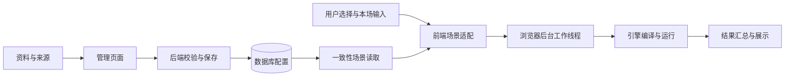

TASK_KEY: planning-project-knowledge-handbook
DOC_TYPE: 其他
WORKSTREAM: planning
STATUS: tracked
EXECUTION_MODEL: Codex 主负责人及内置执行与独立评审代理
LAST_TRACKED_AT: 2026-11-07

# 第六章：系统各部分怎样协作

Damage 的协作围绕两类信息展开：需要保存和维护的作者配置，以及一次计算产生的临时状态和结果。数据库、后端、前端及计算引擎分别拥有其中一部分，跨层通过明确的数据交接连接起来。

本章给出系统全貌和修改入口。完整业务模型见[系统精简设计](../../概要设计/项目/实录驱动的系统精简设计.md)，引擎内部责任见[子系统现状](../../概要设计/项目/Wasm子系统职责与协作现状及调整方向.md)。

## 两条主线

图中的箭头表达信息交接。后端为选定场景读取配置，引擎在浏览器内执行战斗；战斗中的生命变化、冷却和效果实例不会作为每步写入回传数据库。一次计算的生命周期见[第五章](05-一次计算的全过程.md)。

## 各部分拥有的事实

| 部分 | 负责保存或决定什么 | 交接给谁 |
| --- | --- | --- |
| 资料与账本 | 数值出处、修订、对象范围、排除与待核问题 | 录入者和准入核对流程 |
| 数据库 | 作者配置、稳定关系、账号及独立统计数据 | 后端查询和事务 |
| 后端 | 校验、事务保存、引用保护、一致性读取和权限 | 管理页面、场景适配和账号流程 |
| 前端页面 | 选择、编辑草稿、场景条件、错误呈现和结果解释 | 后端请求及生产适配 |
| 前端适配 | 把完整作者数据和本场输入映射成引擎请求 | 工作线程和引擎 |
| 后台工作线程 | 引擎调用、帧数据运输、内存与会话交接 | 页面客户端及引擎 |
| 计算引擎 | 规则编译、本场时间和状态、结算及可靠累计 | 正式运行结果 |

状态的含义由拥有者决定。例如，页面草稿、技能内部状态和编译会话虽然都可能被泛称为“状态”，却具有不同生命周期；概念区别见[第三章](03-核心概念与关系.md)。

## 为什么每层都要检查

页面检查帮助维护者尽早发现问题；后端在保存时检查最终组合和引用，确保数据库里的配置符合约束；适配器检查当前场景能否表达该配置；引擎独立检查收到的规则和运行请求。

这些检查针对不同边界。数据库脚本不会代替业务服务的完整引用校验，前端预检也不能成为后端权限依据。改变共享字段时，需要沿生产者到消费者核对实际影响。

共同公式和固定选项跨层使用，完整定义集中在[共同公式](../../../contracts/formula/README.md)和[固定枚举](../../../contracts/system-enums/README.md)。手册解释它们如何协作，字段、预算、错误与生成规则继续由共享规范和实际校验器维护。

## 从问题定位修改范围

| 要解决的问题 | 首先阅读 | 接着核对 |
| --- | --- | --- |
| 资料数值、来源或对象范围不正确 | [录入边界](../计算范围与录入边界.md)及其资料、账本入口 | 实际配置与对象准入 |
| 编辑、保存或删除行为不正确 | [前端说明](../../../web/README.md)、[后端说明](../../../server/data_manage/README.md) | 草稿基线、事务、引用和权限 |
| 场景装配或来源身份不正确 | [前端模拟适配](../../../web/src/engine/) | 快照、来源准备与通用编译 |
| 数值、事件时间或生命周期不正确 | [第四章](04-规则怎样改变数值.md)、[引擎说明](../../../wasm/tinygo_engine_v2/README.md) | 真实运行输入、状态拥有者及机制用例 |
| 图表、明细或总量理解有误 | [第五章](05-一次计算的全过程.md)、[前端说明](../../../web/README.md) | 正式输出、运行完整性和展示转换 |
| 登录、开通或写入资格异常 | [账号方案](../../详细设计/项目/账号注册登录与权限接入技术方案.md) | 账号状态、实际权限守卫及浏览器接线 |

这些是阅读入口，不是提前规定必须修改哪些文件。应从实际定义和调用继续确认影响面。

## 引擎内部怎样继续阅读

理解业务含义后，再沿[当前架构](../../../wasm/tinygo_engine_v2/ARCHITECTURE.md)和[执行功能入口](../../../wasm/tinygo_engine_v2/internal/runtime/execution/README.md)查看编译、调度、行动、效果、结算和报告的具体所有权。

现有子系统文档承担内部职责和重构边界，手册承担理解顺序。有限排程与四种前置决定已进入实现，完整交接从[接口与协作入口](../../概要设计/项目/Wasm子系统接口设计草案.md)阅读；图提供关系摘要，具体保证仍以契约、源码和验证为准。

## 相关章节与实现入口

- 上一章：[一次计算的全过程](05-一次计算的全过程.md)；下一章：[当前能力与阅读导航](07-当前能力与阅读导航.md)。
- 存储：[数据库导览](../../../db/README.md)。
- 模块入口：[前端](../../../web/README.md)、[后端](../../../server/data_manage/README.md)、[计算引擎](../../../wasm/tinygo_engine_v2/README.md)。
